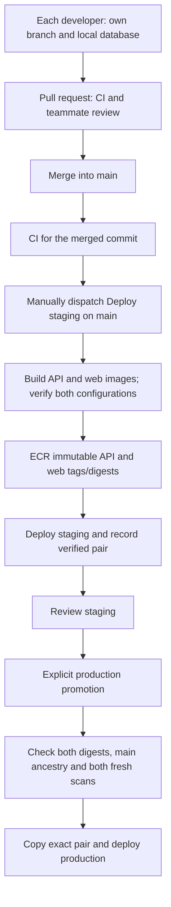

# CICD

Home: [[00 Home]] · Team conventions: [[Working Agreement]] · Canonical status: [[Roadmap and Tasks]] · Application: [[Website MVP]], [[Client Portal]], [[Clinic Workspace]] · Evidence: [[Progress Log]], [[Source Register]]

## Developer quick start

This is the first handoff for either developer. Use the sections in this order:

1. [[CICD#Rails can run locally|Set up the frontend, API and PostgreSQL locally]].
2. [[CICD#Separate developers and worktrees|Keep each developer's ports, credentials and databases separate]].
3. [[CICD#Daily workflow for two developers|Work on a branch, run checks and open a reviewed PR]].
4. [[CICD#What CI does now|Understand the six CI jobs]].
5. [[CICD#Finish activation|Read the remaining host-cutover and delivery-activation requirements before any release]].

[[Software Architecture]] owns code placement. [[Roadmap and Tasks#Current task register]] owns status. Old paths and test counts in [[Progress Log]] are dated history, not setup instructions. No `reference/`, `apps/apply/` or `site/backend/` application is needed.

For remaining work, use [[Roadmap and Tasks#Step 1 — Engineering and release foundation]] rather than treating every setup instruction as unfinished. Its chunks separate candidate/browser acceptance, image hardening, operations/recovery, production preflight and authorized cutover. Before each change, apply [[Working Agreement#Failure-first planning and review]] and record the exact candidate/environment, failure signal and recovery decision; source, CI and hosted evidence are not interchangeable.

## Purpose and current state

D-033 separates the browser application in `apps/web/` from the Rails JSON backend in `apps/api/`. [[Software Architecture]] owns the module/dependency rules; this guide owns local commands, team workflow, CI and release procedures. The apps build independently but the prepared delivery pipeline releases a **matched API/web pair from one commit**.

**Staging verification: 2026-08-31. Production's last hosted verification remains 2026-08-30.** The founder authorized staging configuration and its backed-up PostgreSQL cutover, leaving production untouched. Staging now runs the separate API/static frontend and PostgreSQL with original encryption keys and synthetic records preserved. Main CI passed all five jobs configured at that event. Pull-request run `33469316602` later passed the six-job source including `agent_docs`; that CI result is not new hosted-release evidence. See [[Progress Log#2026-08-31 — Staging delivery activated and PostgreSQL cutover verified]] for exact release and recovery evidence. Source fixes use `feat/staging-delivery-activation` and a PR, not a direct main push.

| Area | Verified source or recorded state |
| --- | --- |
| Repository | One APPly repository; `apps/api/`, `apps/web/`, `ops/aws/` and `APPlyVault/` have distinct responsibilities. The founder removed retired `reference/`; no active app remains at `apps/apply/` or `site/backend/`. |
| API | Rails 8.1.3.1 / Ruby 3.4.10 / Bundler 4.0.15; JSON, sessions/CSRF, permissions, domain workflows and PostgreSQL. |
| Frontend | React/TypeScript/Vite with Node 24 and its own npm lockfile; screens, navigation, forms and styles, with no database credentials. |
| Local development | Frontend at `127.0.0.1:3000`, Rails at `127.0.0.1:3001`, PostgreSQL helper at `127.0.0.1:54329`. Synthetic records only. |
| CI | Six jobs in repository-root `.github/workflows/ci.yml`; exact checks below. Main run `33366127061` passed the preceding five-job configuration for `a710f635f4f0ca653cb6213200a6b4b3845a6914`; PR run `33469316602` passed all six jobs for the pre-rebase agent-workflow commit. |
| Hosted baseline | Staging: PostgreSQL 18.6 plus separate API/web services verified 2026-08-31. Production: unchanged Rails/SQLite bootstrap; no fresh production row-count assertion. Independent storage/keys and ECR remain. |
| Delivery | Staging OIDC role and fixed pair-aware SSM document installed; staging delivery requires a confirmed manual workflow run on `main`. Production role, controls and cutover were deliberately not activated. |

Runtime references are `apps/api/.ruby-version`, `apps/api/Gemfile.lock`, `apps/web/.node-version` and `apps/web/package-lock.json`. T-22/M0 owns CI/browser acceptance, T-20/M1 hosted operations, and T-38 the controlled PostgreSQL cutover. Do not install PostgreSQL source over the SQLite host without the [cutover runbook](../../ops/aws/ec2/postgres-cutover.md).

### Host release contract

The API launcher starts `apply-api`; the static frontend starts `apply-web`. Names match service cleanup/stop targets. API and frontend retain separate internal networks; frontend receives no credentials. Docker on EC2 does not publish internal-only container ports. Each service's `ExecStartPost` refreshes a validated private container IP in root-only nginx upstream configuration and reloads the trusted edge. PostgreSQL stays unpublished; the host's loopback TLS listener is accessed through SSM.

The offline launcher tests execute the actual Bash script with isolated command stubs. They check API/default, frontend and prepare modes, service/container consistency, digest rejection, missing mounts and invalid modes/environments without contacting Docker/AWS or reading host credentials. CI discovers both release and launcher test files and runs Bash syntax checks separately for every host shell script. These checks cover the naming regression fixed on 2026-08-31; they do not claim live systemd/SSM or database recovery acceptance.

## Rails can run locally

Rails supplies the backend; Vite supplies the browser development server. Neither needs EC2 for local work. The shared host is for an installed release that remains available independently of either laptop.

For an authorized teammate, use an independent clone after individual repository/SSH access is established:

```sh
git clone git@github.com:Fibrodysplasia/APPly.git
cd APPly
```

Repository access includes the business-planning vault. Do not share accounts, passwords or SSH private keys. Agents must follow root `AGENTS.md`: use [[01 Table of Contents]] to review relevant sections before changes, not the whole vault by default.

Install the versions above, Docker, Python 3 and PostgreSQL 18 client tools: `psql`, `pg_dump`, `pg_restore`, `createdb`, `dropdb` and `pg_isready`. Put their executable directory on PATH; the earlier local test rerun needed that explicitly. Keep hosted `PG*` credentials and `DATABASE_URL` out of this local shell. Use `bundle install`, not an unrequested dependency update.

First-time setup from the repository root:

```sh
cd apps/api
bundle install
bin/postgres start
bin/postgres exec pg_isready -d postgres
```

Wait until PostgreSQL reports accepting connections, then continue:

```sh
bin/postgres exec bin/rails db:prepare db:seed
cd ../web
npm ci --ignore-scripts
cd ../..
APP_DEVELOPMENT_LOGIN=1 bin/dev
```

Open [local login](http://127.0.0.1:3000/login) and explicitly choose **Continue as demo client** for a new fictional Test Clinic. Omit the flag for ordinary provisioned-account login. No navigation action creates a session automatically. Both development servers must remain loopback-only and must never be tunneled.

For D-040's **reusable local test logins**, prepare them once from `apps/api/` in your own development database:

```sh
APP_DEVELOPMENT_LOGIN=1 bin/postgres exec bin/rails members:prepare_test_accounts
```

Run the app with the same development flag, then select Test Client A, Test Client B, Test Admin, Test Disabled or the dedicated **OmniLogin**. The first four named identities retain their fixed progress and permissions; setup reruns do not reset them. Omni retains one local clinic, now populated in place with the rich patient, scheduling, vital-sign and SOAP scenarios, while Settings → Development view can switch its administrator flag/view label among administrator, clinician, clinic-staff, inventory-manager, read-only and client profiles. Every Omni profile retains unrestricted access to the existing clinic surface in the explicitly enabled local development database, so the selector is for UI/workflow rehearsal rather than permission restriction. No passwords are issued. See [[Client Access Workflow#Reusable local test accounts]] for collision handling and the 12-hour absolute session maximum. Preparation, Omni login and Omni view switching all refuse production mode and require the explicitly enabled loopback-development boundary; never run them against a hosted database or tunnel the local shortcut. Each developer uses their own checkout/database; staging is shared integration review, not an isolated personal sandbox. No production admin appointments are required for these synthetic personas.

After setup, root `bin/dev` starts only Rails and Vite; it does not start PostgreSQL, install dependencies, apply migrations or reset databases. Start PostgreSQL first if stopped. Ctrl-C stops only the child processes it started, leaving persistent database storage intact. It refuses occupied ports 3000/3001; do not kill an unrelated server to free them. Frontend edits use Vite reload; restart the appropriate process after configuration/dependency changes.

For the managed daily lifecycle, run `./dev_server_startup start` or `./dev_server_startup restart` from the repository root; use `stop` to preserve the database while stopping services and `status` for diagnostics. With no command, the root script performs `start`. On Windows, invoke it as `ruby .\dev_server_startup <command>`. This checked-in entry point requires no global launcher installation or PATH change and delegates to `bin/apply`.

`start` and `restart` return success only after PostgreSQL, Rails and Vite are ready; startup errors propagate to the caller. They refuse an occupied port unless its recorded process belongs to this checkout, rather than treating an unrelated or legacy listener as a healthy APPly service. If startup fails, keep the reported error and `tmp/dev/logs` evidence, fix a consequential in-scope defect and retry the managed command; do not substitute an unrecorded manual server and claim the lifecycle works. A workaround is appropriate only when the defect has no consequence for the current task or is explicitly accepted as temporary under [[Working Agreement#Failure-first planning and review]].

### Request path and runtime ownership

| Surface | Local development | Prepared host after coordinated cutover |
| --- | --- | --- |
| Pages/assets | Vite on 3000 | Static `apply-web`: private container IP, port 8080; no host port |
| `/api/*` | Vite proxies to Rails 3001 without changing Host/Origin | Trusted TLS edge routes to `apply-api`'s private container IP, port 3001 |
| API health | Direct `http://127.0.0.1:3001/up`; Vite only proxies `/api` | `https://localhost:8443/up` |
| Frontend health | Successful Vite page response | `https://localhost:8443/health` |
| Database/credentials | Rails through the local PostgreSQL helper; browser has none | PostgreSQL is private; Rails receives runtime secrets, static frontend receives none |

Browser requests stay same-origin; do not add broad CORS or browser-stored authentication tokens. Packaged staging/production deny both clinic UI and clinic API routes. Their frontend page shells contain no protected records.

### Separate developers and worktrees

On separate laptops, both developers may use the default ports. On the same machine, a second worktree needs a different PostgreSQL container/volume, port, development/test database names and server ports. The credential file is checkout-local; do not copy it or regenerate a credential for an existing volume.

For example, in a second checkout's API terminal, before initial database setup and checks:

```sh
export APPLY_POSTGRES_CONTAINER=apply-postgres-feature-b
export PGPORT=54330
export APPLY_DEVELOPMENT_DATABASE=apply_feature_b_development
export APPLY_TEST_DATABASE=apply_feature_b_test
```

Use the API setup commands above, then start its server explicitly from `apps/api/`:

```sh
APP_DEVELOPMENT_LOGIN=1 bin/postgres exec bin/rails server -b 127.0.0.1 -p 3011
```

In another terminal at that second checkout's `apps/web/`, install its dependencies and run:

```sh
APPLY_API_PORT=3011 npm run dev -- --port 3010
```

Use a separate browser profile for simultaneous branches to avoid same-host session-cookie interference. Root `bin/dev` is the fixed 3000/3001 shortcut, not the custom-port launcher. The container helper cannot relocate an existing bind mount simply by changing an environment variable; preserve existing volumes/credentials and review any path transition.

## Daily workflow for two developers

### 1. Agree on a small task and start from current main

Choose a bounded change, such as a training page or pharmacy search. Coordinate ownership when changing the same database tables, shared layout, routes or authentication. `main` should represent the team's integrated, deployable code; unfinished work belongs on feature branches.

From the repository root, first inspect the checkout:

```sh
git status --short
```

The following commands assume a clean checkout. If `git status` lists existing work, preserve and coordinate it before switching branches; do not discard, reset, or blindly stash another person's work. At this review's start the checkout was clean; the founder then removed `reference/`, and this task adds documentation/ignore changes. Those local changes are not automatically committed or published.

```sh
git switch main
git pull --ff-only origin main
git switch -c feature/client-onboarding
```

Replace the example branch name with your task. The other developer creates their own branch in their own clone. A long-lived shared `develop` branch is not necessary for this initial two-person workflow.

### 2. Develop and check locally

Edit and exercise the app using fictional data. From `apps/api/`:

```sh
bin/postgres exec env RAILS_ENV=test bin/rails db:prepare
bin/postgres exec bin/rails test
bin/postgres exec env RAILS_ENV=test bin/rails zeitwerk:check
bin/postgres exec bin/verify-backend
bin/postgres exec bin/verify-postgres
bin/rubocop
bin/brakeman --quiet --no-pager --exit-on-warn --exit-on-error
bin/bundler-audit check --update
```

From `apps/web/`:

```sh
npm test
npm run format:check
npm run build
npm audit --audit-level=high
```

`npm run build` includes TypeScript checking; `npm run typecheck` is available for a faster type-only pass.

From the repository root, with both apps' dependencies installed:

```sh
bin/verify-web
python3 -B -m unittest discover -s ops/aws/ec2 -p 'test_*.py'
for script in ops/aws/ec2/*.sh; do
  bash -n "$script" || exit
done
```

| Check | Data/runtime boundary |
| --- | --- |
| Rails preparation/tests | Uses `APPLY_TEST_DATABASE` (default `apply_test`). Tests replace test fixtures: the selected database must be disposable and distinct from development/hosted databases. Run preparation and tests as separate Rails processes. |
| `apps/api/bin/verify-postgres` | Generates its own synthetic legacy SQLite fixture and uniquely named PostgreSQL upgrade/restore/fresh databases; cleans up only those scratch targets. Requires Python 3 and PostgreSQL clients. |
| `apps/api/bin/verify-backend` | Generates a unique loopback test database and no-login role; checks concurrent payments, addresses, appointments, note revisions and actual runtime history/catalog grants, then removes only those targets. Requires local PostgreSQL role/database creation rights. |
| Root `bin/verify-web` | Starts its own API/Vite children on temporary ports and a generated synthetic database; exercises proxy/session/CSRF/origin, clinic, decimal receipt/retry, portal and logout without browser automation or FDA requests. Cleans up its own database/processes. |
| Frontend tests/build | No application database or backend credentials. |
| Offline delivery tests | Discover all current release/configuration/launcher/route tests; mock external operations, with no AWS/Docker calls, host configuration or credentials. Syntax checks parse each host script separately. |

`bin/postgres` is the persistent local server/credential wrapper and never deletes storage. The verification harnesses are different: they intentionally create and remove their own scratch databases. Root HTTP cleanup uses explicit-name PostgreSQL commands, clears inherited `DATABASE_URL`, isolates the companion test configuration and sets `SKIP_TEST_DATABASE=1`. Never use an unqualified development `rails db:drop` for scratch cleanup: it can include the configured test database. The earlier default-test deletion and authorized recreation remain in [[Progress Log#2026-08-31 — Frontend and API separation completed; test database recreated]].

A passing local command is not GitHub execution, browser/accessibility acceptance, live host acceptance or a security certification. [[Backend Verification Report#Validation evidence]] records the latest source verification; application/container results linked below retain their earlier event-date scope.

### 3. Commit only your intended changes and open a pull request

From the repository root:

```sh
git diff
git add -p
git diff --cached
git commit -m "Improve client onboarding"
git push -u origin feature/client-onboarding
```

`git add -p` reviews tracked changes interactively; add each intended new file explicitly by path. Do not use a blanket `git add .` in a checkout with unrelated work. Review staged content for secrets, database files and accidental changes. A commit records a code version; a push copies commits to GitHub. Feature-branch and main pushes do not deploy. After successful main CI, staging requires a separate confirmed manual workflow run; production still needs separate activation and explicit promotion.

Open a GitHub pull request targeting `main`. Describe the problem, behavior changed, checks performed, screenshots if useful, and any migration/deployment implications. The other developer reviews it while CI runs. A pull request is a proposed integration, not a deployment.

### 4. Integrate other changes and resolve conflicts

Keep branches short and fetch updates regularly. With your own work committed and your feature branch checked out:

```sh
git fetch origin
git merge origin/main
```

If Git reports conflicts, agree the intended combined behavior, edit the affected files, remove conflict markers, stage only the resolved files, and finish the merge commit. Rerun the relevant checks and push. Do not automatically choose all of one side. Merging is the beginner-friendly default here because it does not rewrite published branch history; never force-push a shared branch or `main`.

### 5. Review, merge and update local copies

Recommended team rule: the other developer approves the pull request and all required checks pass before merging. Configure branch protection/rulesets where the repository's GitHub plan supports them; no such setting is created by this guide. Do not bypass a failed check without understanding and resolving it.

After merging, each developer updates their own clean `main` with `git pull --ff-only origin main`, then brings that change into any continuing feature branch. Run the relevant `bundle install` or frontend `npm ci --ignore-scripts` if its lockfile changed and `bin/postgres exec bin/rails db:migrate` from `apps/api/` when new migrations need applying locally. Review the resulting schema diff before committing it. Start the next task on a new branch.

## What CI does now

**Continuous integration (CI)** checks whether changes work together in a fresh environment. The [workflow](../../.github/workflows/ci.yml) configures six GitHub-hosted Ubuntu 24.04 jobs:

| Job | Checks |
| --- | --- |
| `agent_docs` | Check out repository documentation with read-only permissions; validate vault frontmatter, links/headings, Home reachability, layered instructions/playbooks and preflight discovery. No application dependency install or external service. |
| `scan_ruby` | Brakeman static security analysis and Bundler Audit with refreshed vulnerability data. |
| `lint` | RuboCop code-style checks. |
| `frontend` | Install the npm lockfile, run Vitest, Prettier format check, TypeScript/Vite build and npm audit; no app secrets. |
| `delivery_contract` | Run all discovered offline release/configuration/launcher/route tests and a separate Bash syntax check for every host shell script; no AWS or Docker requests. |
| `test` | Start PostgreSQL 18.6 and matching client tools; prepare/test Rails, check eager loading, backend concurrency/runtime grants, and legacy conversion/concurrency/restore. Then install Node/frontend dependencies and run the real Vite-to-API HTTP harness. |

Triggers are pull requests targeting `main`, pushes to `main` (including merges), and a manual **Run workflow** action once the workflow is on the default branch. There is no scheduled trigger. Updates to an open pull request rerun its checks. New checks for the same ref cancel obsolete CI runs; this cancellation policy must not be copied blindly into a database deployment.

The old `site/backend/.github/workflows/ci.yml` was not discoverable as the parent repository's workflow. GitHub requires repository-root `.github/workflows/`. After D-033, Rails jobs use `apps/api`, frontend uses `apps/web`, and release-contract checks use the repository root. Ruby-action/cache paths match the API location, Node setup uses the frontend version file, and Bundler retains a frozen lockfile. [Workflow syntax; S-23](https://docs.github.com/en/actions/reference/workflows-and-actions/workflow-syntax), [Ruby action; S-53](https://github.com/ruby/setup-ruby#working-directory).

CI uses read-only repository permissions and does not persist checkout credentials. Application/release jobs use sparse checkout; `agent_docs` checks out the tracked vault and instruction documents solely for local structural/link validation. CI does not upload vault content, logs or database artifacts, receive AWS or production secrets, or run on the EC2 server. Dependencies and public vulnerability metadata are downloaded by the application jobs. Tests remain wholly synthetic. No path filters are used, so documentation-only pull requests also receive the same checks rather than leaving a future required check pending.

After publishing reviewed changes through the team workflow, open the pull request's **Checks** tab or repository **Actions → CI**. Inspect the exact commit and all six results; a successful local check is not an observed GitHub run. If Actions or the referenced actions are restricted by repository policy, resolve that with the repository owner. Runner availability/minutes depend on the account plan; no plan or billing setting was changed. T-22/M0 stays open until its remaining remote-CI/browser criteria have evidence.

## Image, container, server and database

| Term | Meaning for APPly |
| --- | --- |
| Git commit | A version of source code. `main` is a moving pointer to the integrated history. |
| Docker images | Separate API and static frontend artifacts from one chosen commit; independent contexts/dependencies and a verified digest pair. |
| Image tag and digest | A tag is a readable release label; a digest identifies the exact image contents. Use an immutable commit/release label and record the deployment digest. Rebuilding the same commit later can produce a different digest as base packages change. |
| ECR | AWS's private registry where release images are stored. It is not the running application. |
| Container | A running instance created from an image, with environment-specific configuration supplied at runtime. |
| EC2 | Staging runs API, static-web and PostgreSQL containers plus the trusted HTTPS edge. Production retains its bootstrap arrangement. |
| EBS / PostgreSQL | EBS retains database files and backups outside disposable application containers. Staging uses PostgreSQL; production remains SQLite pending its authorized cutover. No developer database is included in an image. |

Neither a Git merge nor EC2 itself builds or installs an image automatically. A configured workflow must perform those steps. The usual release trigger is a successful CI run for a new `main` commit; a scheduled interval is optional, not required. Scheduled rebuilds/scans can later support maintenance even with unchanged source, but must be verified before deployment. No schedule is created here.

## Why deploy to staging?

**Staging is a rehearsal environment. Production is the environment real users rely on.** These are operating roles, not special kinds of EC2 instance or Git branch.

| Environment | Purpose | Data and configuration |
| --- | --- | --- |
| Local development | Each developer experiments independently and tests changes quickly. | Own PostgreSQL database, synthetic fixtures, Rails `development`. |
| CI | Automated checks in disposable runners. | Fresh synthetic database, Rails `test`, no hosted secrets. |
| Shared staging | Review the installed candidate through actual Docker, networking, HTTPS, secrets and persistent storage. | Separate synthetic data and keys; Rails `production` runtime settings to exercise deployment behavior. |
| Production | Reserved deployment for the released application; currently private pending wider release. | Independent database and keys; no sample seeding, demo assignment/signing or sample portal content. Real audience/data and operational acceptance remain separate. |

Rails `RAILS_ENV=production` selects runtime behavior such as eager loading and production configuration. It does not grant public access or declare the system ready for real use. Our EC2 staging instance already uses that mode. **All clinic routes and the local demo shortcut remain denied there**; do not switch the host to development or remove guards to make a staging walkthrough work. Test selling/onboarding with provisioned synthetic accounts; hosted clinic testing needs separately scoped implementation and review.

Staging catches issues that local tests may miss: missing runtime configuration, Linux/image differences, migration failures, cookie/TLS problems and data lost on restart. For example, the initial container verification exposed an encryption initialization-order defect that was fixed before launch; see [[Progress Log#2026-08-30 — EC2 staging package prepared and locally verified]]. CI, staging and reviewer acceptance provide different evidence; none alone establishes security or clinical readiness.

D-030 selected separate environments. As last recorded on 2026-08-30, staging is `i-011a8232817dc587f`; production is `i-0df3819ee5050b27b`. Each uses a t3.micro with 8 GiB encrypted root and 2 GiB encrypted data. The 2026-08-30 combined bootstrap estimate was $27.28/month before extras; it was not repriced in this review. Staging data and secrets were not copied to production. Both private previews use authenticated SSM and their own TLS certificate; see the runbook for one-tunnel-at-a-time access.

## Delivery pipeline — staging active; production pending

The original bootstrap was manual. Staging's 2026-08-31 activation installs the fixed SSM contract and scoped OIDC role, completes PostgreSQL cutover and exercises GitHub delivery. Production remains outside that scope.



`deploy-staging.yml` is manual-only. In **Actions → Deploy staging → Run workflow**, select `main` and enter `deploy-staging`. The workflow rejects any other ref or confirmation before checkout or AWS authentication. It checks out the selected main commit's exact SHA, builds Linux amd64 API/web images once with separate contexts, and verifies both staging and production configurations before obtaining AWS credentials and publishing. Tags share `sha-<commit>-<run>-<attempt>` with `-api`/`-web` suffixes. CI, PRs, pushes and schedules do not trigger staging, so ordinary integration does not incur image-build, ECR-push or host-deployment activity.

Staging waits for both ECR scans to complete and records severity counts; **staging does not enforce the production zero-critical/high gate**. After host success, `release.py` writes a format-2 receipt to `/apply/releases/staging`: commit, common tag, `images.api`, `images.web`, SSM command, generation and verification time. The workflow summary shows both digests. A failed/unknown remote result does not publish a successful receipt.

`promote-production.yml` runs manually on `main`. In **Actions → Promote production → Run workflow**, paste the exact API and web digests from the same successful staging release and enter `promote-production`. A newer staging release requires fresh review. The workflow requires a format-2 receipt matching both inputs, verifies the staged commit is an ancestor of checked-out main, and requires each staging-image scan to be complete, no older than 24 hours and free of critical/high findings. It copies both images without rebuilding and verifies destination digests before deployment. The script reads existing scan results; it does not initiate a fresh scan automatically. Its GitHub production environment must restrict deployment to the main branch. Independent required reviewers depend on the GitHub plan; they are not claimed as configured.

Each release workflow has its own serialized concurrency group and does not cancel an active deployment; staging and production groups are separate. The host also takes a release lock, rejects stale generations, checks disk space, backs up the stopped database, retains both previous image references and verifies TLS/database/environment policy. Follow the printed SSM command to completion; runner cancellation or disconnection does not prove the remote operation stopped. A failed release remains a deliberate recovery task, not an automatic down-migration.

The deployment identity uses GitHub OIDC and scoped AWS roles, never AWS root keys stored in GitHub. The prepared fixed SSM document accepts validated API/web image digests and a release generation. GitHub roles cannot fetch app secrets, alter infrastructure or execute arbitrary RunShellScript commands. Bootstrap AWS root use remains separately authorized until further notice. [OIDC in AWS](https://docs.github.com/en/actions/how-tos/secure-your-work/security-harden-deployments/oidc-in-aws).

### Finish activation

Staging configuration, cutover and recovery were verified on 2026-08-31. The steps below remain the procedure for separately authorized production activation or a new environment. T-22 retains browser/accessibility acceptance; T-38 retains production cutover. Do not repeat staging conversion or activate production merely to complete a checklist.

Challenge the release before executing it: wrong target, incompatible schema, mismatched image pair, stale scan, unavailable keys, partial import, lost SSM acknowledgment, failed restart and insufficient recovery capacity. Each applicable case needs an observable refusal/failure, preserved evidence and a scoped recovery path in T-20.1/T-20.2/T-38.1/T-38.2. Use offline/synthetic rehearsals first; no destructive hosted injection or production change is authorized by this checklist. A later image rollback must not be assumed to undo migrated data.

1. Run the local delivery checks above and verify both packaged configurations from the intended commit. The launcher/service consistency regression is now fixed and included in CI.
2. Complete the [PostgreSQL cutover](../../ops/aws/ec2/postgres-cutover.md) for each existing SQLite environment, preserving old data, matching keys, scripts and recovery evidence. Install the revised launcher/installer, both application services, PostgreSQL service and trusted edge together; accept the actual host path before declaring it ready.
3. Review the fixed SSM document's `image`, `webImage` and `generation` contract against the installed pair-aware installer. Legacy single-image receipts are not promotable. Existing delivery resources need a separately reviewed update; the additions-only helper cannot silently modify them.
4. Confirm individual GitHub/AWS access, repository plan/policy support, exact OIDC subjects, production-main restriction and team review controls. Check `targets.json` against intended resources; its role names are not proof that roles exist.
5. Publish only reviewed changes through the team workflow, observe all six CI jobs, the staged exact pair, synthetic staging acceptance and explicit production promotion. Capture actual commit/digests/SSM results, not just green local checks.

When an authorized operator is ready, GitHub sign-in and read-only configuration preflight are:

```sh
gh auth login --hostname github.com --git-protocol ssh --web --skip-ssh-key
python3 ops/aws/ec2/configure-delivery.py --staging-only
```

GitHub authentication/admin access were verified on 2026-08-31. `--staging-only` checks account, admin access and resolved OIDC metadata without reading/changing production controls; omit it only for authorized two-environment configuration. It does **not** inspect the host's launcher, database, service installation or a current delivery change set.

Only within an approved activation task:

```sh
python3 ops/aws/ec2/configure-delivery.py --staging-only --apply
```

`--staging-only --apply` sets `EnableProduction=false`, skips production GitHub settings and creates no production role. Without that flag, `--apply` may create a missing production environment/main-only rule. Both modes execute a CloudFormation change set only when every resource change is an addition. It refuses incompatible existing protections and AWS modifications. It is not transactional across GitHub/AWS: if a later check fails, an earlier environment or unexecuted change set may already exist. Inspect the actual outcome before retrying. This tool does not configure required reviewers/branch protection, install host files, migrate data, commit/push or deploy the apps.

Validate GitHub's resolved `sub_claim_prefix` against the exact repository names/immutable IDs; do not infer it from `use_immutable_subject`, because a new repository's default may include IDs while the opt-in flag is false. Staging uses the exact main subject and STS audience, without wildcards. A reviewed staging-role-only change set corrected the initial mismatch; the helper's additions-only guard remains intact.

Wait for the actual delivery stack completion and validate trust/permissions before relying on it. An existing SSM document update needs its own reviewed change set; do not weaken trust or broaden GitHub shell/secret permissions to bypass that requirement. Private-repository feature availability and independent required reviewers must be checked against the actual plan at activation; no upgrade or visibility change is authorized by this guide.

The [environment runbook](../../ops/aws/ec2/environments.md) holds installed-resource/access history; [EC2 operations](../../ops/aws/ec2/README.md) holds manual operator procedures. GitHub environment/OIDC background remains linked through [[Source Register]]; this source reconciliation did not recheck external service policy.

### Current release limits

The current `f8a0cae` candidate scans report API six critical/fifteen high and web one critical/nine high findings. Staging requires completed scans but no severity threshold; the unchanged production gate rejects this pair. Private bootstrap operation is not security acceptance or authorization for real data. Public HTTPS needs an exact domain or stable IP with certificate/proxy configuration; a domain purchase is not required. Backups/monitoring schedules, recovery objectives, MFA/account operations and complete browser/security acceptance remain open.

**Protected owner review active, 2026-09-01 (T-20.3):** the [review-access runbook](../../ops/aws/ec2/review-access.md) records fixed staging URL `https://44.218.229.179`, an IP certificate, two allowlisted individual synthetic reviewers, authenticated edge and certificate renewal. The founder explicitly accepted the exact main `f8a0cae` / run `33521216835` counts above for this bounded synthetic preview. Private checks for both reviewers and the final outside TLS/auth/content/denial/logout path passed before completion was recorded. Public HTTP serves only certificate challenges; staging HTTPS requires both the edge credential and ordinary app login. Production and all clinic/development-login guards remain unchanged. This is not confidential, clinical or production release acceptance, and a later image pair needs fresh review.

**D-047 staging demo clinic source, 2026-09-01 (T-20.4):** current source makes the static clinic shell available only through the separately authenticated staging-review server and allows Rails clinic routes only for the exact active `StagingDemoUser` assignment in `APP_DEPLOYMENT_ENV=staging`. Production/private edges retain `/clinic` 404, Rails independently denies every other hosted identity and the account remains a non-platform-admin. The isolated baseline has four synthetic patients/notes, three office items and two staff entries with full clinic permissions. Reset-on-logout is excluded because it would silently rewrite append-only history. This is source evidence; close public ingress before a manually authorized delivery, then record the exact new pair/scans, provisioning and outside denials before reopening.

Production disables sample content without deleting historical records; ordinary account provisioning adds no demonstration paperwork. Staging keeps sample portal material but never enables the local password-free login or clinic routes. Real signing and patient-system deployment remain gated. This establishes separate deployment environments, not the final clinical architecture or a highly available service.

## Database collaboration and rollback rules

- Root `.gitignore` and the app-specific rules exclude local environments/keys, database files and dumps, logs, dependencies and build caches. Keep migrations, `db/structure.sql`, lockfiles and synthetic test source tracked. Check a proposed path with `git check-ignore -v PATH`; review `git status` and the staged diff before committing. Ignore rules neither remove tracked files nor make sensitive files safe, and they do not replace `.dockerignore` or the separate app build contexts.
- Share migrations under `apps/api/db/migrate/` and the canonical `db/structure.sql`. Do not commit, email or copy database files/dumps, legacy SQLite/WAL/SHM files, hosted keys, secrets or real records between developers/environments. Wholly synthetic upgrade fixtures are generated independently by the rehearsal tool.
- Each developer applies merged migrations to their own database. A Git pull updates files; it does not change the running server or apply its migrations. Coordinate simultaneous edits to the same tables and reconcile the SQL schema from the combined migrations; never hand-resolve a conflict by dropping unfamiliar triggers or constraints.
- Once a migration has been shared/applied, add a new corrective migration rather than rewriting its history. Test both a fresh database and upgrading a prior synthetic schema when changing migrations.
- Favor staged, backward-compatible changes for releases: add new fields, update/backfill safely, then remove old fields in a later release after old code no longer needs them. Large backfills need their own runtime/locking review.
- Rolling back an image does not undo a destructive migration. Restoring a backup can lose subsequent writes and needs a deliberate recovery decision. Preserve database, matching encryption-key versions and image references together; never rotate/delete keys as an ordinary code rollback.

## Troubleshooting without resets

| Symptom | First check |
| --- | --- |
| `psql`, `pg_dump` or `pg_restore` missing/version mismatch | PostgreSQL 18 clients are on this shell's PATH. Do not reset a database to fix a missing executable. |
| Local database connection refused | Docker/container is running and `PGPORT` matches its published port; wait for `pg_isready`. A root `bin/dev` start does not start PostgreSQL. |
| Existing volume but missing local credential file | Stop and recover the approved credential/path. Do not regenerate the password, delete the volume or copy another checkout's secrets. |
| Ports occupied or wrong backend | Root launcher uses 3000/3001. For a second checkout use its own ports/container and matching `APPLY_API_PORT`, with separate browser session state. |
| Local login shows only ordinary email/password fields, with no test choices | Check `/api/csrf` through port 3000. A 502 means Vite cannot reach Rails; starting only `apps/web` is insufficient. With PostgreSQL running and both app ports free, use `APP_DEVELOPMENT_LOGIN=1 bin/dev` from the repository root. If this checkout's Vite is already running on 3000 and 3001 is free, start only the API from `apps/api` with `APP_DEVELOPMENT_LOGIN=1 bin/postgres exec bin/dev`. Refresh login after recovery. A healthy API still needs the explicit development flag; prepare missing named profiles separately as described above, without resets. |
| Clinic/demo unavailable on a packaged environment | Expected production-mode denial, including staging. Use the explicit loopback development walkthrough; do not remove guards. |
| Production promotion rejected | Check both digests against the latest format-2 staging receipt, commit ancestry and each complete scan's age/severity. Do not bypass a rejection. |
| Runner disconnects or release reports unknown | Track the printed SSM command to a terminal state before retrying; the remote operation may still be running. Preserve failure evidence and matching data/key/image references. |

## Recorded verification and remaining acceptance

[[Progress Log#2026-08-31 — Frontend and API separation completed; test database recreated]] records 76 Rails tests / 784 assertions, 11 frontend tests, five offline release-pair tests, formatting/typecheck/build/static checks and local staging/production container verification. Those are prior application/container results, not new runs for this CI/CD update.

The earlier launcher correction passed all 12 offline delivery tests, including seven then-new launcher tests; the regression cases failed before that correction. Its actionlint, ShellCheck and Bash results are recorded in the linked progress entry. See the newest [[Progress Log]] entry for checks actually rerun during this handoff review; prior application/container results are not fresh acceptance.

The paired container verifier covers TLS/routing, guards, persistence/restart and separate PostgreSQL restore, but launches disposable containers directly. The new launcher tests complement that evidence; neither verifies live systemd/SSM installation, actual IAM/EBS recovery, browser interactions or operational capacity.

M0 now has observed successful main CI; scoped browser/accessibility acceptance remains open. Staging has actual cutover, restart, decryption and separate PostgreSQL restore evidence. M1 retains operational ownership/schedules/targets and broader acceptance; T-38 retains production cutover. No new schedule, reviewer commitment or deadline is created here.

## Boundaries and maintenance

This is a development guide, not a production approval. All examples remain synthetic. Confidential-applicant release remains M4/T-25; patient-system work remains subject to L-05 and applicable E2/E3/professional gates in [[Texas Diligence]] and [[Roadmap and Tasks]]. A passing CI run or working EC2 host closes none of those gates.

Keep this guide aligned when the workflow, runtime versions, database adapter or deployment mechanism changes. Record actual validation in [[Progress Log]] and update canonical task status only with evidence. Missing external MD/governance/SharePoint originals were not treated as reviewed; no dependent legal or clinical conclusions are made here.
