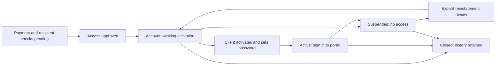

# Client Access Workflow

Home: [[00 Home]] · Product: [[Client Portal]] · Canonical status: [[Roadmap and Tasks#Step 2 — Client onboarding and operator workflow]] · Risk: [[Risks and Assumptions]]

## Purpose and review boundary

**T-23.1 structure accepted, revision 3 — 2026-08-31.** Define how a paid launch client receives, uses, recovers and loses portal access, with an operator path for each exception. The founder accepted the structure with a 12-hour session limit (D-040); Codex owns this implementation/documentation increment. The founder owns initial payment confirmation and client-access authorization under D-038. Other production role assignments/backups are deliberately deferred; due date remains TBD. Structure acceptance does not imply full implementation or operational acceptance. Task status stays in [[Roadmap and Tasks]].

**Settled direction:** D-022 requires provisioned access after payment, no public signup, and a first signed-in page with **Paperwork** and **Onboarding & Training**. The initial boundary is one individual account with personal assignments/progress. Shared credentials and multi-person engagement access are outside this increment. D-025/D-026/D-033 preserve separate clinic permissions and frontend/API responsibilities; portal access does not grant clinic access, signing authority, professional authority or access to another entity's records.

**Confirmed assignment — D-038:** the founder will initially confirm payment and authorize the intended client's access. This assigns those two responsibilities only; it does not assign account provisioning, delivery, recovery, security administration or backup coverage.

**Accepted structure — D-040:** manual payment confirmation and access approval, an inactive account awaiting a single-use activation link, client-set passwords, controlled recovery, immediate suspension/revocation and evidence-preserving closure. A login lasts at most **12 hours from creation**, without activity extending that maximum. One designated consultancy operator may fill several routine roles if explicitly assigned; each action must still be attributable. No additional person is appointed by structure acceptance.

Only wholly synthetic design/implementation/rehearsal is in scope. The local test profiles and session limit below are now implemented; no outbound messages, payment integration, hosted changes or real-data inspection were performed. Real applicant handling/signing remains M4/T-25; a paid pilot remains M5/G2/T-10. Patient data is excluded. Kevin's source packet, governance originals and delivery/recovery service approval remain unavailable or unreviewed; none is needed for this local increment. This is product/operations planning, not legal or compliance advice.

## Current source versus proposed workflow

Initial read-only inspection was at commit `fb2c1d6b5e04e881aacc49d7ef06d0e95e804dda`. The 2026-08-31 working-tree increment adds local test profiles and the session limit; [[Progress Log#2026-08-31 — Twelve-hour sessions and reusable local test accounts]] records actual checks. Remaining workflow features below are still implementation work; no hosted account test occurred.

| Area | Observed current source | Proposed change in later chunks |
| --- | --- | --- |
| Provisioning | [members.rake](../../apps/api/lib/tasks/members.rake) interactively sets an operator-chosen password and optional admin flag. [User schema](../../apps/api/db/structure.sql) defaults `active` to true. Account save precedes optional demo assignment; no encompassing workflow transaction is shown. No invitation is sent. | T-23.2: approved request, non-admin pending account, retry-safe provisioning and activation; separately recoverable assignment under T-24.2. Do not treat the existing task as this runbook's implementation. |
| Login and session | [Authentication](../../apps/api/app/controllers/concerns/member_authentication.rb) now creates a 12-hour session; the cookie lifetime is also 12 hours. [MemberSession](../../apps/api/app/models/member_session.rb) checks both explicit expiry and age, so older 24-hour records also stop at 12 hours on the updated runtime. Activity never extends server authority. | D-040 accepts this maximum; later lifecycle transitions must also govern activation, recovery and concurrent requests. Idle/step-up/factor details and confidential-use acceptance remain open. The initial local change did not update hosts; the later authorized merge applies this limit to staging through existing delivery, with production still deferred. |
| Reset and revocation | [User](../../apps/api/app/models/user.rb) deletes member sessions after password or active-status updates. Interactive reset changes the password without changing active status. | T-23.3: identity verification, purpose-bound reset, explicit suspension/closure/reinstatement and race tests. Source callbacks alone do not prove concurrent revocation safety. |
| Operator control | The app has an admin boolean; [routes](../../apps/api/config/routes.rb) and [login UI](../../apps/web/src/features/identity/Login.tsx) have no activation/recovery journey or scoped lifecycle administration. | T-23.4: action-specific authority, MFA/step-up and protected lifecycle audit. Shell access and the admin flag are not a reviewed operator-role model. |

## Proposed responsibility map

**Confirmed:** the founder fills payment confirmer and initial access authorizer (D-038 in [[Decisions#Initial client-access responsibility]]). D-040 accepts the role structure below; other production appointments and all backups remain **unassigned and deferred** until the founder determines the founding members' responsibilities. These are capabilities, not new job titles or proof of formal company authority. Consultancy ownership, physician duties and developer access do not automatically confer them; see [[Entity and Product Boundary]].

| Role | Permitted responsibility | Boundary and escalation |
| --- | --- | --- |
| Payment confirmer — founder | Check the agreed payment condition in the authorized business source; record outcome and controlled reference. | A payer may differ from the intended client. A forwarded receipt or Contact message alone cannot authorize access. Do not copy payment records into the vault. |
| Access authorizer — founder for initial access | Confirm the intended individual, engagement, recipient address and allowed portal scope after payment confirmation. The role also covers reinstatement/closure approval; the person for those production responsibilities remains deferred. | Payment proof does not identify the recipient or grant signatory rights. Ambiguous identity, disputed entitlement or multiple users remains unresolved. |
| Access operator | Provision the approved non-admin account; initiate/reissue activation; reconcile delivery; carry out authorized suspension/closure. | Cannot approve their own privilege increase, choose a replacement recipient without verification, impersonate the client or grant clinic access. Content assignment is a separate permission under T-24.2. |
| Recovery verifier | Verify the claimant through an approved, previously established contact method; authorize a bounded reset or address-change request. | Never ask for an existing password, activation token, patient example or identity-document upload to this workspace. No verified recovery route means unresolved, not a bypass. |
| Security/access administrator | Manage operator grants, handle suspected compromise and authorize recovery exceptions within a separately accepted policy. | Privilege grants require a different authorized approver; no self-grants. Bootstrap and all-operator-lockout recovery need a reviewed process, not an undocumented database edit. |
| Client | Activate their own account, choose their password, sign in and use only permitted personal content; request assistance. | Activation proves neither professional identity nor legal signing authority. Training completion and demo signing retain their existing limits. |

The access operator owns routine unresolved requests; the designated backup takes over if unavailable. Suspected misdelivery or compromise escalates immediately to the security/access role using approved incident handling. If the required role/backup is absent, keep the request unresolved and the affected access denied; do not invent a response-time promise. Named coverage is required before real operation.

## Proposed lifecycle contract

Keep business approval, account state, delivery and recovery separate so a sent message cannot be mistaken for activated access.

Arrows require authorized, recorded transitions; elapsed time, payment status, successful delivery or a password reset cannot silently advance this lifecycle.

| Record / state | Meaning and allowed next step |
| --- | --- |
| Access request: pending / approved / declined / cancelled | No login entitlement while pending. Approval records payment confirmation, exact individual/recipient and scope. Declined/cancelled requests issue no usable credential; invalidating an approved request also revokes its pending activation. An already active account requires a separate suspend/close decision. |
| Account: awaiting activation | Reserved individual identity, no ordinary login or protected content. A valid activation can move it to active; expiry/failed delivery leaves it here. Reinstatement returns here with old authority revoked. |
| Account: active | Ordinary authenticated access to permitted launch content. Recovery requests do not themselves change this state. Successful reset requires the account still be active at commit. |
| Account: suspended | Login, content, activation, reset completion and pending challenges denied. Revoke existing sessions and unconsumed tokens; preserve records. Only separately approved reinstatement can begin fresh activation. |
| Account: closed | No access or usable sessions/tokens; assignments and completion evidence retained. Reopening needs an explicit new review and fresh activation; never create a duplicate identity to evade closure. Retention/export/deletion policy remains M4, with no automatic deletion here. |
| Delivery attempt: not attempted / queued / submitted / failed / unknown | These describe the delivery operation only. Provider acceptance is not receipt by the intended person, and neither is activation. A bounced/expired invitation leaves account state unchanged. Unknown outcome must be reconciled before another send. |
| Activation/reset challenge: issued / consumed / expired / revoked | Bound to one account, recipient version, purpose and authorization generation. One successful use; reissue revokes earlier challenges of that purpose. Suspension, closure, recipient change and successful recovery invalidate stale authority. |
| Recovery request: requested / verified / challenge issued / completed / unresolved / cancelled | Separate from account state. A verified request can issue a reset only for an active account; suspended/closed accounts require reinstatement review. Missing identity evidence remains unresolved. |

## Operator runbook — proposed normal path

1. **Open an access request.** Confirm the authorized environment and synthetic-only scope. Record a request reference, intended individual/recipient and engagement reference in the eventual approved system. Do not grant access from a public Contact submission or assume the payer is the account holder.
2. **Confirm payment, then authorize access.** The founder fills both roles initially (D-038): record that the agreed payment condition is met using a controlled reference, without importing financial details; separately verify the intended recipient through the established engagement contact and record allowed portal scope. Keep both actions attributable even when the same person performs them. Unknown payment terms or recipient identity stays pending; no invented deposit threshold or checkout integration.
3. **Provision once.** The operator confirms the approved target before execution. Reuse a stable request key and normalized identity checks: same request/same inputs returns the existing outcome; conflicting inputs or an existing identity requires reconciliation, not overwrite, duplicate account or an automatic entitlement expansion. Persist the pending account and required authorization/history atomically or recoverably. No usable password, admin flag or clinic grant is added by this workflow.
4. **Prepare content separately.** Record requested synthetic assignments under T-24.2. A failed assignment must remain visibly pending/failed and retryable without creating another account or replacing prior evidence. Activation may succeed with no assignments: show an honest empty state and operator follow-up, not a completed onboarding claim. Actual packet approval remains T-12/M3/M4.
5. **Issue activation to the verified address.** Use a short-lived, single-use link to let the client set their own password. Keep delivery mocked until the exact service/channel, lifetime, retry policy and data path are approved. Store only a protected verifier server-side; no raw credential in the vault, audit, logs, analytics or support transcript. Link possession alone is not sufficient for initial recipient authorization or a legal identity check.
6. **Client activates, then signs in.** Opening a link, including by a mail scanner, must not consume it or create a session. Explicit password submission rechecks the approved request, recipient binding, account state, expiry and unused challenge in one protected transition. Consume the challenge and activate only once; the client then uses ordinary login. Existing browser identity must not cause the wrong account to be changed. Tokens must not leak through referrers, history persistence, third-party resources or error reporting; review that transport in T-23.2.
7. **Verify access and record the actual outcome.** First sign-in opens Paperwork and Onboarding & Training. Show only permitted content and personal progress. The operator can see delivery/activation/first-login outcomes without learning the password or opening confidential documents. “Active” does not mean content assigned, paperwork completed, payment settled forever or clinic ready.

## Recovery, changes and offboarding

| Situation | Required operator and system behavior | Safe unresolved outcome |
| --- | --- | --- |
| Link expired, replayed or never received | Recheck recipient/approval/account state; revoke the old challenge before a controlled reissue. Treat delivery timeout as unknown and reconcile its attempt ID. Client sees a generic unusable-link response. | Remain awaiting activation. Never resend a reusable password or enable the local demo shortcut on a host. |
| Wrong recipient or address correction | Stop further delivery; revoke the affected challenge and suspend any account that may have been activated by the wrong person. Verify the intended person and new address through an established independent channel; record approval. Recipient change invalidates old sessions/challenges and needs fresh activation. | Unresolved until verified; no transfer/merge of someone else's content. Escalate suspected exposure under the incident procedure without copying its contents. |
| Forgotten password, known verified channel | Give a generic request acknowledgment without exposing whether an account exists. The verifier approves recovery; issue a purpose-bound, expiring reset through the approved route. At completion, recheck active status and recovery authority; change the password, consume the challenge and revoke all prior sessions and outstanding authentication challenges. Require fresh login. | Existing active access is not suspended merely by an unverified request, which would enable denial of service. Suspected compromise uses the separate suspension path. |
| Lost mailbox, lost MFA or no trusted recovery channel | Escalate for assisted verification using a previously approved independent method. A newly supplied address, caller assertion, receipt or forwarded link is insufficient. A password reset cannot remove MFA or satisfy step-up. | Mark unresolved; retain access denial where suspended. The assisted method remains to select; no temporary shared password, security-question fallback or ad hoc identity upload. |
| Suspected compromise or urgent removal | Authorized operator suspends and revokes sessions, activation/reset links and pending challenges together. Every protected operation rechecks current authority. Already committed actions stay recorded; in-flight work must serialize/recheck so revocation cannot be bypassed by a later commit. | If outcome is uncertain, report unknown and reconcile immediately; never acknowledge successful revocation without evidence. Use only an approved containment path and preserve incident/history records. |
| Payment dispute, refund or end of launch work | Route entitlement to the access authorizer; no automatic suspension/closure from an unreviewed payment event or a paperwork completion checkbox. Ongoing support is part of the model, with duration/terms still open. | Keep the business request unresolved pending a scoped decision; suspected compromise remains independently actionable. No new refund/support policy is invented. |
| Reinstatement or return after closure | Authorizer records the reason and current entitlement/identity verification. Use the same retained identity after reconciliation, return to awaiting activation, and issue a new challenge. Review content scope separately. | Deny implicit reactivation by reset, payment retry or duplicate provisioning. Do not restore old sessions/tokens or silently reassign issued evidence. |
| Approved closure and record retrieval | Record authorized reason; revoke all access, preserve content/progress/audit. Any later export must use a separately approved, identity-checked route that proves recipient and ownership. | No deletion, indefinite-retention promise or export to a new address. M4 owns retention/holds/export acceptance. |

## Evidence, authority and implementation boundaries

Proposed lifecycle history records actor, subject, permitted action, request/correlation reference, prior/new state, recipient-version reference, authorization/payment-evidence reference, reason, event time and actual outcome. Failed/denied and uncertain operations must be distinguishable from completed ones. Delivery uses an attempt reference, not a copied message or token. Store real identifying evidence only in an approved system; the vault holds synthetic examples and non-sensitive summaries.

Granting or restoring access must fail closed if required history cannot be committed. Suspension/revocation needs the same protected transaction; if a database/audit outage prevents confirmation, escalate containment and report unknown rather than success. Ordinary operators cannot edit history. An outbound delivery failure after provisioning is recorded separately and must not roll an account into active state. Durable audit, least-privilege enforcement and outage behavior still require T-23.4 implementation/testing.

The accepted structure requires MFA for operator access and step-up for privileged grants, recovery exceptions and reinstatement. The login maximum is now 12 hours (D-040); factor choice, enrollment/replacement, idle/step-up policy and challenge lifetimes remain to select and test in T-23.4, with confidential-use acceptance before M4 release. No recovery path may silently bypass those controls. Local generic test access is a guarded synthetic exception, not an MFA implementation or production operator bootstrap.

Identity workflows, transaction boundaries, permissions and challenge/session handling belong in the Rails API; React renders their outcomes and never decides authority. Preserve [[Software Architecture]]'s same-origin/CSRF, server authorization, no-store and browser-persistence rules. Launch assignments remain separate from identity and clinic membership. This note specifies behavior, not a new schema, service vendor or production configuration.

## Failure challenge and required evidence

R-17 is the primary risk; R-02/R-09 cover authority/entity confusion and R-18 covers misleading content/completion state. The following are **planned synthetic cases, not executed tests or operator acceptance**. For each later run, record candidate/environment, actor/reviewer/date, expected versus actual denial/outcome, preserved history, recovery result and residual issues using [[Evidence Note Template]].

| Trigger and harm | Observable guard or failure signal | Required exercise and recovery evidence |
| --- | --- | --- |
| Payer, forwarded recipient or second client mistaken for approved individual | Recipient/engagement mismatch remains pending; no valid challenge or cross-client content | T-23.2: two synthetic identities, conflicting recipient and duplicate email/request cases; prove no automatic merge, grant or disclosure. |
| Duplicate provisioning, assignment failure or lost acknowledgment | One pending account per approved request; conflicts and pending assignment visible | T-23.2/T-24.2: repeat and concurrent requests, failure after each persistence boundary, then reconcile/retry without extra account or false completion. |
| Mail scanner, stale/reissued link or different logged-in user activates | GET has no activation side effect; purpose/account/recipient/expiry checks; atomic single use | T-23.2: scanner GET, expired/replayed/reissued token, cross-purpose token and two simultaneous submissions; exactly one permitted activation, no wrong-account mutation. |
| Delivery fails or succeeds but acknowledgment is lost | Delivery failed/unknown is distinct from active; attempt is reconcilable | T-23.2: mock timeout before/after submission and bounce; controlled reissue invalidates old authority and never labels provider acceptance as client receipt. |
| Attacker requests recovery or changes recipient | Generic responses, scoped abuse controls and independent verification; no MFA bypass | T-23.3/T-23.4: existing/nonexistent/disabled identities, untrusted new email and lost-factor request; unresolved path preserves denial without exposing account existence. |
| Reset, login or protected mutation races suspension/closure | Current authority rechecked under an agreed transaction/locking boundary; revocation cannot be undone by reset | T-23.3: exercise both orderings and old-session replay. No usable session survives revocation; no later unauthorized commit or implicit reactivation. |
| Operator self-grants or assumes clinical/signing authority | Action-specific denial and attributable audit; portal roles convey no clinic grant | T-23.4: ordinary client/operator and self-elevation attempts denied, including direct API requests; record scoped bootstrap/backup process. |
| Required audit is unavailable or operator leaves mid-request | Grant denied; revocation uncertainty raised; request has owner/backup and last confirmed state | T-23.4/T-17.1: fail audit/commit and interrupt workflow; show preserved history, honest acknowledgment and authorized reconciliation without SQL repair. |
| Closure erases evidence or automatic refund handling ends support | Closure is authorized and history remains; completion/payment events do not close access | T-23.3 and M4: preserve assignments/completion history through suspension/closure; later independently verify scoped export without reactivating the client. |

Any unauthorized access, lost/altered evidence, undetected partial state or false success rejects the affected path. Stop it, preserve evidence and revise the contract/implementation; a working happy path does not offset the failure.

## Reusable local test accounts

D-040 selects local development for this work. At the [local login page](http://127.0.0.1:3000/login), use **Reusable local test logins → Test account → Use test login**. Names describe test personas, not appointments of founding members. No password is supplied or shared.

| Choice | Synthetic identity | Current access |
| --- | --- | --- |
| Test Admin | `test-admin@example.invalid` | Administrator inquiry inbox and sample training; no clinic membership. This is the existing admin capability, not the future fine-grained operator-role system. |
| Test Client A | `test-client-a@example.invalid` | Own demo paperwork, learning progress and separately assigned Test Clinic A. |
| Test Client B | `test-client-b@example.invalid` | Own demo paperwork, learning progress and separately assigned Test Clinic B; use to check cross-client denial. |
| Test Disabled | `test-disabled@example.invalid` | Deliberately denied sign-in; no clinic membership. |
| Omni | `test-omni@example.invalid` | One persistent Omni Test Clinic and wholly synthetic workflow. Settings → Development view switches between six fixed server-owned profiles: administrator, clinician, clinic staff, inventory manager, read-only and client/portal. |

These identities persist across local login/logout and setup reruns. Setup is transactional and rejects conflicting existing identities; it does not reset passwords, fixed-persona privileges, disabled state, settings or progress. Omni is the narrow exception: its current development profile is deliberately mutable through its own Settings surface, and one shared local database therefore exposes the last selected Omni profile to either developer using that database. Each switch atomically revokes the active Omni grant, activates the selected immutable role definition, synchronizes the existing administrator flag, and records grant events plus a `development.omni.swap` audit entry. It does not allow arbitrary permissions or modify another account. Opaque per-installation credential derivation verifies fixture ownership without publishing a password; the named identities are rejected by ordinary password login. A changed local key or conflicting account needs deliberate developer reconciliation, never automatic overwrite.

The chooser requires Rails development, `APP_DEVELOPMENT_LOGIN=1`, loopback host/peer, matching Origin and CSRF. Named sessions remain subject to those guards and their configured test privilege; changing an ordinary test client into an admin invalidates that shortcut. OmniLogin and `PATCH`/`PUT /api/development_access` additionally require the reserved Omni identity, its active clinic membership and one recognizable Omni grant; the API returns not found outside the guarded local environment. The selector is rendered only when `/api/settings` supplies the verified Omni projection. Production-mode requests remain denied even with the flag. Sample signing remains demo-only. **Continue as demo client** retains the original fresh-account workflow.

Each developer prepares the profiles in their own local database using the command in [[CICD#Rails can run locally]]. Do not point two checkouts at the same database or share these personas on a hosted server. Staging shares deployed code, configuration and some data: separate logins alone do not prevent interference. Reserve it for coordinated integrated-version review. The initial local implementation changed no hosted accounts or deployments. The later D-040 continuation authorizes a reviewed merge through existing CI/staging delivery; no hosted test accounts or production promotion are included.

## Review points and next handoff

**The founder accepted the structure and 12-hour maximum under D-040; initial payment/access approval remains assigned under D-038.** Do not reopen those choices or force production role assignments now. Production responsibilities/backups among the founding members are deferred; exact delivery/recovery mechanisms and their implementation remain open. The generic local personas permit synthetic development without assigning real authority.

T-23.1 retains the full synthetic lifecycle tabletop and its evidence; the local account/session tests do not simulate an unimplemented activation/recovery service. Before real operation, return to the deferred appointments/backups, approve the exact delivery/identity-verification method, settle remaining challenge/MFA parameters, and confirm whether the actual engagement fits one individual account. Multiple people require separately scoped membership/permissions; never share a password.

T-23.2–T-23.4 implement and exercise these contracts; T-24.2 handles assignment; T-17.1 joins the operator walkthrough and inquiry response. Structure acceptance and local fixture/session checks do not complete those chunks or pass M2/M4. Payment thresholds, support duration, actual source packet, public audience and clinical release stay with their existing owners/gates rather than becoming invented defaults here.

The later D-040 merge authorization and isolated adversarial review are recorded in [[Progress Log#2026-08-31 — Client test-access adversarial review and merge candidate]]. This supersedes the initial no-publication scope, not the local-only test-account or production-release boundaries.
