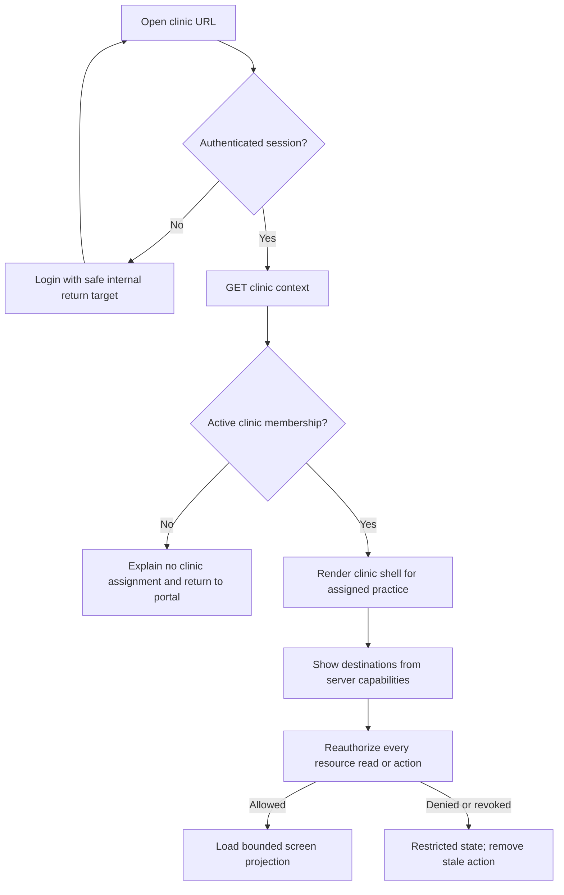
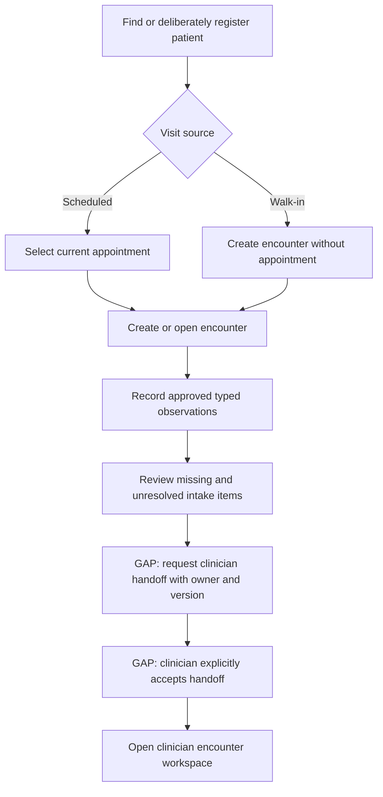
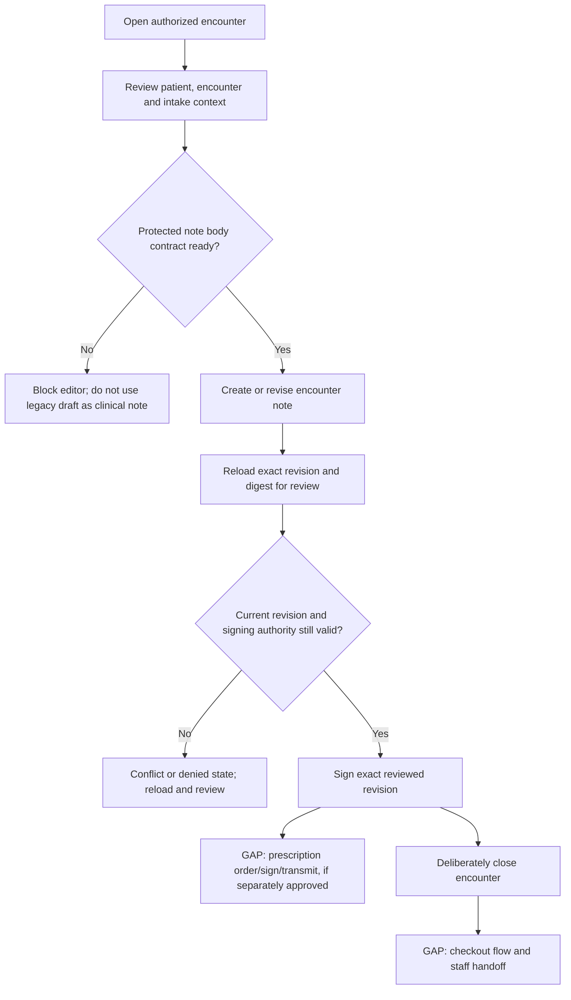
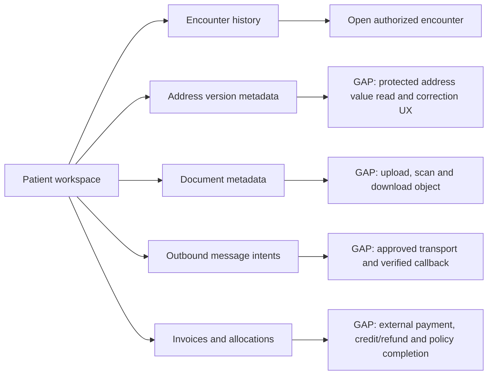
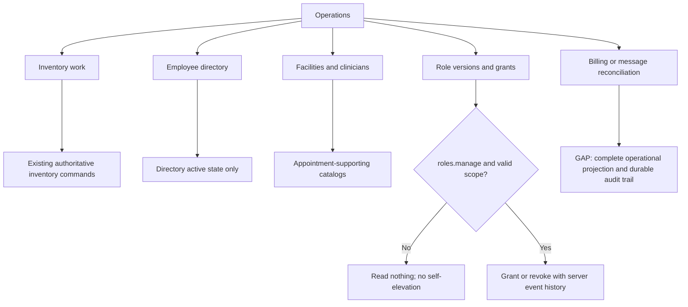

# Clinic Frontend Backend Mapping

Home: [[00 Home]] · Index: [[01 Table of Contents]] · Design: [[Clinic Workspace Design]] · Target: [[Target-State Clinic ERD]] · Backend handoff: [[ERD Implementation Prompt]] · Canonical status: [[Roadmap and Tasks]]

## Outcome and boundary

**Request, 2026-08-31:** on a new branch, review the current code, map the proposed clinic frontend onto the implemented backend and prepare user-flow diagrams before any code change or design decision. This note is that pre-design integration map. It records observed interfaces, existing approved/proposed direction and unresolved dependencies separately. It does not select a new layout, change application code or make a clinical workflow decision.

**Minimum implementation follow-up, 2026-08-31:** the founder authorized the narrow mapped frontend slice without backend logic or an extensive test expansion. The clinic shell now uses `/api/clinic/context` for identity, policy version and navigation capabilities while retaining `/api/clinic` only as a compatibility adapter for existing inventory/Operations consumers. Added read-only Schedule, paged Patients, a bounded patient-registration form backed by the existing `patients.write` endpoint, patient encounter history and encounter/observation detail; legacy drafts remain read-only. The live board, clinical note editor/signing, prescribing, protected address values, document transfer, external messages and payment execution remain unavailable.

**Working-tree review, 2026-08-31:** concurrent frontend/backend edits now expand the registration payload and patient detail projection to demographics, contact and emergency records, communication preferences and social-history records, with `PATCH /api/clinic/patients/:id` exposed for updates. `CareFlow.tsx` also presents MUI-based appointment/scheduling and encounter controls using facility, clinician, visit-type and patient endpoints. These are observed source changes, not a revised acceptance boundary: field protection, audit/history semantics, typed intake/triage, membership, arrival/flow, note signing and prescribing remain unresolved. The migration and dependency changes are uncommitted and were not applied by this review.

Keep the workload-first Overview, patient directory, Pharmacy, Operations, Office inventory, Employees and account-owned Settings. Add depth inside those destinations rather than a sidebar entry per database table. Staff do intake/triage and explicit handoff; clinicians get a focused note/review workspace. Preserve Sage & ivory, Mineral blue and Warm graphite, system/light/dark modes, the viewport-height chart-tab sidebar, desktop/tablet support and the separate launch experience.

The corrected ERD and revision-5 handoff remain the target, while the current Rails code is the implementation source. D-044 supersedes older blanket deferrals of pictured modules; it does not supply the still-unrecorded minor ERD amendments, clinical definitions, patient membership terms or prescribing model. No database reset, application-code implementation, account provisioning, external delivery, commit/push, deployment or real-data access is performed by this mapping. Clinical/confidential/security/operational gates remain open.

**Failure-first entry:** an attractive screen could report a live queue from example rows, treat access membership as a paid patient membership, sign the wrong revision, restore revoked access through legacy flags, or report success before an external action is known. Prevention is explicit source/provenance, workflow-specific commands, one authorization evaluator and visible pending/conflict/unknown states. The synthetic tests in [[Clinic Frontend Backend Mapping#Acceptance and recovery]] must disprove these failure hypotheses before the corresponding feature is accepted. Codex owns this planning deliverable; implementation/review owners and dates remain unassigned.

## Review baseline and source status

Reviewed through Home/TOC: current backend verification, ERD and implementation handoff; D-043/D-044; architecture and audit requirements; CI/CD; failure-first agreement; clinic design; relevant tasks, decisions and progress. Inspected the current frontend route registry, browser contracts, request client, clinic shell, tracking board, patients, staff and operations components; inspected Rails routes, clinic controllers, serializers and permission rules. MD/SharePoint originals, final ERD amendments and clinical workflow evidence remain unavailable and were not assumed reviewed. No patient chart, hosted system or live external service was inspected.

Snapshot: branch `feature/frontend-backend-flow-mapping`, base HEAD `4989742264cb616c3c32e55d92e7357e673b1b67`, clean before this documentation update. This branch was created specifically for the mapping. The backend APIs described below are implementation observations, not release or clinical-readiness claims. [[Backend Verification Report]] is the detailed current verification source.

Primary code: [frontend routes](../../apps/web/src/App.tsx), [current response types](../../apps/web/src/api/contracts.ts), [request client](../../apps/web/src/api/client.ts), [clinic shell](../../apps/web/src/features/clinic/Workspace.tsx), [read-only care flow](../../apps/web/src/features/clinic/CareFlow.tsx), [board examples](../../apps/web/src/features/clinic/trackingBoardData.ts), [Patients](../../apps/web/src/features/clinic/Patients.tsx), [API routes](../../apps/api/config/routes.rb), [implemented ERD migration](../../apps/api/db/migrate/20260831000200_implement_approved_clinic_erd_schema.rb).

| Area | Direct observation | Integration consequence |
| --- | --- | --- |
| Current browser | Context/capability bootstrap plus read-only appointment, patient, encounter and observation consumers are now present; inventory/staff/settings remain integrated and Overview still imports `EXAMPLE_VISITS` with a fixed clock | Keep the example board isolated until an accepted visit projection exists. Do not infer handoff, live wait or clinical readiness from the new read-only screens |
| Backend schema/model work | The target ERD schema, models and services are committed; the verification report records 68 entities and 103 structural edges present | Structural coverage is not workflow completion. Keep the UI behind implemented, permissioned API projections rather than direct table-shaped contracts |
| HTTP boundary | Rails now exposes context, facilities, clinicians, role versions/grants, appointments, encounters, note revision/signature, observations, patient address metadata, document metadata, message intents, invoices/allocations and the earlier directory/inventory routes | The browser currently consumes only the earlier clinic contracts. Add typed adapters and screens incrementally; do not call private services or mirror Active Record fields |
| Authorization | `Ability` evaluates immutable role-version permissions with practice or site scope; `BaseController` requires active membership and exposes capability checks | Use `/api/clinic/context` for navigation capability projection, but reauthorize every resource/action. Site-scoped consumers must not infer practice-wide access |
| Authorization transition risk | The context now separates `patients` (read) from `patients_write` (registration/create); it still returns coarse booleans and every practice site; facilities lookup requires `appointments.write` | Keep registration visible only for `patients_write`, while the API rechecks `patients.write`. Before exposing broad navigation or facility filters, reconcile read-specific capabilities, permitted-site projection and role migration parity. Do not treat a visible link as authority |
| Clinical history | Conditions/allergies/medication statements currently have patient ownership but no meaningful clinical value fields in the implemented model | Tables are scaffolding, not complete intake/reconciliation APIs. Define clinical dictionary and revision/correction rules before forms |
| Note services | Create/revise/sign routes exist, require separate note-write/sign capabilities and sign an exact revision/digest | The serializer omits body content, the accepted correction/read-review contract is incomplete and `encrypted_body` is not actually encrypted at rest. Keep note-body UI blocked until protected-value handling and exact review are resolved |
| Patient identity | API/model provides `display_name` and clinic-local `reference`, no structured given/family name or birth-date contract | Initial/surname abbreviation and age cannot be reliably populated by splitting names or guessing dates |

## Current frontend-to-backend interface map

Status meanings: **usable contract** means a current Rails JSON route exists and its data can support the named browser slice after typed frontend integration; **partial contract** means the route exists but cannot truthfully support the full UX; **backend gap** means the workflow must remain a labeled example or unavailable. These are implementation statuses, not design selections.

| Frontend destination / current source | Current backend authority | Status and proposed mapping boundary |
| --- | --- | --- |
| Clinic shell and navigation (`Workspace.tsx`) | `GET /api/clinic/context`; compatibility `GET /api/clinic` | **Minimum slice implemented:** context owns identity/version/action visibility and is checked against the signed-in user and compatibility practice. `/api/clinic` remains only for existing inventory/Operations actions until their projection is replaced; no site filter is exposed |
| Overview tracking board (`TrackingBoardPage.tsx`, fixed `EXAMPLE_VISITS`) | Appointment and encounter lists plus detail; observations by patient | **Synthetic table only:** the MUI table, filters and search continue to use independently invented examples because there is no arrival, five-stage flow, handoff/owner event, commercial membership, board projection or trusted wait clock. Do not client-join these endpoints into a false live queue |
| Patient directory/detail (`Patients.tsx`) | Patient list/show and patient encounter collection | **Minimum slice implemented:** paged directory, patient identity, encounter history and read-only legacy unsigned drafts. Patient create and legacy-note write are no longer exposed because context does not distinguish patient read/write |
| Scheduling (`CareFlow.tsx`) | Appointment list; context site codes | **Read-only slice implemented:** bounded scheduled rows link to patient/encounter records and explicitly distinguish schedule from arrival/queue. No booking, transition, site filter or client-side patient join |
| Encounter workspace (`CareFlow.tsx`) | Encounter detail plus encounter-filtered patient observations | **Read-only slice implemented:** identity, open/completed status, times, counts and uninterpreted recorded values. No close, intake ownership, handoff, board stage or correction/reopen control |
| Intake/triage (`CareFlow.tsx` observation display only) | Observation list | **Partial read implemented:** recorded code/value/unit/source/time only. No entry form, clinical thresholds, history-review semantics or readiness claim |
| Clinician note (legacy draft UI only) | Encounter-note create/show/revise/sign | **Blocked for body entry/signing UI:** route lifecycle exists, but protected body handling, body read/review DTO and signed-correction semantics are unresolved. Prescription workflow is absent |
| Patient documents (no current component) | Category list; document metadata list/show | **Metadata-only:** object upload/download, scan execution and reauthorized streaming are absent |
| Patient messages (no current component) | Intent list/show/create and delivery-event record | **Local intent/history only:** external transport/callback authority is absent; protected recipient/content handling is unresolved. A user must never record delivery manually in the intended workflow |
| Patient billing (no current component) | Invoice list/show/create/post and payment allocation | **Synthetic bookkeeping slice:** exact server amounts and posting exist; credits/refunds/coverage/claims and external payment execution are incomplete or model-only |
| Operations (`Operations.tsx`) | Legacy counts; facility/clinician catalogs; roles/grants; inventory and staff directory | **Usable expansion path:** keep reorder and directories here; add authorization-aware access/facility work only after read/action capability reconciliation. Employee directory status remains separate from account access |
| Pharmacy and office inventory | Existing catalog, product/batch/receipt/hold/count/configuration and office-item routes | **Current integrated area:** preserve exact decimal strings and ledger semantics; align navigation with the common permission projection without redesigning inventory |
| Account Settings | `GET/PATCH /api/settings` | **Current integrated area:** retain user-owned theme preference; do not place practice policy or role configuration here |

## User-flow diagrams before design

The diagrams below combine current route capability with the already recorded workflow hypothesis. Solid nodes are supportable by a current API; nodes explicitly marked **GAP** are not backend-authoritative yet. They define questions and integration seams, not approved clinical policy or a chosen interface.

### 1. Session, clinic context and destination visibility

### 2. Staff scheduling, intake and handoff

Current safe stopping point: the API can create/open an encounter and record observations. It cannot truthfully claim arrival, intake ownership, “ready,” accepted handoff or current-stage wait.

### 3. Clinician note, signature and visit completion

The create/revise/sign/close route lifecycle exists. The “yes” branch at protected note body remains unavailable until actual encryption and a reviewable body DTO exist; signing must never be inferred from a save or encounter close.

### 4. Patient support sections

### 5. Operations and access administration

Employee-directory changes never create or revoke login authority. Role administration must stay out of personal Settings and must not make platform or cross-clinic evidence visible.

## Navigation and layout

The following paths are proposed additions; current paths stay valid. Keep the current plain-language labels and account Settings location. Do not add a clinic selector; a site filter is a narrower location within the assigned clinic, not another tenant.

| Destination | Retain | Add or change |
| --- | --- | --- |
| `/clinic` — Overview | Tracking-board rows/cards, stage filters, current-wait/arrival sorting, disclosure details, unique reference | Server-backed active encounters, freshness indicator, permitted site/owner filters, check-in, actionable next step. Add a separate Scheduled subview at `/clinic/schedule`; scheduled people do not count as waiting |
| `/clinic/patients` | Directory and explicit patient selection; return to board | Bounded server search/pagination, identity disambiguation and deliberate registration action; no automatic creation on no results |
| `/clinic/patients/:patientId` | Persistent patient context | Summary, Encounters, Documents, Messages and Billing sections; history, addresses and membership in Summary. Load each permitted section on demand, not one full-chart response |
| `/clinic/patients/:patientId/encounters/:encounterId` | Same clinic shell and board-return link | Focused Intake / Clinical note / Visit history workspace. Identity, site/room, owner and stage stay visible. Detail URL must reauthorize both patient and encounter |
| `/clinic/pharmacy` and `/:productId` | Catalog, stock/availability, product/lot/location detail, receipts, holds, counts and ledger | Align permission projection and stale/retry responses; clarify stock-location versus patient room. Keep exact-unit summaries and current pagination |
| `/clinic/inventory` | Office-stock adjustments and reorder information | Reuse improved action/error primitives; no clinical stock-use or procurement inference |
| `/clinic/operations` | Reorder work, directory totals, module shortcuts | Nested work areas: Facilities, Team access, Billing work, Message delivery, Suppliers and Activity. Show only implemented and authorized entries; do not show empty placeholder tabs for every target table |
| `/clinic/staff` | Employees directory, job title and active status | Staff detail/address history; separate link to authorized account/access management. Directory active status never grants or revokes a login |
| `/clinic/settings` | Signed-in user, palette/brightness, explicit versioned save | Keep personal preferences only. No clinic policy, patient membership pricing, global role editing or facility configuration here |

Patient subroutes may use `/documents`, `/messages`, `/billing` and `/encounters`; Operations subroutes use `/facilities`, `/access`, `/billing`, `/messages`, `/suppliers`, `/activity`. Extend the existing route registry deliberately; do not introduce a new routing library just for this plan. Shared identity/encounter context needs an unsaved-change navigation guard for links, Back/Forward, reload and patient switching. If router adoption is selected later, isolate it as a tested infrastructure change preserving current URLs.

**Encounter layout:** on wide screens place a compact read-only intake/history context column beside the main task. Staff enter short grouped intake sections; clinicians land on a single note composer with review context, revision status and explicit review/sign action. On tablet portrait/phone use one column and a wrapping section selector; keep the patient/encounter heading before the editor and the action area visible without covering the virtual keyboard. Use a full task page for long intake/note work, not a cramped modal. Board row expansion is a quick read; “Open encounter” starts work. Provide an explicit controlled transition, not drag-and-drop as the only way to move stages.

Use existing tokens, system font stacks, 16px inputs/body, readable secondary text, tabular quantities/times and restrained cards. Preserve 44px chart-tab/touch controls, text-plus-color statuses, native form semantics and no decorative dashboard metrics. Status meaning is identical in every theme. Reuse the current sidebar, rather than creating an encounter-specific second shell. See [[Clinic Workspace Design#Accessibility and ease-of-access targets]] for the existing acceptance target; this plan does not claim conformance.

## Tracking-board field contract

Proposed `GET /api/clinic/board` returns a minimal authorized `BoardPage`, not all patients with browser-side joins. Suggested envelope: `schema_version`, `context` (expected user/practice, policy version), `as_of`, `timezone`, filter scope, server totals, bounded rows/cursor, permitted actions and explicit source mode. Separate “all authorized current encounters” totals from filtered/page totals; never count only the first page or include unauthorized sites in aggregates. Business-day boundaries and cross-midnight open encounters must be explicit; open overnight work must not disappear at midnight.

| UI field | Target source | Required contract or missing piece |
| --- | --- | --- |
| Short patient label | `clinic_patients` | Server-produced label using approved structured given/family names, including Unicode, hyphens, short names and mononyms. Current `display_name` is insufficient; display full authorized identity only in selection/work context |
| Stable row/reference | `clinic_encounters` + clinic-local patient reference | One row per encounter, not per patient; separate patient and encounter IDs/references. Abbreviations can collide and are not de-identification or signing identity confirmation |
| Age / identifying context | Proposed demographics extension | Derive age on the server for an explicit date from a verified birth date; absent remains unknown. Do not ship birth date just to draw an age badge |
| Reason / visit type | Appointment visit type; encounter reason extension for walk-ins | Catalog code/label is not a chief complaint. The ERD has no reason field or walk-in visit-type relationship; define encrypted typed payload and minimal role-filtered summary |
| Stage | Encounter plus proposed flow events | Existing `open/completed` is not the board's five stages. Do not map arbitrary status strings to clinical readiness |
| Site / room | `clinic_sites`, `clinic_rooms`, encounter links | Room belongs to selected site. “Waiting area”/“Unassigned” is a display state unless explicitly modeled, not a pharmacy storage bin |
| Responsible person / next step | `clinic_encounter_participants` + handoff/action contract | Booked clinician is not necessarily actual responsible participant. Define ownership/acceptance, missing-owner handling and permitted next action; job titles alone confer no authority |
| Arrival / elapsed | Explicit arrival event proposed; encounter start only if accepted as arrival | Scheduled time is not arrival. Decide whether clinical encounter creation happens at check-in; otherwise an independently durable arrival record is required |
| Current-stage wait | Proposed `stage_entered_at`/flow event history | Current wait only for a waiting stage; total elapsed separately. Never derive it from `updated_at`, note timestamps or latest observation |
| Triage availability | Typed observations, history-review evidence and intake state | Distinguish not recorded, in progress, recorded and reviewed. No rows does not mean normal or no allergies. Show units, author, observed/recorded times and encounter association |
| Patient membership | Proposed patient commercial-membership history | Not `clinic_memberships` and not insurance `clinic_coverage_versions`. Unknown/not verified stays unknown; no balance or payment-card information on board |
| Freshness | Server `as_of`, encounter version and request generation | Show last updated/stale/offline. An example shift never replaces an error from a real endpoint. Freeze/label timers when data is stale rather than appearing freshly verified |
| Row action | Server `allowed_actions` for current state/resource | Action descriptor is UX guidance; server reauthorizes and compares expected version on execution. Missing/stale permission is not retried automatically |

Use a discriminated field state such as `known`, `not_recorded`, `not_applicable`, `restricted`, `not_supported` where safe. Do not put restricted raw values in JSON and hide them with CSS. Do not disclose that a restricted resource exists merely to explain a hidden field. Search terms/clinical reasons stay out of URLs, analytics and access-log query strings; propose a POST search endpoint with a minimal body and redacted diagnostics. Board presentation-only filter codes can use URL state; patient names cannot.

Recommended refresh: bounded conditional/background reads while visible, refresh on focus and after acknowledged actions, with request cancellation and backoff. Choose cadence after load testing, not a promised real-time service. Keep the selected row/focus stable when rows change; announce a concise update without reading every timer tick. No websockets, offline chart cache or browser record persistence are required for the first slice.

## Encounter workflow and clinical work

The five-stage presentation remains familiar, but the backend needs an explicit transition contract. The following is a proposed synthetic walkthrough, not approved clinical policy:

| Transition | Deliberate action and responsible role | Evidence and safe failure |
| --- | --- | --- |
| Scheduled/walk-in → Awaiting intake | Authorized staff select and confirm patient, then check in | Atomic encounter/arrival creation, optional same-patient appointment, current server time, request key. Duplicate check-in returns the existing result; no duplicate encounter |
| Awaiting intake → In intake | Staff accept intake ownership | Expected encounter version, participant/flow event; room optional until workflow requires it. Someone already owning work produces a conflict, not silent takeover |
| In intake → Ready for clinician | Staff save intake and request handoff | Persist completeness/review state and source versions; unresolved items remain visible. “Ready” means staff handoff requested, not clinician acceptance or a clinical safety score |
| Ready → With clinician | Authorized clinician accepts handoff | Explicit acceptance and responsible participant event. Merely opening the note does not change responsibility |
| With clinician → Awaiting checkout | Clinician deliberately hands off completion work | Note status and outstanding work shown independently. Signing alone does not close encounter, finish checkout or imply a prescription was transmitted |
| Awaiting checkout → Completed | Authorized staff complete approved checkout checklist | Server validates required work or accepted exception; completed timestamp/flow event. Billing status remains separate, not a condition invented to deny care |
| Correction, return to intake, abandonment or cancellation | Explicit reasoned command under accepted policy | Preserve earlier stages/times/owners. No generic destructive status overwrite, accidental encounter deletion or backdated fabricated history |

Appointment lifecycle is separate. Current source proposes `scheduled → confirmed/cancelled/no_show`, `confirmed → cancelled/completed/no_show`; encounter service creates `open` and closes to `completed`. These are implementation observations, not approval of the five-stage mapping. Scheduled-list actions need booking/reschedule/cancel/no-show validation, version checking, half-open room/provider conflict handling and a recoverable alternative slot; no implicit overbooking. A walk-in may have no appointment. At most one encounter per appointment; patient/context cannot be reassigned to repair a mistake.

**Intake:** group identity/contact, reason, history review and approved observations into short sections. Define a typed dictionary with units, permissible value shape and correction semantics, not a JSON blob or free-text vitals string. Numeric values remain exact strings when necessary; BP is grouped components; derived observations retain source versions/formula. Missing, declined, not asked and not applicable must be distinguishable where the approved dictionary supports them. Do not invent clinical thresholds, scores, default “normal” or automatic reassurance. Separate observing, recording and reviewing authors/times. Review attestation/version is missing from the pictured history tables; a current allergy row alone does not prove today's review.

**Clinical note:** save creates an immutable revision under a stable note header. Send `body`/typed content through an authorized API; encryption, trusted author, payload version validation and digest computation belong to Rails, not a browser field named `encrypted_body`. Show unsaved, saving, saved revision, conflict, failed/unknown outcome and signed states. Initially prefer explicit Save draft to unverified autosave. Preserve author provenance when displaying staff context; importing text into a clinician note is explicit and does not silently make it clinician-authored evidence.

**Review/sign:** open an exact persisted revision in a read-only preview showing patient identity, encounter, author, revision and attestation. Server supplies a review token/version/digest bound to that content and actor context. Confirm/sign is separate from Save, submits expected header version plus revision/token and an idempotency key; server validates active authority and accepted latest-revision policy under the same lock as save. A concurrent revision invalidates review and requires re-review, not signing an older draft by accident. Return the committed signature reference and revision, never just a green toast. Signed content cannot be edited in place; a separate correction/addendum command requires reason and links the predecessor, preserving prior signatures. Co-signing, attestations and correction authority remain point-of-use clinical decisions.

**Legacy drafts:** keep `clinic_notes` visible as “Legacy unsigned drafts” with original author/time. Do not manufacture encounters, revisions, signatures, reviewed status or recovered authors. Disable the old draft-write action only when its replacement is accepted and an explicit transition is available. Do not redirect old `POST /patients/:id/note` silently into an arbitrary current encounter.

**Prescriptions:** the target contains medication history, not a prescription/order model. Preserve space in the encounter workflow, but explain “Prescribing not available” rather than a working-looking Sign/send button. Medication statements cannot carry prescription intent or cause stock deductions. A separate amendment must define orders/revisions, signer authority, medication/dose/instructions/recipient validation, cancellation and transmission/acknowledgment/failure reconciliation; no vendor is selected. Note signing, prescription authorization, transmission and pharmacy acknowledgment are separate events. This gap does not block patient/encounter/unsigned-note integration.

## Complete target-entity mapping

Every one of the ERD's 68 named entities is assigned below. Backend-only and history-only entities intentionally have no CRUD screen. The additional PaperTrail table and frozen legacy stock tables are accounted for separately. An entity-to-screen map is not evidence of implemented workflow/constraint coverage.

| Target entities | Frontend home / role | Required behavior |
| --- | --- | --- |
| `organizations`, `clinic_practices` | Shell clinic identity; restricted Operations practice metadata if needed | Organization grouping is metadata only. No organization-wide charts, clinic creation/switcher or inherited access |
| `users`, `member_sessions`, `clinic_memberships` | Login/session banner; assigned clinic; authorized Team access summary | One assigned practice per clinical account; active/session checks. Show “Clinic access” to avoid confusion with patient membership. No session tokens or shared-account UI |
| `identity_preferences` | Existing personal Settings | Unique current user; allowlisted appearance and version conflict handling. Preserve expected-user guard and account remount behavior |
| `clinic_sites`, `clinic_rooms`, `clinic_departments`, `clinic_visit_types` | Operations → Facilities; scoped selectors in scheduling/encounters | Site timezone fallback; room/site validation, retired catalogs remain in history, department is not a location or stock bin. Add safe labels if codes are not human-readable |
| `clinic_clinician_profiles`, `clinic_clinician_assignments`, `clinic_clinician_credentials` | Operations → Team access/clinician detail; booked clinician picker | Distinguish profile, effective assignment and credential review from current permission. No “licensed/authorized” badge inferred merely from a profile or issuer text |
| `clinic_patients` | Directory, Summary, identity heading, board projection | Clinic-local reference; minimal search result; typed demographic extension needed. Cross-clinic matching/merge not proposed |
| `clinic_appointments` | Overview → Scheduled; patient upcoming visits | Booking/transition commands; conflicts; optional room/site/clinician; date/time and time-zone disambiguation |
| `clinic_encounters`, `clinic_encounter_participants` | Board and focused encounter | Actual visit, optional appointment, current participants and history; flow/arrival/ownership additions as above |
| `clinic_notes` | Patient → legacy history | Read-only preserved unsigned entries after accepted write-path retirement; no fabricated signed history |
| `clinic_encounter_notes`, `clinic_encounter_note_revisions`, `clinic_encounter_note_signatures` | Encounter → Clinical note / Visit history | Revision-specific save/review/sign/correction; no general update/delete for immutable revisions/signatures |
| `clinic_observations`, `clinic_observation_sources` | Intake, triage detail and clinician context | Typed values/groups/units, provenance and derived-source detail; no arbitrary formulas in browser or silent overwrite |
| `clinic_conditions`, `clinic_allergies`, `clinic_medication_statements` | Patient Summary; encounter history review | Actual typed clinical content/state and reviewed-version contract still needed. Unknown ≠ negative history; statements ≠ prescriptions |
| `clinic_items` | Office inventory | Preserve integer unit/stock controls and shared ledger; no independent mutable stock source |
| `clinic_pharmacy_products`, `clinic_inventory_lots`, `clinic_inventory_locations`, `clinic_pharmacy_batches` | Pharmacy catalog/product/position | Product versus lot versus bin, exact on-hand/available by unit, expiry/active/hold exclusion; barcode/dispensing not inferred |
| `clinic_inventory_suppliers`, `clinic_supplier_address_versions` | Operations → Suppliers; receipt supplier selector | Same-practice immutable address history; no price-feed connection, purchasing or supplier-account credentials |
| `clinic_inventory_receipts`, `clinic_inventory_receipt_lines`, `clinic_inventory_entries` | Receive and read-only product/office history | Atomic posting, exact input/conversion/stock units, original cost/currency, actor/profile. Receipt is not supplier invoice or patient invoice |
| `clinic_inventory_holds`, `clinic_inventory_hold_releases` | Product position → Holds | Distinct overlapping holds, explicit individual release, reason and authority; releasing one must not make still-held stock available |
| `clinic_inventory_counts`, `clinic_inventory_count_approvals` | Product position → Count/review | Frozen cutoff/profile and variance; separate approval, stale rejection. Don't replace current stock with the observed count |
| `clinic_inventory_profiles`, `clinic_inventory_catalog_events` | Existing Pharmacy configuration/history; Operations shortcut | Versioned synthetic operating profile versus user permission; no implied clinical activation. Metadata-only catalog history, not arbitrary audit restore |
| `clinic_staff_members`, `clinic_staff_address_versions` | Employees directory/detail | Human directory with typed owned address versions, separate from identity accounts; no automatic access grant from title/active field |
| `clinic_patient_address_versions` | Patient Summary → Contact/address | Immutable versions and same-owner primary pointer, reauthorized details. Distinct from staff/supplier records even if address text matches |
| `role_versions`, `permissions`, `role_version_permissions` | Backend policy catalog; read-only role descriptions in Team access | Immutable global definitions with versions; no customer-editable arbitrary permission strings |
| `clinic_role_grants`, `clinic_role_grant_events` | Operations → Team access | Authorized practice/site-scoped grant/revoke with effective interval, grantor ceiling and revision. No self-elevation; history remains after revocation |
| `clinic_document_categories`, `clinic_documents` | Patient Documents; encounter attachments; restricted category configuration | File is an immutable private object version, same patient/encounter, categorized and scanned; no public object links or generic storage browser |
| `clinic_message_intents`, `clinic_message_attachments`, `clinic_message_outbox`, `clinic_message_delivery_events` | Patient Messages; Operations → Message delivery | Immutable recipient/purpose/content/attachment versions; atomic queue and reconciliation. Outbound-only target; not an inbound inbox or staff chat |
| `clinic_invoices`, `clinic_invoice_lines` | Patient Billing; Operations → Billing work | Draft/review/post with exact amounts/currency/rounding-policy version; immutable posted descriptions/amounts. No approved rates/default membership charges exist |
| `clinic_payment_events`, `clinic_payment_allocations`, `clinic_credit_notes`, `clinic_refund_events` | Patient Billing timeline and authorized reconciliation | Explicit payment/allocation/credit/refund commands, same patient/currency, bounded amounts and duplicate-event handling. Recording a payment ≠ charging a card |
| `clinic_coverage_versions`, `clinic_insurance_claims` | Capability-gated patient Billing → Coverage/claims | Preserve full target coverage without making insurance the cash-pay clinic's primary flow. Coverage evidence/version and patient/invoice consistency; no insurer transmission implied |
| `clinic_audit_events`, `clinic_audit_resource_manifests`, `clinic_audit_delivery_receipts` | Backend capture; restricted Operations → Activity if accepted | Metadata-only authorized history and delivery health; no general patient-history export, raw payloads or generic version reification. Record reads/denials/failed actions separately from model changes |
| `platform_audit_events` | Restricted platform/operator evidence, not clinic screen | Authentication/unknown-tenant events remain separately scoped; never expose cross-clinic/platform history to clinic administrators |

Additional source/transition records: `clinic_model_versions` is the in-progress tenant-bound PaperTrail store, not a general browser endpoint or clinical revision history. Preserve frozen `clinic_pharmacy_movements`, `clinic_stock_movements` and `clinic_pharmacy_batch_events` as historical evidence where present; show provenance through authorized inventory history, not new posting forms. Launch paperwork, learning progress, materials, inquiries/contact and their identity relationships are outside the ERD but remain supported; their routes and own authorization do not disappear in a clinic replacement.

## Current API and frontend implementation boundary

Keep Rails authoritative for tenancy, actors, permissions, validation, transitions and exact arithmetic. Encryption and durable audit must also be Rails/infrastructure authorities before protected values are enabled, but the current verification report shows those controls are incomplete. Queries return authorized screen projections; commands express user intent. Do not expose one CRUD controller for each table. IDs identify a candidate resource, never grant access; Rails resolves every submitted link through the current practice and same-patient/site constraints.

### Existing consumer transition

All routes below exist in the inspected source. Proposed replacement modules should preserve these contracts until their consumers switch together and compatibility tests pass.

| Current routes | Consumer | Disposition |
| --- | --- | --- |
| `GET /api/clinic` | `Workspace`, `Operations`, navigation/action visibility | Retain compatibility initially, but derive flags/actions and aggregates from the same authoritative evaluator. Then split lightweight `/api/clinic/context` from `/api/clinic/operations` so every patient screen does not fetch inventory/staff totals |
| `GET/POST /api/clinic/patients`; `GET /api/clinic/patients/:id`; `POST /api/clinic/patients/:id/note` | `Patients.tsx` | Retain IDs and legacy-history reads, add bounded search/summary. Replace old draft write only with explicit encounter selection and accepted note API; preserve archived entries |
| `GET/POST /api/clinic/pharmacy`; `GET/PATCH/PUT /api/clinic/pharmacy/:id` | `Catalog`, `NewProduct`, `Product` | Preserve projection, filters/paging, `Decimal` strings, stock semantics and profile history; adapt action visibility from common policy |
| `POST /api/clinic/pharmacy/lookup`, `/import`, `/demo`; `POST /api/clinic/pharmacy/:id/receive` | NDC search/import/demo and receiving | Preserve explicit public lookup, bound import token and no-stock import, guarded synthetic demo, retry-safe receipt. No automatic external lookups from chart fields |
| `POST /api/clinic/pharmacy_batches/:id/movement`, `/status`, `/count`; `POST /api/clinic/inventory_counts/:id/approve`; `POST /api/clinic/inventory_configuration` | Product controls/configuration | Keep command authority, ledger and audit; add structured conflict/reconciliation results without double posting. Profile configuration remains separate from account permissions |
| `GET/POST /api/clinic/inventory`; `POST /api/clinic/inventory/:id/adjust` | `Office.tsx` | Retain existing single-ledger office behavior; no balance-mutation endpoint |
| `GET/POST /api/clinic/staff`; `PATCH/PUT /api/clinic/staff/:id` | `Staff.tsx` | Retain directory behavior; new address/access flows are separate, scoped commands |
| `GET /api/csrf`; `GET/POST/DELETE /api/session`; `POST /api/development_session`; `GET/PATCH/PUT /api/settings` | App, Login, Appearance, Settings | Retain CSRF bootstrap serialization, explicit login, 12-hour absolute session, demo/environment guards and current-user preferences. No automatic test login, new role granted by persona name, or mutation replay |
| `/api/materials` list/detail/start/complete, `/api/paperworks` list/detail/start/sign/receipt, `/api/contact_messages`, `/api/inquiries` | Launch components | Preserve all current methods and account/admin restrictions. Launch signing is not reusable clinical authority. Verify the route manifest and non-ERD data/history explicitly |

### Implemented screen-oriented contracts

Prefix `/api/clinic` is omitted. These routes exist in the reviewed source; none is consumed by the current browser unless noted in the earlier consumer table.

| Implemented query / command family | Current wire result | Safe frontend use and limitation |
| --- | --- | --- |
| `GET /context` | Schema/policy versions, user, practice, membership, coarse capabilities and practice sites | Clinic bootstrap and module visibility after site/capability reconciliation; not proof an individual resource/action is allowed |
| `GET /facilities`; `GET /clinicians`; `GET /role_versions`; `GET/POST /role_grants`; `POST /role_grants/:id/revoke` | Paged catalogs, clinician assignments/credentials, immutable role definitions and grant history | Scheduling selectors and Operations access administration. Facility read currently requires appointment-write; grant actions require `roles.manage` |
| `GET/POST /appointments`; `GET /appointments/:id`; `POST /appointments/:id/transition` | Patient/site/room/clinician/visit-type IDs, UTC instants, status and optional encounter ID | Scheduled list, booking and supported status actions. No update/reschedule route or browser labels in appointment rows |
| `GET /encounters`; `GET/POST /patients/:patient_id/encounters`; `GET /encounters/:id`; `POST /encounters/:id/close` | Patient/appointment/site/room IDs, start/end/status; detail adds participants, note IDs and counts | Encounter history/open/detail/close. No board-stage or handoff mutation |
| `GET/POST /patients/:patient_id/observations` | Typed value, code/unit, encounter/group/source IDs and actor/observed/recorded timestamps | Intake data after an approved dictionary and field-level UX; no current history-review or correction route |
| `GET/POST /patients/:patient_id/address_versions` | Metadata on read; create accepts `encrypted_address` | Do not expose protected address entry yet: the field is stored as plaintext despite its name and no value-read DTO exists |
| `POST /encounters/:encounter_id/notes`; `GET /notes/:id`; `POST /notes/:id/revisions`; `POST /notes/:id/signatures` | Header/version, revision metadata and exact-revision signatures; body omitted | Lifecycle testing only until protected body encryption, body review and correction contract are complete |
| `GET /document_categories`; `GET /patients/:patient_id/documents`; `GET /documents/:id` | Category and immutable document metadata including object version/checksum/size/type/scan state | Read-only metadata section; no upload/download/scan transport |
| `GET/POST /patients/:patient_id/message_intents`; `GET /message_intents/:id`; `POST /message_intents/:id/delivery_events` | Intent purpose/key/state, attachments and recorded delivery outcomes | Labeled local intent history only. No external transport; content/recipient protected-value control is incomplete; delivery-event recording is not a clinic-user action |
| `GET/POST /patients/:patient_id/invoices`; `GET /invoices/:id`; `POST /invoices/:id/post`; `POST /invoices/:id/payment_allocations` | Draft/posted invoice, exact string line values, allocated and credit totals | Synthetic invoice draft/post/allocation UI after policy review; does not execute a payment or complete refund/credit/coverage/claim workflows |

### Still-required backend contracts

| Missing query / command family | Required for | Why the frontend must wait |
| --- | --- | --- |
| Authorized board projection plus arrival, stage and handoff commands | Live Overview and trusted wait/owner/next-action fields | Client-side joins cannot create authoritative stage history, counts, timestamps or transition conflict handling |
| Bounded body-based patient search and typed demographics | Scalable directory, short patient label, age and reason context | Current list filters `reference` in a GET query and patient identity lacks typed names/birth date |
| Note body review/correction plus actual protected-value encryption | Clinician compose/review/sign | Current metadata cannot show the exact body being signed, and plaintext-at-rest fields fail the intended contract |
| Commercial patient membership history | Board/summary member state | Clinic-access membership and insurance coverage are different concepts and cannot substitute |
| Prescription order/revision/signature/transmission | Physician prescription task | No current prescribing entity or route exists |
| Document object upload/scan/download | Patient Documents and message attachment release | Metadata cannot prove a private object is present, clean or authorized for download |
| External message adapter/callback and reconciliation | Truthful sent/delivered/failed status | Queue intent and locally recorded event are not external delivery evidence |
| Credits/refunds/coverage/claims plus payment execution/reconciliation | Complete cash-pay billing and optional coverage | Current APIs implement only a narrow bookkeeping subset |
| Protected-value address/message/coverage handling and durable access/read/denial audit | Any protected clinical workflow | [[Backend Verification Report]] identifies plaintext and audit-pipeline gaps; successful JSON responses do not close them |
| Restricted Operations projections/activity/receipts | Safe work queues and uncertain-result recovery | No complete operational aggregate, activity viewer or generic receipt lookup is exposed |

Patient membership and prescribing endpoints deliberately remain undefined pending the amendments below; this is a named model gap, not permission to repurpose another entity. Generic operation-status lookup also remains a proposal; implement it with a protected per-domain receipt or approved shared record, not an audit-log scrape.

### Shared frontend changes

| Source area | Planned change | Preserve / verify |
| --- | --- | --- |
| `src/api/contracts.ts` | Split domain DTOs as they grow; add discriminated clinical states, `AllowedActions`, page envelopes, expected resource versions and safe structured errors | Browser-facing DTOs only, no Active Record model mirroring. Define opaque string IDs for new bigint contracts or prove safe-number bounds and adapt existing IDs explicitly |
| `src/api/client.ts` | Parse `{code,message,field_errors,request_id,current_version?}` without sensitive exception details; separate JSON and approved binary upload/download transport | Same-origin credentials, no-store, redirects denied, CSRF generation/serialization, no automatic write replay. Distinguish validation from stale CSRF rather than clearing context for every new domain validation error |
| `src/shared/ui.tsx` | Accessible field-error summary; request lifecycle and unsaved/conflict guards; dedicated typed forms for observations/line arrays | Current generic Form has only shallow field grouping and cannot represent all clinical/billing structures. Do not squeeze arrays/files into bracket-name hacks |
| `Workspace` / navigation | Versioned session/practice/policy context, resource-aware actions; context invalidation on account change/revocation | Existing `key={user.id}`, current-user Settings, chart-tab/focus behavior, no clinic picker or broad admin bypass |
| `TrackingBoardPage` / `trackingBoardData` | Keep visual presentation; introduce explicit example/API providers and a tested DTO adapter; make row links use real encounter context only in API mode | Never mix example IDs with API records or fall back to invented examples after a fetch failure |
| `Patients.tsx` | Separate Directory, PatientWorkspace, EncounterWorkspace, IntakePanel, NoteEditor/Review and LegacyDraftHistory components | Stable current routes, safe identity confirmation, read-only historical provenance and no patient switch with unnoticed unsaved content |
| `Operations.tsx`, `Staff.tsx` | Authorized nested operations sections and detail pages; action-specific controls | Reorder/directory counts stay off clinical workload metrics; employee identity remains distinct from account identity |
| Inventory components | Update policy/error/version adapters, retaining current domain forms and exact quantities | No inventory rewrite to resemble clinical encounters; keep existing product/bin/ledger semantics and isolated external FDA lookup |
| Clinic CSS | Add scoped patient/encounter layouts and form primitives to existing theme tokens | Remove accidental dependence on `pharmacy-page` for non-pharmacy layout when extracting shared primitives; no launch-style/global CSS regression |

Fresh page, Back/Forward and login-return behavior must work for new nested routes. Extend the existing exact allowlist with parsed safe internal route patterns; no open redirects, free-form URL targets or record content in `next`. Revalidate access/identity on return, do not resume signing automatically. Clear uncommitted sensitive state at expiry/account change; safe in-memory editing is not offline persistence. Any future encrypted server draft recovery is a separately specified feature, not localStorage/IndexedDB or service-worker caching.

## Documents, messages, billing and operations details

**Documents:** UI owns file selection/progress; server validates size, type, checksum and actual private object version. Scan state is visible, download disabled while pending/quarantined/rejected. Reauthorize download and message attachment at execution; don't rely on a once-authorized URL. A metadata row is not proof an object exists or scanning succeeded. The ERD lacks a logical-document version-chain/retention-hold model: do not invent replacement/delete/version-history actions until those links and disposition rules are accepted. Use a local synthetic storage adapter first; no chosen cloud bucket/vendor. Preserve failed/orphan upload reconciliation without deleting held evidence.

**Messages:** compose under one patient, show recipient snapshot and purpose, explicitly choose permitted clean document versions, review then enqueue. An accepted intent is “Queued,” not “Sent.” Show delivered/failed/unknown with meaningful next steps; an ambiguous delivery must be reconciled before another send. Different payload with the same key is rejected even under concurrent requests. Callback events are server/vendor-adapter inputs, never user-editable delivery status. No inbound inbox, real SMS/email, consent inference or automatic appointment reminders are added by this plan; recipient/contact preferences and disclosure authority need their own contract.

**Cash-pay billing:** Patient Billing prioritizes draft charges, posted invoices, recorded payments and outstanding amounts, with receipt/history detail. A worklist in Operations serves authorized reconciliation staff. Monetary precision, rounding and totals are server-owned; JavaScript must not calculate invoice truth using floating point. Posting locks immutable line snapshots; corrections use credit/refund workflows rather than editing paid history. Currency mismatches, over-allocation/refund, repeated external event IDs and uncertain external outcomes are rejected/reconciled. Member badge never sets clinical queue priority, implies paid-in-full, or silently discounts a line. Coverage/claims are target features but remain out of the primary cash-pay flow unless enabled and specified. APPly fees based on ordered inventory value and deferred supplier pricing are separate from patient charges.

**Team access / facilities:** catalog administration and grant administration are different permissions. Preserve all historical memberships/authors even when inactive. A practice/site grant is evaluated for the actual resource site; an unspecified site cannot widen a site-only grant. Resources without a site need an explicit policy. Catalog setup must not expose all patient names or billing histories. No clinic account invitation, password/reset/MFA provisioning flow is invented; [[Client Access Workflow]] and T-23 retain those responsibilities.

**Audit:** PaperTrail model versions, clinical note revisions, stock entries and operation/read evidence have different purposes. A browser click is not durable evidence. Required mutation audit commits atomically; denied/rolled-back/read evidence follows the independent durability contract in [[Software Architecture#PaperTrail audit contract]] and [[Data Modeling#Auditing design]]. UI reports a write complete only after its transaction/receipt; downstream scan/delivery remains pending. Audit outage blocks the affected protected release with a recoverable error, never a silent bypass. Restrict Activity viewers and audit their queries; no generic reify/restore/delete versions UI.

## ERD amendments and contract decisions to reconcile

These are specific gaps to reconcile with the founder's promised minor amendments, not a claim those amendments were received. Engineering can proceed on independent approved slices while a dependent point is unresolved.

| Gap | Recommended design amendment or decision | What waits |
| --- | --- | --- |
| Demographics/board identity | Typed encrypted given/family/display-name and optional birth-date/contact schema with reviewed handling of names; server short-label/age projection | Exact initial/three-surname and age; directory integration can retain existing name/reference meantime |
| Arrival and board flow | Durable arrival plus append-only stage/ownership/handoff events, current projection/version and trusted event times; decide arrival versus encounter-start semantics | Live five-stage board/check-in/wait clocks; do not use generic audit versions as the flow ledger |
| Triage and history review | Approved observation dictionary, meaningful condition/allergy/medication fields, review attestations/source versions and correction rules | Actual triage/history forms and “reviewed/ready” claims; no clinical thresholds invented |
| Patient commercial membership | Separate patient membership/plan reference, versioned effective history and explicit verification provenance; define allowed statuses and manual verification first if accepted | Member badge from backend, enrollment/renewal/benefits/fees. No subscription/payment vendor or automatic rules assumed |
| Prescriptions | Separate authorized order/revision/signature/transmission model with clinical/service review | Prescribing, not medication history or unsigned notes |
| Note correction/signature | Accepted attestation and correction semantics, exact review token, current-revision/version locking and typed encrypted content | Sign/correct controls; draft/read context can be delivered earlier |
| Document grouping/lifecycle and communication authority | Logical document/version links, scan/object adapter, hold/retention contract; recipient/contact preferences and lawful-purpose checks | Replace/delete/send actions; no external service or retention duration guessed |
| Authorization migration | Explicit activation/version marker and deterministic grant migration; no fallback after cutover even with zero active grants. Define action catalog and site-less record policy | Grant-enabled UI, restricted aggregates and all new high-impact commands |
| Billing policy | Accepted line dictionary, currency/precision/rounding, posting/payment/refund/claim rules and membership eligibility if used | Charge calculation/posting/settlement; not basic planned screens. Current numeric columns alone do not choose policy |

These additions should be reconciled in the ERD/implementation handoff by the backend owner before structural changes; this plan does not modify the concurrent migration or assert its approval. Do not turn gaps into indefinite deferral of all 68 target entities: every dependent feature remains assigned in the coverage table and delivery sequence.

## Delivery sequence and migration

This is a candidate dependency sequence linked to canonical tasks, not an accepted design, duplicate status list or new deadline. It starts from the APIs that now exist and keeps gaps ahead of their consumers. Run focused tests per slice and full regression/upgrade/restore before accepted integration. This documentation pass is on `feature/frontend-backend-flow-mapping`; it changes no application code.

| Order | Independently reviewable slice | Entry / exit evidence; canonical ownership |
| --- | --- | --- |
| 1 | Resolve release-blocking transport, protected-value, audit and site/capability contracts | Actual encryption for protected values; independent read/denial/download/login audit; permitted-site projection; role migration/revocation evidence. T-23/T-34.3/T-34.5 and E2; no clinical editor exposed |
| 2 | Frontend contract foundation and read-only context | Add typed page envelopes, structured errors and context adapter; preserve CSRF/no-store/no-replay. Prove account change, revocation, stale resource and deep-link behavior |
| 3 | Patient workspace, scheduled list and read-only encounter history | Consume current patient/appointment/encounter/facility/clinician APIs with bounded paging and same-patient/site tests. Preserve legacy drafts as unsigned history |
| 4 | Arrival → flow/ownership → live synthetic board | Add the missing backend flow amendment and authorized board projection first. Prove duplicate-safe arrival, fresh/stale/empty/denied modes and timers before removing example-only mode. T-13/T-44 |
| 5 | Staff intake/history review → explicit handoff | Accept typed dictionary/review semantics and handoff model; integrate observations with wrong-patient, incomplete, absent-owner and conflict tests. T-13.3/T-13.4 |
| 6 | Protected clinician note review/sign/correction and encounter close | Complete encryption/body-read/review/correction contract; prove version/race/idempotency/audit behavior. Prescription and checkout remain separately gated rather than implied side effects |
| 7 | Documents and addresses, then outbound messages | Private-object/version/scan/read-audit acceptance before attachments; protected addresses and unknown-delivery reconciliation. No real delivery or browser cache |
| 8 | Patient billing/reconciliation and optional coverage/claims; membership only after its model is accepted | Explicit rules and exact arithmetic; recorded versus executed payment distinction; preserve cash-pay default. No supplier/APPly-fee coupling |
| Alongside 2–8 | Inventory regression plus Suppliers, Employees/access/facility configuration and restricted Activity | Preserve shared ledger/history/profile invariants and directory/access distinction; full ERD coverage. T-34 and relevant T-23/T-13 dependencies |
| 9 | Consumer cutover, legacy write retirement, migration/restore and responsive/accessibility acceptance | Version-pinned API/web pair; old clients get explicit incompatibility for unsafe commands. Reconciled data, routes, audit/history and all tests below; T-22/E2/E3 remain evidence gates, not automatic approval |

The founder selected the minimum **frontend context plus read-only patient/scheduling/encounter integration** on 2026-08-31. It is now implemented without site filtering or protected mutations. Permission/site projection refinement remains required before broader navigation, scheduling mutation or a live board.

Migration rules:

1. Inventory every current route/consumer, non-ERD workflow, table/model, service/callback/job and database guard before retirement; this note maps UI-facing behavior, while the backend handoff still requires a complete executable-path matrix.
2. Preserve IDs or an explicit reversible ID map, original ciphertext, authorship/time, stock units/conversions, sessions/preferences, launch records and immutable history. Never convert example board rows into backend patients/encounters. Never fabricate historical signatures or visit dates for old drafts.
3. Use additive compatibility readers/serializers during transition where safe, but one authoritative command path and one policy evaluator. No dual stock posting, old/new permission OR, silent client coercion or generic shadow-write success.
4. A versioned route/DTO capability handshake prevents a frontend from exposing commands a backend cannot handle. Unsupported/disabled is explicit, not an empty clinical result. Keep the synthetic banner and production clinic denial; integration does not authorize hosted clinic rollout.
5. Rehearse from a preserved synthetic old-schema dataset into an isolated target, reconcile counts/relationships/amounts/history and decrypt with the appropriate keys. Restore independently. After new writes, an old binary may not understand new state; rollback is not permission to discard it. Define forward recovery or a verified reverse transition before cutover.

## Acceptance and recovery

Use the commands and isolated-data boundaries in [[CICD#2. Develop and check locally]]: frontend tests/typecheck/build/format; Rails tests/eager-load/lint/static checks; independent PostgreSQL upgrade/concurrency/restore; native HTTP verifier. Add producer-consumer fixtures for every new projection and command, not just snapshots of successful pages. For the minimum slice, 71 focused frontend tests plus typecheck, formatting and production build pass; Rails/database suites were not rerun because backend logic and schema were untouched. The dated backend evidence remains in [[Backend Verification Report]].

| Layer / scenario | Observable expected result |
| --- | --- |
| Route/DTO completeness | Each existing consumer has retain/migrate/retire evidence; each target family has a query/command or explicit backend/history-only disposition. Every UI command has server authorization, validation, audit and error tests |
| Accounts and tenancy | Test Client A/B remain isolated; Test Admin has no clinic by virtue of consultancy admin; disabled/expired accounts fail. Add narrowly scoped intake, clinician, inventory-only, billing-only and site-only synthetic personas after the action matrix is accepted, not full-access defaults |
| Grant cutover/revocation | Old flags true + zero effective grants after activation stays denied; revoking/expiring last grant does not restore permissions. UI, summaries, search, deep links, writes and object downloads agree with the evaluator |
| Site / patient / encounter mismatch | Forged related IDs, mismatched nested URLs, different-site rooms and site-less access fail before release/write; error does not disclose the foreign record. Organization metadata never broadens scope |
| Wrong patient and abbreviations | Colliding initials/surnames show distinct reference; full identity confirmed before work/signing; mononyms and Unicode don't produce guesses. Account/patient navigation cannot retain another person's editor state |
| Board truth and time | Empty clinic ≠ failed load ≠ restricted data ≠ example shift; counts include authorized pages only under explicit scope. Scheduled time ≠ arrival; stage wait ≠ total time. Test DST ambiguity, midnight carryover, future/absent timestamps and stale clock |
| Scheduling/check-in | Provider/room overlaps rejected; adjacent half-open slots accepted; cancelled/no-show/completed appointments handled by accepted policy. Concurrent duplicate check-in creates one encounter/arrival and a recoverable receipt |
| Intake/provenance | Missing values aren't zero/normal; BP components/units and derived sources remain linked. Unreviewed history stays unreviewed; staff provenance persists when clinician views/uses it |
| Handoff | Opening a row doesn't accept ownership. Missing/unavailable owner and simultaneous acceptance produce clear unresolved/conflict state. Corrections preserve prior transition times and actor |
| Notes | Save A versus save B, save versus sign and repeated sign don't lose work or sign unintended revision. Signed correction appends reason/link; legacy draft never becomes signed evidence. Failure/expiry cannot yield “Saved” or auto-replay |
| Uncertain mutations | Dropped response after commit produces “Outcome not confirmed” and explicit receipt lookup. Retry uses the same key only after reconciliation; changed payload is rejected under sequential and concurrent retries |
| Inventory regression | Exact strings/unit totals; no extra ledger source; duplicate receipts, stale counts, overlapping holds, profile changes and legacy attribution reconcile. Clinical note/prescription actions never change stock |
| Documents/messages | Oversized/bad checksum/quarantined/foreign-version upload/download/attachment rejected; access revoked after enqueue is rechecked. Queue ≠ delivery; unknown transport outcome is reconciled before resending |
| Billing | No float rounding, missing-policy posting, cross-patient/currency allocation, overpayment allocation/refund, duplicate external event or mutation of posted history. Member/coverage/clinic-access statuses never substitute for one another |
| Audit and failures | Sensitive-field-only change and callback child are captured without content; actor context resets across requests/jobs. Inject capture failure and prove transaction rollback/read denial plus independent attempt/failure evidence; no false success or missing side-effect state |
| Responsive/accessibility | 320/390px phone; 768/834px portrait tablet; 959/1024px intermediate/landscape; 1280/1440px desktop. All themes/modes with populated, empty, long-label, error and conflict states. Check keyboard, focus return, screen reader, 200% text/400% zoom, touch and virtual keyboard; no whole-page horizontal overflow or hidden sign-out |
| Restoration and release | Fresh/upgrade/restore with synthetic history preserves exact values, foreign keys, authors and expected permissions; restricted runtime protections pass. Current and new paired frontend/API HTTP flows pass; production clinic denial and local-only test login remain |

On affected-path failure: stop the action, retain truthful pending/unsaved/error state within the approved session boundary, reconcile via protected server receipt and allow authorized reload/re-review. Do not auto-reset the database, clear history, disable CSRF/audit, store chart drafts in the browser or quietly relabel failure as completion. Full clinical workflow, independent security/operational acceptance and L-05 remain separate from successful synthetic tests.

## Planning deliverables and remaining limits

Delivered across the planning and minimum implementation passes: a current source baseline, five user-flow diagrams, complete entity/API mapping, a context-owned clinic shell and the bounded read-only scheduling/patient/encounter/observation slice. No Rails/schema change, new dependency, clinical mutation, note signing, prescribing, billing or sending action was added.

Implementation validation and current documentation checks are recorded in the newest [[Progress Log]] entry. The local browser verified capability-denied Overview/Operations behavior and 390×844 reflow without horizontal overflow for the active synthetic Test Clinic A session; that session currently has no patient capability, so populated Schedule/Encounter browser rendering was not claimed. Static focused views cover their content boundaries. These checks do not validate encryption, access auditing, clinical acceptance or deployment readiness.

Next review point: reconcile permission/site projection and a correctly provisioned synthetic patient-capable account, then review the bounded read-only routes. Do not begin the live board or protected note editor until their named backend contracts exist. [[Roadmap and Tasks]] remains the only task/status register.
