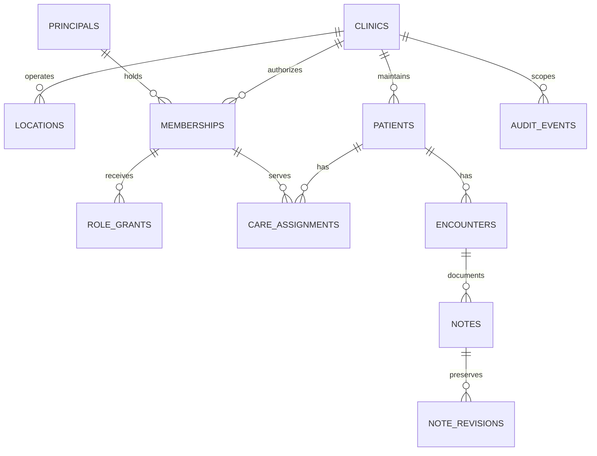

# Data Modeling

Home: [[00 Home]] · Product: [[SharePoint and EMR]] · Boundaries: [[Entity and Product Boundary]] · Tasks: [[Roadmap and Tasks]] · Review: [[Texas Diligence]]

## Purpose and approval boundary

**Proposal:** a PostgreSQL model for multiple independent clinics, with tenant isolation, limited access by job and care responsibility, and auditable access and changes. Requested by the founder on 2026-08-30. PostgreSQL is the modeling target for this note; shared hosting, vendors, product features, and production architecture are not approved by this document.

**No set of tables is inherently “HIPAA compliant.”** The Security Rule addresses administrative, physical, and technical safeguards, including risk analysis, authorization, integrity, and audit controls. This model supports that work; it is not a compliance certification, legal opinion, or clinical-readiness assessment. “Addressable” does not mean optional. [HHS Security Rule summary; S-09](https://www.hhs.gov/hipaa/for-professionals/security/laws-regulations/index.html).

All structures and examples below are proposed and contain no patient data. Real patient-data access, integration, migration, or deployment remains blocked by **L-05** and applicable professional/operational gates in [[Texas Diligence]]. SharePoint remains the intended starter EHR. Its actual workflow, security evidence, source documents, and migration mapping have not been reviewed. This note does not validate or replace that system.

The consultancy, future software entity, Kevin's clinic/physician services, and customer clinics remain separate. Equity, employment, mentorship, technical administration, or a software subscription confers no patient-record permission. The marketing site and this vault must never become clinical-data stores.

## Tenant boundary and architecture proposal

Use **one `clinic_id` per independently authorized record-custody boundary**, normally a customer clinic business. Model that clinic's physical offices as `locations`. Confirm the legal custody boundary before provisioning; a building, physician, parent company, or billing account alone does not define it.

The same clinician can have separate memberships at several clinics. The same person receiving care at two clinics has two separate patient records; no global patient index, automatic matching, chart merging, or implied sharing is proposed. Any later transfer must be a reviewed disclosure/import workflow with provenance and recipient authorization.

| Storage approach | Fit and tradeoff |
| --- | --- |
| Shared database and schema, with `clinic_id`, composite constraints, and row-level security (RLS) | Working model below. Simplifies common migrations; a database administrator or compromised privileged component can affect many clinics. Requires rigorous authorization testing and operational separation. |
| Separate database or cluster per clinic | Candidate when contracts, risk analysis, restore needs, or isolation requirements justify it. Adds provisioning/migration/recovery work. Shared administrators, services, and backups can still create shared risks. |

The shared model is a recommendation to evaluate, not an accepted deployment decision. Schema names organize permissions; schemas alone are not isolation. Keep consultancy CRM, software-company billing, and education products outside the clinical database and credential boundary. An `organization_id` may group business accounts but must never grant chart access.



Relationships in the diagram are conceptual; the composite keys below enforce clinic and patient consistency.

## Modeling conventions

- Tenant tables use `PRIMARY KEY (clinic_id, id)` with both columns `uuid NOT NULL`. Every tenant-to-tenant foreign key includes `clinic_id`. Add `patient_id` to composite references where two linked resources must belong to the same patient. Global random UUIDs do not substitute for these checks.
- Use `timestamptz` for instants, `date` for calendar dates, and a clinic IANA timezone for display. Use `numeric`, not floating point, for money/quantity; store currency and units explicitly. Unknown is nullable where justified, not zero or an invented date.
- Use explicit required fields, foreign keys, unique constraints, status checks, and version numbers. Index referencing foreign keys and actual clinic-scoped query paths. Do not put cross-table authorization or changing time conditions in `CHECK` constraints. [PostgreSQL constraints; S-16](https://www.postgresql.org/docs/18/ddl-constraints.html).
- Mutable records have `created_at`, `updated_at`, trusted creator/updater attribution, and an optimistic-lock version. Stable keys, clinic, patient, and historical authorship cannot be reassigned by ordinary update endpoints. Corrections need explicit workflows. No cascading deletion of charts, signatures, or audit evidence.
- Names, contact details, birth dates, MRNs, appointment data, clinical values, payment information, object references, and patient-linked UUIDs are sensitive. Separating demographics from clinical content improves permissions; it does not de-identify either table.
- `_enc bytea` means an application-produced authenticated-encryption envelope, including nonce/tag and a versioned payload format. `key_ref` identifies a managed key; it is not a key or secret. Bind clinic, resource ID, field purpose, and version as authenticated associated data to prevent ciphertext substitution. Define and validate the payload fields before implementation; do not accept arbitrary JSON as a chart.
- Encrypt storage, backups, replicas, and transport even when fields are encrypted. Keep decryption authorization separate from database credentials. Field encryption limits SQL search/reporting and requires tested key recovery and rotation. If exact MRN lookup is needed, a clinic-specific keyed lookup token is an optional index; plain hashes of names/dates are unsuitable and tokens remain sensitive. No cross-clinic lookup key. [PostgreSQL encryption options; S-20](https://www.postgresql.org/docs/18/encryption-options.html).

## Proposed table catalog

This is a logical catalog, not a commitment to implement every feature. Tenant tables use the composite key above; global catalogs, tenant roots, one-to-one extensions, and platform audit events have the explicitly described exceptions. `…_id` references are UUIDs; `…_at` values are `timestamptz`; statuses/codes are constrained `text`. Lists of grants/resources below mean normalized child rows, not unconstrained arrays containing clinical data. The SQL later implements only the core relationship examples.

### Identity and authorization

| Table | Main columns beyond common keys | Constraints and use |
| --- | --- | --- |
| `platform.organizations` (global) | `id`, `name`, `status` | Business grouping only; no inherited clinical permissions. Keep confidential agreements in approved controlled storage. |
| `platform.clinics` (tenant root) | `id`, optional `organization_id`, `name`, `record_custodian_ref`, `timezone`, `status` | Custodian is a controlled business reference, not an inferred legal conclusion. Suspension stops new access without destroying records. |
| `platform.locations` | `name`, `timezone`, `status` | Belongs to one clinic; permission can be narrower than all locations. |
| `identity.principals` (global) | `id`, `kind`, `issuer`, `subject`, `status` | `UNIQUE (issuer, subject)`; human and workload principals distinct. Identity-provider subjects, not passwords, MFA seeds, access tokens, or raw session cookies. No global patient identity here. |
| `identity.clinic_memberships` | `principal_id`, `status`, `valid_from`, `valid_until`, `revoked_at`, `approved_by_principal_id` | One membership per clinic/principal, with lifecycle changes audited. Disabling a membership invalidates all its grants. Prior memberships remain attributable. |
| `identity.clinician_credentials` | `membership_id`, `profession`, `credential_ref`, `reviewed_at`, `reviewer_id`, `valid_until`, `status` | Supports recorded scope verification for NP/APRN, PA, MD, and other roles. A database flag does not establish licensure or prescribing authority. |
| `authz.roles`, `authz.permissions`, `authz.role_permissions` (global catalogs) | Role/permission IDs and codes; role-to-permission pairs; `policy_version` | Versioned application permissions, distinct from PostgreSQL roles. No customer ability to edit the global catalog. |
| `authz.role_grants` | `membership_id`, `role_id`, optional `location_id`, `valid_from`, `expires_at`, `revoked_at`, `grantor_id`, `approval_ref` | Same-clinic membership/location FKs. No self-escalation; granting requires an allowed role ceiling and the required independent approval. |
| `authz.care_assignments` | `patient_id`, `membership_id`, `relationship_code`, `valid_from`, `valid_until`, `revoked_at`, `approved_by_id` | Same-clinic FKs. Records an approved care/coverage relationship; users cannot assign themselves to arbitrary patients. |
| `authz.access_exceptions` | `membership_id`, `patient_id`, `kind`, `purpose_code`, `reason_enc`, `approval_ref`, `starts_at`, `expires_at`, `revoked_at`, `reviewed_at` | Patient-scoped emergency/support exception with normalized allowed-action rows. No wildcard clinic access. No permission to alter policy or erase evidence. |

Membership, role, care-assignment, and exception tables are themselves protected. Ordinary chart endpoints cannot change them. Historical rows and decision events remain available after access is revoked.

### Patient care and record lifecycle

| Table | Main columns beyond common keys | Constraints and use |
| --- | --- | --- |
| `clinical.patients` | `status`, timestamps, `lock_version` | Local record anchor. UUIDs are not anonymization. Merge/link proposals require human reconciliation within a clinic. |
| `clinical.patient_demographics` | `patient_id`, `demographics_enc`, `payload_version`, `key_ref`, `lock_version` | One row per patient. Typed encrypted payload for names, birth date, contact/address, and local identifiers; avoid SSNs unless separately justified. Minimal registration projections only. |
| `clinical.appointments` | `patient_id`, `location_id`, `assigned_membership_id`, `starts_at`, `ends_at`, `status` | Same-clinic references; end after start. Do not expose visit reasons or detailed clinical notes to scheduling roles. |
| `clinical.encounters` | `patient_id`, `location_id`, `responsible_membership_id`, `started_at`, `ended_at`, `status` | Patient and provider membership remain in the same clinic. Professional scope checked separately. |
| `clinical.notes` | `patient_id`, `encounter_id`, `note_kind` | Composite FK includes patient and encounter. Stable identity for successive versions; patient/encounter cannot silently change. |
| `clinical.note_revisions` | `note_id`, `revision_no`, `prior_revision_no`, `body_enc`, `payload_version`, `key_ref`, `author_membership_id`, `created_at` | Unique note/revision; same-note predecessor. Append only. Draft revisions and signed content remain traceable. |
| `clinical.note_signatures` | `note_id`, `revision_no`, `signer_membership_id`, `signed_at`, `content_digest`, `attestation_version` | References an exact revision; signer verified from the session, not submitted author ID. Digest/attribution alone is not proof of legal signature sufficiency. |
| `clinical.conditions`, `clinical.allergies`, `clinical.medication_statements` | `patient_id`, optional `encounter_id`, code/system/version, status, clinically relevant typed values, author and effective times | Separate typed tables and revision/history rules. Medication statements record history; no e-prescribing or dispensing integration is authorized. Patient-linked codes are PHI. |
| `clinical.observations` | `patient_id`, optional `encounter_id`, code/system/version, `observed_at`, value type, numeric/text/coded value, unit, author | Enforce exactly the appropriate value type; record source/provenance. Clinical validation and terminology selection remain open. |
| `clinical.orders`, `clinical.results` | Patient/encounter, ordering membership, order type/status, result values and source | Candidate later module only; results reference the same clinic and patient as the order. External labs/prescribing require separate integration and clinical review. |
| `clinical.documents` | `patient_id`, optional `encounter_id`, opaque `object_key`, immutable `object_version`, media type, size, checksum, `key_ref`, `scan_status`, `retention_class` | Private approved object storage; no public URLs or names in keys. Pending/quarantined files cannot be downloaded. Object authorization must match database authorization. |
| `privacy.patient_directives` | `patient_id`, `directive_type`, `scope_code`, encrypted details, version, effective/expiry/revocation times, evidence document | Separate treatment consent, disclosure authorization, restrictions, and communication preferences. Do not reduce all lawful access to one `consent = true` flag. |
| `privacy.record_requests` | `patient_id`, `request_type`, requester verification reference, `received_at`, `due_at`, status, reviewer, resolution reference | Access, amendment, and other requests; due dates derived from reviewed applicable rules, not hard-coded guesses. Preserve amendment decisions and disagreement/addendum records. |
| `privacy.disclosures` | `patient_id`, recipient reference, purpose/lawful-basis code, authorization reference if applicable, `disclosed_at`, resource manifest reference, reviewer | Supports release tracking and any required accounting; an audit log alone is not an accounting-of-disclosures implementation. |
| `privacy.retention_policies`, `privacy.legal_holds`, `privacy.hold_resources` | Record class, approved retention rule/version, reviewer/effective date; hold authority/reference and resource links | Separate policy from calculated disposal eligibility; multiple holds can apply. No automatic hard delete merely because a user closes a record. |

Field-level release rules, restricted record categories, representative/minor access, terminology, signature requirements, and clinical amendment workflows need qualified review before those features are enabled. Patient-portal identities and delegated access are deliberately outside this initial staff model.

### Inventory and commercial boundary

| Table | Main columns beyond common keys | Constraints and use |
| --- | --- | --- |
| `inventory.items`, `inventory.lots` | Clinic SKU/name/unit/status; item reference, lot code, expiry | `UNIQUE (clinic_id, sku)`; lot belongs to the same clinic/item. Supplies, medications, devices, and equipment are not presumed interchangeable. |
| `inventory.purchase_orders`, `inventory.purchase_order_lines` | Supplier reference, status, currency, order timestamps; item, quantity, unit price, adjustments | Positive ordered quantities, exact amounts, same-clinic FKs, explicit currency. Approved procurement workflow required before placing orders. |
| `inventory.order_events` | Order reference, event type/version/time, source event ID, adjustment reference, recorded amounts | Append-only placed/cancelled/returned/credited history; unique clinic/source event for idempotency. Business event is not automatically a billable event. |
| `inventory.stock_movements` | Item/lot/location, signed quantity, movement/reversal type, source event ID | Append-only stock ledger; atomic posting and concurrency control, reversals rather than rewriting history. Balance is derived/reconciled. |
| `clinical.inventory_usage` (optional) | `patient_id`, `encounter_id`, stock movement reference, quantity, clinician | Put patient-to-stock linkage in the clinical boundary. Inventory staff and software billing cannot join to patients. Enable only after service/workflow review. |

The founder selected recurring fees based on **ordered inventory value**, not patient revenue. Preserve order events, but do not implement eligibility, rate, or billing-trigger calculations until T-14 resolves them. Any later software billing service receives only approved clinic/order-value fields, never charts or patient-level usage. Patient billing, payment credentials, card data, and the consultancy's finances are outside this schema proposal.

### Audit and delivery infrastructure

| Table | Main columns beyond common keys | Constraints and use |
| --- | --- | --- |
| `audit.events` | Event/request IDs, authenticated actor, membership, workload/session correlation, action/purpose, target references, outcome, policy/exception reference, trusted times | Append-only clinic event ledger; detailed behavior below. No chart payloads or credentials. |
| `audit.event_resources` | `event_id`, resource type/ID, patient reference where needed, revision/object version | Same-clinic event reference; records actual resources released, including paginated results. Treat as sensitive. |
| `audit.platform_events` (separate scope) | Event ID, known actor if any, request ID, event type/outcome, time | Authentication failures, platform operations, and unknown-tenant denials. Never use nullable `clinic_id` as a wildcard access policy in tenant tables. |
| `audit.delivery_receipts` | Event ID, destination receipt/checkpoint, attempt/result/time | Track archival delivery without modifying event contents. Unique destination/event deduplicates retries. |
| `ops.export_jobs` | Requester membership, purpose, resource scope/manifest, approval, status, expiry, destination reference | Same-clinic job. Reauthorize execution and every download, not only job submission. No unrestricted generic SQL/export endpoint. |
| `ops.integration_events` (future) | Source system, source ID/version, event type, processing status, reconciliation reference | Unique clinic/source/version; mapping and clinical reconciliation required before any SharePoint or external integration. No live integration authorized. |

## PostgreSQL core DDL examples

**Illustrative, incomplete SQL; not a production migration.** Uses PostgreSQL 18 documentation as the reference. Hosting version/extensions remain to be selected and patched. Role provisioning, API functions, authorization helpers, encryption, full catalog DDL, triggers, and all-table policies are not implemented here. There are no sample patient rows.

These tables illustrate tenant-safe references and appendable note history. Create them only in a future authorized synthetic environment under a dedicated owner; do not grant application access before the controls later in this note exist.

```sql
CREATE SCHEMA platform;
CREATE SCHEMA identity;
CREATE SCHEMA clinical;
CREATE SCHEMA audit;

CREATE TABLE platform.clinics (
    id uuid PRIMARY KEY DEFAULT gen_random_uuid(),
    name text NOT NULL,
    timezone text NOT NULL,
    status text NOT NULL CHECK (status IN ('active', 'suspended', 'closed'))
);

CREATE TABLE identity.principals (
    id uuid PRIMARY KEY DEFAULT gen_random_uuid(),
    kind text NOT NULL CHECK (kind IN ('human', 'workload')),
    issuer text NOT NULL,
    subject text NOT NULL,
    status text NOT NULL CHECK (status IN ('active', 'disabled')),
    UNIQUE (issuer, subject)
);

CREATE TABLE identity.clinic_memberships (
    clinic_id uuid NOT NULL REFERENCES platform.clinics(id),
    id uuid NOT NULL DEFAULT gen_random_uuid(),
    principal_id uuid NOT NULL REFERENCES identity.principals(id),
    status text NOT NULL CHECK (status IN ('active', 'suspended', 'revoked')),
    valid_from timestamptz NOT NULL,
    valid_until timestamptz,
    revoked_at timestamptz,
    PRIMARY KEY (clinic_id, id),
    UNIQUE (clinic_id, principal_id),
    CHECK (valid_until IS NULL OR valid_until > valid_from)
);

CREATE TABLE clinical.patients (
    clinic_id uuid NOT NULL REFERENCES platform.clinics(id),
    id uuid NOT NULL DEFAULT gen_random_uuid(),
    status text NOT NULL CHECK (status IN ('active', 'inactive')),
    created_at timestamptz NOT NULL DEFAULT now(),
    updated_at timestamptz NOT NULL DEFAULT now(),
    lock_version bigint NOT NULL DEFAULT 1 CHECK (lock_version > 0),
    PRIMARY KEY (clinic_id, id)
);

CREATE TABLE clinical.patient_demographics (
    clinic_id uuid NOT NULL,
    patient_id uuid NOT NULL,
    demographics_enc bytea NOT NULL,
    payload_version integer NOT NULL CHECK (payload_version > 0),
    key_ref text NOT NULL,
    lock_version bigint NOT NULL DEFAULT 1 CHECK (lock_version > 0),
    PRIMARY KEY (clinic_id, patient_id),
    FOREIGN KEY (clinic_id, patient_id)
        REFERENCES clinical.patients(clinic_id, id)
);

CREATE TABLE clinical.encounters (
    clinic_id uuid NOT NULL,
    id uuid NOT NULL DEFAULT gen_random_uuid(),
    patient_id uuid NOT NULL,
    responsible_membership_id uuid NOT NULL,
    started_at timestamptz NOT NULL,
    ended_at timestamptz,
    status text NOT NULL CHECK (status IN ('open', 'closed', 'entered_in_error')),
    PRIMARY KEY (clinic_id, id),
    UNIQUE (clinic_id, patient_id, id),
    FOREIGN KEY (clinic_id, patient_id)
        REFERENCES clinical.patients(clinic_id, id),
    FOREIGN KEY (clinic_id, responsible_membership_id)
        REFERENCES identity.clinic_memberships(clinic_id, id),
    CHECK (ended_at IS NULL OR ended_at >= started_at)
);

CREATE TABLE clinical.notes (
    clinic_id uuid NOT NULL,
    id uuid NOT NULL DEFAULT gen_random_uuid(),
    patient_id uuid NOT NULL,
    encounter_id uuid NOT NULL,
    note_kind text NOT NULL,
    PRIMARY KEY (clinic_id, id),
    FOREIGN KEY (clinic_id, patient_id, encounter_id)
        REFERENCES clinical.encounters(clinic_id, patient_id, id)
);

CREATE TABLE clinical.note_revisions (
    clinic_id uuid NOT NULL,
    id uuid NOT NULL DEFAULT gen_random_uuid(),
    note_id uuid NOT NULL,
    revision_no integer NOT NULL CHECK (revision_no > 0),
    prior_revision_no integer,
    body_enc bytea NOT NULL,
    payload_version integer NOT NULL CHECK (payload_version > 0),
    key_ref text NOT NULL,
    author_membership_id uuid NOT NULL,
    created_at timestamptz NOT NULL DEFAULT now(),
    PRIMARY KEY (clinic_id, id),
    UNIQUE (clinic_id, note_id, revision_no),
    FOREIGN KEY (clinic_id, note_id)
        REFERENCES clinical.notes(clinic_id, id),
    FOREIGN KEY (clinic_id, note_id, prior_revision_no)
        REFERENCES clinical.note_revisions(clinic_id, note_id, revision_no),
    FOREIGN KEY (clinic_id, author_membership_id)
        REFERENCES identity.clinic_memberships(clinic_id, id),
    CHECK ((revision_no = 1 AND prior_revision_no IS NULL)
        OR (revision_no > 1 AND prior_revision_no IS NOT NULL
            AND prior_revision_no = revision_no - 1))
);

CREATE INDEX encounters_patient_time
    ON clinical.encounters (clinic_id, patient_id, started_at DESC);
CREATE INDEX encounters_provider
    ON clinical.encounters (clinic_id, responsible_membership_id);
CREATE INDEX notes_encounter
    ON clinical.notes (clinic_id, patient_id, encounter_id);
CREATE INDEX revisions_author
    ON clinical.note_revisions (clinic_id, author_membership_id);
```

`patient_demographics` is a one-to-one extension and uses `(clinic_id, patient_id)` instead of a redundant `id`. Defaults do not maintain `updated_at`, enforce a state transition, check active employment, or verify authorship. Reviewed write functions must do that, increment `lock_version`, reject stale writes, and emit audit events atomically. Note/revision parent IDs are immutable. Serialize revisions per note and use the unique revision constraint to reject conflicting concurrent edits; never silently overwrite one author's work. Signing references an exact revision, and later amendments append new content while preserving the signed version.

## Access control proposal

Use **role-based permissions plus clinic, patient, purpose, time, and record restrictions**. Deny by default. For every operation, require an authenticated active principal, active clinic membership, a current permission, and the operation's resource scope. Clinical chart access additionally requires an approved care/coverage assignment or narrowly scoped exception. Registration and inventory have separate permissions; neither inherits chart access.

This is a proposed access policy, not a claim that HIPAA universally requires a care-team table. Minimum-necessary rules have exceptions, including disclosures to or requests by providers for treatment; this does not justify unrestricted internal browsing or agent access. [HHS minimum necessary guidance; S-11](https://www.hhs.gov/hipaa/for-professionals/privacy/guidance/minimum-necessary-requirement/index.html).

| Application role | Proposed allowed scope | Default restrictions |
| --- | --- | --- |
| Clinic access administrator | Invite/disable members; request bounded role grants; maintain clinic/location configuration | No chart access, self-elevation, or unrestricted role creation. Clinical/access-review grants require the appropriate separate approval. |
| Reception/scheduling | Register patients; minimal demographics/contact projections; appointment logistics in assigned clinic/location | No clinical notes, full directives, clinical results, signatures, or bulk exports. Patient search is permission-limited and audited. |
| NP/PA/MD clinician | Assigned/covering patients; chart read; permitted clinical entries and signing within verified scope | No automatic access to other clinics, employee administration, prescribing, or data export. Credentials and actual professional arrangements govern scope. |
| Clinical assistant/nurse | Assigned patient workflow and permitted observations/document preparation | No independent clinician signing or professional functions beyond verified scope. Distinct permissions per job. |
| Inventory operator | Items, lots, purchasing preparation, stock movements | No patient-linked usage, chart joins, role grants, or authority to place purchases without approved procurement scope. |
| Privacy/records officer | Scoped record requests, directives, disclosure processing, approved exports and audit investigation | Read access limited to assigned cases and purpose; cannot edit clinical facts or erase audit evidence. |
| Clinic security reviewer | Clinic audit metadata, access/grant review, incident investigation | No routine chart access; any needed record content uses a separately approved case. Audit reads/exports also audited. |
| Software support / consultancy personnel | Synthetic reproduction and operational health by default | No standing PHI access. Approved support exception only for a named clinic/patient/action/time, with appropriate agreements. No clinician impersonation. |
| Workload principal | One job-specific permission and explicit clinic scope, such as audited export delivery | No interactive login, role administration, cross-clinic batch credential, or inherited human authority. Capture both job actor and requesting human. |

Roles may be combined only after approved review; role accumulation must not bypass record restrictions. Provider coverage must be clinically workable and explicitly assigned. Kevin's mentorship role does not create a care relationship.

### Trusted identity and request context

Do not trust a browser's `clinic_id`, user ID, role list, object key, or `SET app.clinic_id` value. A custom PostgreSQL session setting is writable by the connected role; it is not proof of identity. RLS with a freely replaceable tenant setting only guards against some application mistakes.

Proposed stronger boundary:

1. An approved identity provider authenticates each human using individual accounts and MFA. An authorization component independently verifies the login and current grants, then issues a short-lived, audience-bound request capability for one principal, clinic, request, purpose, allowed actions/resources, and expiry. Its signing key is inaccessible to the SQL-serving process and database connection role. No authorization is inferred from email-domain membership.
2. The application connects through a private authenticated channel as `app_connection`, which has only `EXECUTE` on named API functions. Each entry function validates the capability through a reviewed verifier: issuer, pinned algorithm/keys, audience, signature, expiry, replay protection, resource bounds, and current membership/revocation state. A caller-supplied ID must match this authority.
3. The verifier binds a single immutable context to the current transaction in protected storage, for example keyed by backend identity plus full transaction ID. The caller cannot insert/update that storage or substitute identity by changing session settings. `authz.current_clinic_id()` and `authz.allowed(...)` below read only this verified context and protected policy data, never raw client claims. `current_user` inside a definer function is a database role, not the human actor.
4. Begin a fresh transaction per request; reject missing, expired, conflicting, or reused contexts; clear transaction state on commit/rollback and pool reuse. Check revocation on every new transaction and again before sensitive release. Bound transaction duration and cancel active sessions/jobs where immediate revocation is required; an old snapshot must not silently retain authority.
5. The API returns only permitted columns/fields and records access before releasing data. Background jobs, cached responses, object downloads, and exports follow the same clinic and resource authorization. No public database or generic SQL endpoint.

**The verifier, capability issuer, revocation protocol, and pooling behavior are required design work, not implemented helpers.** If they cannot be implemented and independently tested, do not deploy this shared access model. Never replace them with a function that accepts arbitrary actor/tenant IDs. Capabilities are bearer credentials: do not put them in logs, URLs, diagnostics, or audit payloads.

### PostgreSQL roles and RLS

| PostgreSQL role | Required boundary |
| --- | --- |
| `data_owner` | `NOLOGIN`, owns tables/policies; not available to app/support credentials. Migration access is separately approved and audited. |
| `app_connection` | Login/workload authentication only; no table DML, schema creation, ownership, role creation, `BYPASSRLS`, or membership permitting `SET ROLE` to an executor/owner. Named API function execution only. |
| `clinical_executor` | `NOLOGIN`, non-owner, `NOBYPASSRLS`; owns narrowly scoped clinical API functions and receives only needed table/column privileges under RLS. Separate executors for access administration, inventory, and audit operations. |
| Audit writer / reviewer / archive worker | Distinct credentials and grants for append, scoped review, and delivery; none can erase audit events. Archive administration is separate from application/database administration. |
| Migration / recovery administrator | Short-lived privileged access with recorded approval, independent logging, and no normal application use. Restore access covers all affected tenants and must be protected accordingly. |

Enable and force RLS on every tenant table, including authorization, inventory, jobs, audit-resource tables, and directly accessible partitions. Root/global tables need explicit restricted access too. RLS does not stop superusers or `BYPASSRLS`, and operations such as `TRUNCATE` are outside row policies. Do not grant these powers to runtime roles. [PostgreSQL row security; S-13](https://www.postgresql.org/docs/18/ddl-rowsecurity.html).

The following **policy fragment** depends on the unimplemented trusted helpers above. `authz.allowed(action, clinic_id, patient_id)` must check current permission, patient/purpose scope, active membership, exceptions, and overriding restrictions. It must fail closed and avoid recursive queries through its own RLS policies.

```sql
ALTER TABLE clinical.patient_demographics ENABLE ROW LEVEL SECURITY;
ALTER TABLE clinical.patient_demographics FORCE ROW LEVEL SECURITY;

-- A restrictive boundary remains AND-ed with all applicable allow policies.
CREATE POLICY demographics_clinic_boundary
ON clinical.patient_demographics AS RESTRICTIVE
FOR ALL TO clinical_executor
USING (clinic_id = authz.current_clinic_id())
WITH CHECK (clinic_id = authz.current_clinic_id());

CREATE POLICY demographics_read
ON clinical.patient_demographics FOR SELECT TO clinical_executor
USING (authz.allowed('demographics.read', clinic_id, patient_id));

CREATE POLICY demographics_insert
ON clinical.patient_demographics FOR INSERT TO clinical_executor
WITH CHECK (authz.allowed('demographics.create', clinic_id, patient_id));

CREATE POLICY demographics_update
ON clinical.patient_demographics FOR UPDATE TO clinical_executor
USING (authz.allowed('demographics.update', clinic_id, patient_id))
WITH CHECK (authz.allowed('demographics.update', clinic_id, patient_id));

-- No DELETE policy or grant. Only the bounded executor receives these grants.
GRANT SELECT, INSERT ON clinical.patient_demographics TO clinical_executor;
GRANT UPDATE (demographics_enc, payload_version, key_ref, lock_version)
    ON clinical.patient_demographics TO clinical_executor;
```

`USING` filters existing rows; `WITH CHECK` validates inserted/updated rows. Restrictive policies narrow access but need applicable permissive policies. Test `RETURNING`, upserts, joins, and update/read permission combinations; separate permissive policies combine with OR. This fragment is not an all-table policy generator. [PostgreSQL CREATE POLICY; S-14](https://www.postgresql.org/docs/18/sql-createpolicy.html).

Secure every definer function: fixed `search_path` such as `pg_catalog, authz, pg_temp`, with only trusted schemas and fully qualified relations; static parameterized SQL; minimal non-owner privileges; revoke `PUBLIC` execution and grant only intended callers within the creation transaction. Revoke unneeded database/schema privileges and set restrictive default privileges for each object-creating role. Callers must not be able to replace helpers or disable triggers/policies. [PostgreSQL function security; S-15](https://www.postgresql.org/docs/18/sql-createfunction.html).

RLS limits rows, not fields. API projections and decrypt permissions enforce the role matrix. Any internal views must preserve the intended caller/RLS behavior; `security_invoker = true` uses the invoker's underlying privileges and policies, while ordinary views can use the owner's. Avoid owner-bypassing views and report/materialized-view endpoints that expose other clinics. [PostgreSQL CREATE VIEW; S-21](https://www.postgresql.org/docs/18/sql-createview.html).

Tenant-scoped constraints reduce accidental cross-clinic links but constraint errors can still reveal existence. Return generic unauthorized/not-found responses without raw database errors. Index and rate-limit authorized searches. Do not expose arbitrary filter expressions, query plans, row counts, or caches that bypass resource checks.

### Emergency access, support, and revocation

“Break glass” is a separate, expiring patient-scope exception for an authenticated clinician already authorized at that clinic. Require step-up authentication, a recorded reason, explicit actions, and an immediate audit/alert. It can override the ordinary care-assignment requirement only where the reviewed emergency policy permits; it cannot bypass tenant boundaries, all sensitive-record restrictions, or professional scope. An emergency may use post-event review rather than waiting for prior approval, but the workflow must be clinically reviewed before launch.

Support access is not an emergency: require approval from the authorized clinic representative, permitted contractual purpose, named personnel, minimal patient/resource scope, expiry, and logged start/end. Prefer synthetic troubleshooting. Never grant blanket cross-clinic support access or share clinician sessions. Revoke membership/grants promptly on departure or scope change, invalidate sessions/capabilities, cancel pending jobs, and reauthorize any cached/exported access. Review grant conflicts and emergency/support use at an agreed cadence; none is scheduled by this note.

## Auditing design

### What an event records

Record successful and denied chart/demographic access, searches, edits, signing/amendments, printing/export/download, directives/disclosures, grant changes, emergency/support access, authentication/security events, and administrative/database changes. Record patient/resource references for actual returned resources; a query string and total count alone cannot reconstruct whose records were released. Do not claim the user read a screen merely because a response was prepared.

```sql
CREATE TABLE audit.events (
    clinic_id uuid NOT NULL,
    id uuid NOT NULL DEFAULT gen_random_uuid(),
    request_id uuid NOT NULL,
    actor_principal_id uuid NOT NULL,
    actor_membership_id uuid,
    executing_workload_id uuid,
    session_ref uuid NOT NULL,
    action text NOT NULL,
    purpose_code text NOT NULL,
    resource_type text NOT NULL,
    resource_id uuid,
    patient_id uuid,
    outcome text NOT NULL CHECK (outcome IN
        ('attempted', 'denied', 'prepared', 'committed', 'released', 'failed')),
    reason_code text,
    policy_version text NOT NULL,
    access_exception_id uuid,
    occurred_at timestamptz NOT NULL,
    recorded_at timestamptz NOT NULL DEFAULT clock_timestamp(),
    PRIMARY KEY (clinic_id, id)
);
CREATE INDEX audit_clinic_time
    ON audit.events (clinic_id, recorded_at DESC, id);
CREATE INDEX audit_patient_time
    ON audit.events (clinic_id, patient_id, recorded_at DESC);
CREATE INDEX audit_request ON audit.events (clinic_id, request_id);
```

This fragment intentionally does not attach cascading FKs to operational records: evidence must survive account/record lifecycle changes and failed target lookups. The protected event writer must validate actual clinic, authenticated actor, request context, allowed action/resource types, and outcome. It cannot accept an arbitrary client-written event as trusted evidence. Unknown identity/tenant failures go to `audit.platform_events`; distinguish authenticated identity from unverified claims. Add normalized event-resource rows and old/new revision IDs or changed-field names without copying values. Network/device evidence, if justified, belongs in restricted security records with its own retention policy.

No full notes, names, birth dates, raw search strings, request/response bodies, SQL bind values, credentials, capability tokens, or before/after PHI JSON blobs in audit events. UUID references and clinical access patterns can themselves be PHI; logs, review tools, and archives require equivalent protection and authorized service coverage.

### Capture, durability, and tamper resistance

| Layer | Required proposed behavior |
| --- | --- |
| Application/API | Authenticate and authorize every resource release; durably record read/search/export access, including cache hits and object downloads. Capture denies before returning the failure. Track prepared/released/delivery-failed states separately where observable. |
| Database changes | Reviewed write functions/triggers append mutation events and revisions in the same transaction as the change. Audit failure aborts the write. Ordinary executors get no update/delete/truncate permission on immutable history/events. Reject prohibited edits even through alternate endpoints. |
| Failed/rolled-back activity | Emit attempt and failure evidence to an independent durable security sink outside the business transaction. Transactional audit inserts roll back too; they cannot be the sole evidence of denied or failed attempts. Correlate request, workload, DB session, and transaction. |
| Database administration | Evaluate pgAudit plus platform/connection logging for SELECT, DML, DDL, privilege/policy changes, privileged sessions, and bulk operations. Correlate with application identity; a shared DB login alone does not identify the human. |
| Immutable archive | Ship committed events and independent security logs to encrypted, retention-locked storage in a separately controlled security account/domain. Use immutable event IDs, idempotent delivery, receipts/checkpoints, monitored gaps/lag, and restricted audited reader access. |

PostgreSQL row triggers do not fire on `SELECT`. pgAudit can supply statement/object activity but does not replace patient-resource access events, and its documentation warns that superusers cannot be reliably audited by pgAudit alone. [PostgreSQL triggers; S-17](https://www.postgresql.org/docs/18/sql-createtrigger.html), [pgAudit; S-18](https://github.com/pgaudit/pgaudit).

For ordinary reads, persist the access event and resource manifest before releasing PHI; if durable capture fails, deny the release. For writes, require committed audit evidence before acknowledging success. If archive delivery is temporarily unavailable, retain events in a durable protected queue, alert, and enforce the approved backlog/availability limit. Never silently drop events or claim exactly-once transport; deduplicate retries by event ID. Emergency downtime procedures must be approved clinically, with accountable reconciliation rather than an undocumented logging bypass.

Append-only grants/triggers do not defeat a superuser or owner. A hash chain in the same database can be rewritten with the data. Independent immutable copies, externally protected checkpoints/signatures if used, restricted privilege escalation, and separation of administrators provide tamper evidence. Protect signing keys outside the database; test archive verification and recovery. Do not claim tamper-proof storage.

Use a pgAudit version matching the selected PostgreSQL major version and verified host support. Proposed logging configuration keeps `pgaudit.log_parameter` off and evaluates disabling statement text (`pgaudit.log_statement`) where it could disclose literals/tokens; retain operation/object metadata and application correlations. Review all PostgreSQL error/slow-query/bind logging, ORM diagnostics, proxy logs, traces, crash reports, and observability destinations. A parameter-logging switch alone does not remove PHI in SQL literals or error details. [pgAudit settings; S-18](https://github.com/pgaudit/pgaudit), [PostgreSQL logging; S-19](https://www.postgresql.org/docs/18/runtime-config-logging.html).

### Review and retention

Before go-live, name the clinic privacy/security reviewers and software incident responders, agree review cadence and response expectations, and test alerts for repeated cross-clinic denials, unusual chart browsing, bulk releases, emergency/support grants, privilege changes, disabled logging, delivery gaps, and failed restores. Audit the reviewers' own searches and exports. Alert notifications contain only minimal operational references, not patient details. No monitoring service or recurring automation is created here.

Maintain separate retention classes for clinical records, audit/security logs, authorization/disclosure records, operational queues, and backups. HHS describes six years from creation or last effective date, whichever is later, for required Security Rule documentation; that is not a universal patient-record or all-log retention period. The HIPAA Privacy Rule does not set a general medical-record retention period. Resolve Texas/profession/service-specific retention, contracts, and legal holds with the responsible reviewers before configuring deletion. [HHS Security Rule summary; S-09](https://www.hhs.gov/hipaa/for-professionals/security/laws-regulations/index.html), [HHS record-retention FAQ; S-12](https://www.hhs.gov/hipaa/for-professionals/faq/580/does-hipaa-require-covered-entities-to-keep-medical-records-for-any-period/index.html).

Offboarding is a controlled export, handoff, access revocation, and eventual disposal process. Test complete clinic-scoped export and restoration without exposing other clinics. Holds override ordinary disposal; include object versions, replicas, caches, keys, logs, and backup expiry in the plan. A soft-delete flag does not establish compliant disposal, and destroying a shared encryption key can destroy other clinics' records or held evidence.

## Evidence required before implementation and patient use

These are design acceptance criteria under T-13/T-09 and L-05, not completed tasks or a second status register. Specific owners, budgets, time limits, retention periods, RPO/RTO, vendors, and dates remain unassigned unless subsequently agreed.

| Evidence area | Required next evidence |
| --- | --- |
| Entity and service boundary | Approved record custodian, permitted purposes, clinic/software/consultancy/subcontractor responsibilities, support limits, and actual service/data-flow inventory. |
| Agreements and infrastructure | Applicable BAAs for the exact database, object storage, backup, logging, support, and other services/configurations. A cloud provider holding only encrypted ePHI can still be a business associate; encryption does not remove this review. [HHS cloud guidance; S-10](https://www.hhs.gov/hipaa/for-professionals/special-topics/health-information-technology/cloud-computing/index.html). |
| Risk and operations | Documented risk analysis and tested controls: private network paths, TLS certificate verification, MFA, individual access, least privilege, managed secrets/keys, tenant isolation, secure endpoints, patching, incident response, and recovery. These are proposed project controls, not a claim that every implementation is universally mandated verbatim. |
| Clinical scope and continuity | Authorized synthetic walkthrough, NP/PA/physician scope and coverage review, record categories, signatures/amendments, orders/results if included, downtime procedures, and patient-rights workflows. |
| State/federal applicability | Qualified review of HIPAA applicability, Texas Medical Records Privacy Act, record restrictions and deadlines, and other service-specific law. Cash-pay does not establish exemption. [Texas AG patient privacy; S-06 rechecked](https://www.texasattorneygeneral.gov/consumer-protection/health-care/patient-privacy). |
| Effective rules | HHS's reviewed rulemaking page describes the Security Rule changes as proposed and says the current rule remains effective. Recheck controlling law/effective dates before deployment; do not present proposed requirements as enacted law. [HHS rulemaking; S-22](https://www.hhs.gov/hipaa/for-professionals/security/hipaa-security-rule-nprm/index.html). |
| Migration | Authorized source inventory, mapping, provenance, counts/reconciliation, duplicate handling, signed-history preservation, cutover, rollback and clinical acceptance. No SharePoint mapping is inferred from this proposal. |

### Required synthetic acceptance scenarios

| Scenario | Expected evidence |
| --- | --- |
| Clinic A user requests Clinic B patient, including guessed valid UUID | Denied without confirming existence; no patient content in response/error/log; denial evidence captured. |
| Cross-clinic FK or note linked to a different patient in the same clinic | Database rejects the invalid relationship; API cannot move immutable clinic/patient keys. |
| Same clinician belongs to two clinics | A request is scoped to exactly one; no combined chart/query/export without separate authorizations. |
| Missing/forged/expired/replayed capability, caller-set GUC, pooled connection reused | No access; identity cannot be rebound or leaked between transactions. Test concurrency and prepared statements. |
| Reception, inventory, access admin, developer, or mentor requests a chart | Denied unless a separately approved clinical/case permission applies; response fields and decryption obey the matrix. |
| Self-grant, unauthorized care assignment, expired support or emergency access | Rejected and audited; narrow approved emergency access works and triggers review. |
| Membership revoked during active work or while an export is queued | New requests fail; sensitive release rechecks authority; active cancellation behavior and revocation latency demonstrated. |
| Concurrent edits, signed-note alteration, revision chain tampering | No lost update or silent overwrite; immutable signed revision remains, authorized amendment is attributable. |
| Read/search/cache hit/download/export/print versus mutation | Actual released-resource manifest recorded, with actor and purpose; no unsupported claim that a human viewed it. |
| Read audit failure, failed SQL, rollback, archive outage, duplicate deliveries | No unaudited release/acknowledged write; independent failed-attempt evidence survives rollback; durable retries and gap alerts demonstrated. |
| Ordinary role versus owner/superuser, definer function, view, direct partition, bulk operation | Runtime cannot bypass policy; privileged paths require separate controls and produce independent evidence. |
| Backup restore, clinic export, key rotation, hold and offboarding | Completeness and isolation proven; recovery times measured; no data loss from key/retention changes or other-clinic exposure. |
| Object-key substitution and hostile upload | Same tenant/patient authorization enforced; quarantine and private retrieval work; no public object exposure. |

## Review record and limitations

Prepared 2026-08-30 after personally reviewing all **21 existing Markdown notes and 5 JSON configuration files** in the vault. The local wiki-link baseline had 169 links, no missing note/heading targets, and every note reachable from Home. The mentorship note is now present; D-019 explains older ownership/pricing records. No missing external MD/governance/security original was treated as reviewed.

Official HHS, Texas AG, PostgreSQL, and pgAudit references were accessed on 2026-08-30 and registered in [[Source Register]]. Source-supported technical/legal background is distinguished from the proposed schema and policy choices above. SQL is an illustrative subset, not executed or security-tested; no database, credentials, patient data, cloud resources, integration, or deployment was created. All live-data and professional gates remain open.
