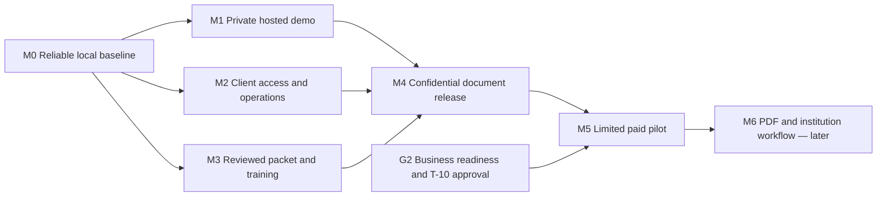

# Roadmap and Tasks

Home: [[00 Home]] · Index: [[01 Table of Contents]] · Developer handoff: [[CICD]] · Decisions: [[Decisions]] · Changes: [[Progress Log]]

## Current developer handoff — 2026-08-31

Start with [[CICD]] for setup/checks and [[Software Architecture]] for code ownership. Local source is the completed React/Vite frontend plus Rails API/PostgreSQL split (T-40), with shared exact-unit inventory, receipts, holds and counts (T-34/T-38). The founder removed retired `reference/`; no code/workflow depends on it. Root `.gitignore` supplies shared local-artifact exclusions. [[01 Table of Contents]] routes task-specific review; the former full-vault reading requirement is replaced, not the safety/release gates.

T-22/M0 still needs current-frontend browser/accessibility acceptance and observed remote CI. T-38 owns hosted PostgreSQL cutover and paired service/SSM installation; delivery activation is distinct from CI checks. T-20/M1 retains operational/recovery acceptance. Last recorded hosted verification is 2026-08-30 on SQLite, not a fresh host observation. No implementation milestone or professional gate is closed by this documentation review. The dated baselines below remain historical; use the current task register for status.

## Rules

This is the canonical task register. Future work requires an accepted owner and scope; founder-confirmed direction is recorded in [[Decisions]]. D-020 authorized the consultancy website; D-024/D-025 authorized the local launch and clinic experiences; D-033 now separates their browser UI from the Rails API. T-28/T-29 track migration and the synthetic clinic prototype. Production clinical release, budgets, dates, outreach and professional engagements remain uncommitted. The MD's source materials are expected on 2026-08-31 morning; this is not a deadline or automated follow-up. Further general business questions are deferred while the website moves forward. The founder subsequently requested a focused pharmacy provider/counsel discussion guide; T-35 records that delivery and T-36 the proposed follow-up, without reopening settled direction or assigning a meeting.

The founder expressed no deadline pressure. Use dependencies and readiness evidence rather than an arbitrary 90-day calendar. Packet planning and remaining business decisions can proceed while the existing materials are unavailable.

The subsequent backend documentation request is recorded as T-18. [[Data Modeling]] is a PostgreSQL proposal; it does not close T-13, select hosting, authorize a build, or pass L-05.

D-021/D-022 authorize [[Client Portal]]. D-025 adds the separately presented [[Clinic Workspace]]; D-033 now puts both experiences in `apps/web` with shared backend authority in `apps/api`. This synthetic prototype does not approve the complete clinical model in T-18, PHI or production sharing. T-20 remains hosting, not clinical release.

Statuses: backlog, ready, in progress, awaiting input, blocked, done. “Done” requires a linked deliverable or recorded result. Blocked items name the dependency and next action. Unknown owners/dates stay unassigned / TBD.

## Milestones and evidence gates — proposed

| Gate | Outcome | Evidence required to pass |
| --- | --- | --- |
| G0 — Agreed foundation | We know what we are trying to sell and to whom | NP/PA, Sherman/North Texas, done-for-you/support, Kevin's role, formation stages, ownership facts, and ordered-inventory-value pricing basis recorded; resolve remaining valuation/rate rules, support/cost terms, governance details, budget, and capacity when the commitment needs them |
| G1 — Grounded offer and packet | A specific launch package is worth testing | Existing MD materials indexed; packet mapped with transfer limits; specific local prospects/needs; scope and cost/price hypothesis; review needs identified |
| G2 — Ready for a paid pilot | We can responsibly deliver the agreed scope | Applicable professional review, contract/scope, accepted owner/capacity, measurable outcome, and data boundary; unresolved blocking issues closed or scope narrowed |
| G3 — Repeatable delivery / product investment | We can scale the launch package and plan the separate software product responsibly | Actual paid delivery results, labor/rework/costs by entity, approved reusable packet, product requirements/economics, and scoped migration/investment decision |

Passing a company milestone is not a clinical go-live authorization. Customer clinics need their own applicable readiness evidence and responsible professionals.

## Development plan — proposed 2026-08-30

**Recommended sequence:** finish a reliable, operable consultancy portal before adding document-delivery automation. Keep the separate EHR/inventory product on its own discovery and approval path. This plan responds to the founder's current vault/code review request; it is not acceptance of new implementation, spending, public release, or patient-data access.

The G0–G3 gates above concern the business. The M0–M6 milestones below concern software delivery; G0 is not a prerequisite to safe local website work. All new milestones remain **proposed and unpassed**. T-16/T-19 describe delivered prototype work, not production readiness. Owners remain unassigned and dates TBD; no estimates assume unknown capacity.

**Current refinement:** D-033 supersedes the Rails-rendered-UI choice from D-024/D-025/D-032. `apps/web` owns the independent React frontend; `apps/api` owns Rails JSON and the established domain boundaries. T-28/T-29/T-39 preserve prior delivery history; T-40 records the frontend/API split. The clinic prototype remains synthetic and production-disabled. The baseline below is historical evidence, not a current architecture prescription.

### Reviewed baseline

| Area | Direct observation / evidence | Planning consequence |
| --- | --- | --- |
| Vault | All 23 Markdown notes and 5 JSON configurations reviewed, including concurrent updates. All 208 baseline wiki links resolve; all notes are reachable from Home | No missing local note blocks planning. The old missing mentorship note exists; D-019 explains earlier ownership/pricing discrepancies. Obsidian still has stale `Welcome.md` UI references and Sync enabled; preserve settings and do not infer approved synchronization |
| Product boundary | D-021/D-022 and current code implement Contact, provisioned login, paperwork and training; no public signup or EHR | Extend the existing portal; do not import the clinical PostgreSQL proposal into it |
| Code | Separate `site/` Git repository; reviewed base `c063938` plus existing uncommitted local-demo changes. Vinext/React frontend, Rails 8.1.3.1 service, SQLite, npm and Bundler lockfiles | Preserve both repositories and local edits. These runtime choices describe this portal only |
| Existing protection | Account-scoped paperwork, session revocation, origin/CSRF checks, encrypted inquiry/document fields, server-enforced demo signing, guarded local demo access | Useful foundation, but no production security or signature-sufficiency conclusion |
| Deployment | Vault records an owner-only Sites frontend and no deployed Rails backend; current hosted state was not independently rechecked in this review | Online contact/login and client access need a separately approved Rails host and end-to-end release verification |
| Verification | Five frontend tests, typecheck, frontend lint, Rails lint and Brakeman pass. Rails passes 26 tests / 214 assertions on a fresh schema-only scratch database | Build, browser interaction, container, hosted flows and dependency audits were not rerun in this review; prior results stay historical |
| Reproducibility gap | `db:prepare test` on a fresh scratch database seeds three guides and fails two list assertions; `db:schema:load test` on a second fresh database passes | Fix/document deterministic test setup; do not report all initialization paths green |
| Automation gap | Only `backend/.github/workflows/ci.yml` exists; its commands assume Rails at the repository root, and it has no frontend jobs | Wire checks at the actual site repository root or another approved CI service. GitHub requires repository-root `.github/workflows`; S-23 in [[Source Register]] supports this limited finding |
| Workflow gaps | Provision/reset are interactive tasks; no activation/reset delivery, content-management flow, durable activity audit, real signing, PDF or submission pipeline | Build the smallest operator workflow and approved record lifecycle before real-client release |
| Evidence gaps | Actual MD packet, reuse permission, governance and SharePoint/security originals remain absent | These block dependent content, commercial or clinical conclusions, not M0 local engineering |

**Later repository-layout correction, 2026-08-30:** D-023 replaces the separate-repository arrangement described in the historical baseline above. `site/` is now an ordinary folder in APPly; future GitHub CI belongs at APPly's root `.github/workflows/`, with explicit `site/` and `site/backend/` working directories. This Git repair does not complete T-22 or change application/runtime behavior. See [[Progress Log#2026-08-30 — Site moved into the main Git repository]].

**CI repair and team guide, 2026-08-30:** [[CICD]] documents local development, independent branches/databases, CI and the proposed release process. The local workflow now lives at APPly's root `.github/workflows/ci.yml`, with explicit Rails/Ruby working directories, corrected cache paths, SQLite installation and fresh synthetic test setup. It runs checks only; no image publication or AWS deployment is configured. Push and observe the GitHub run before accepting the remote-CI criterion; T-22/M0 remains open. Historical baseline findings above are preserved.

**D-030 environment setup, 2026-08-30:** separate private staging and production containers are running with independent data/keys; production sample content is disabled. Root delivery workflows and scoped OIDC/SSM configuration are prepared locally, but GitHub login/settings/role activation, commit/push and observed runs remain outstanding. Public HTTPS needs domain/DNS configuration. [[CICD]] supersedes the earlier delivery-proposed guide; no clinical/confidential release gate is passed.

**Database dependency, updated by D-031:** local PostgreSQL conversion, inventory controls, CI service, container verification and synthetic migration/restore rehearsal now pass under T-38. The hosted maintenance cutover remains pending. Previously, the checkout changed to PostgreSQL while hosted verification was in progress. The incompatible candidate was rejected; both hosts retain the verified SQLite release. T-20/T-22 require reconciliation of CI, host database configuration and migration/recovery testing before delivery activation from that newer source. No concurrent database changes were reverted or treated as a completed hosted migration.

T-28 corrected the earlier unsupported “opened the doors” copy to “worked through the setup,” preserving the unknown opening/first-patient status in [[MD Pilot]]. Final copy approval remains open.

### Dependencies and scope

M2 engineering and M3 source review can proceed while M1 hosting is unresolved. M3 source inventory/review may start as soon as authorized materials arrive; its M0 dependency concerns the portal implementation, not reading those sources. Until approved services and data handling exist, use wholly synthetic records; keep confidential originals in controlled storage outside this vault/prototype. An unavailable source leaves its branch awaiting input rather than stopping all development.

### M0 — Reliable local baseline

**Outcome:** a reproducible developer handoff with a clearly bounded demo. **Work:** T-22; preserve T-16/T-19 delivery history. **Entry:** current checkout and synthetic fixtures; no new business answers required.

Exit criteria:

- A clean checkout reproduces Rails API tests, frontend tests/typecheck/build, lint and static checks using the Bundler/npm lockfiles and documented runtime versions. D-033 reintroduces an independent JavaScript frontend after T-28. Test initialization uses explicitly isolated synthetic databases and handles the sample-seed conflict without touching development/client records; verification cleanup names only its own generated scratch database.
- CI is configured for the actual repository layout, covers the Rails API and independent frontend, and has an observed successful run in an approved service. If no remote CI is available, local reproducibility may pass but the CI criterion stays open.
- The ordinary and local-demo paths pass separate regressions: authentication, CSRF/origin denial, cross-account denial, admin denial, stale/double signing, training progress, expiry/revocation and backend outage. The demo shortcut is absent/denied in production, including with its flag accidentally set.
- Browser QA is explicitly scoped before execution and records desktop/mobile and keyboard outcomes for login → paperwork → training → logout, Contact, reload/back navigation, empty/error states and expired sessions. A working build alone does not satisfy this criterion.
- Current documentation matches the demo; the unsupported opening claim is corrected or evidenced. The review records no unresolved defect that exposes another account, loses saved work, falsely reports success, or blocks a primary flow.

**Evidence to close:** reproducible commands/runtime versions, CI result, test/QA matrix, defect dispositions and reviewed code version. **Proposed acceptance roles:** engineering owner and founder/product reviewer; names not yet assigned.

### M1 — Private hosted demo with recoverable storage

**Outcome:** Rails selling/onboarding works online using synthetic accounts only; clinic release remains a separate authorization. **Work:** T-20. **Entry:** M0 and an approved hosting/data-flow choice; the local password-free shortcut is not the hosted login strategy.

Exit criteria:

- The chosen Ruby host runs a verified production artifact/container. Configure exact HTTPS origins, protected secrets and persistent storage; no development keys, database or flag enter the artifact. Retain a single service instance/process-local-limit constraint until a reviewed scaling design replaces it.
- Test the actual HTTPS → Rails path for login/session/logout, demo paperwork, training and Contact/inbox. Verify Secure/HttpOnly/SameSite cookies, host/origin/CSRF rejection, direct-backend exposure, caching and logs. No unauthorized account receives content.
- Correct proxy trust and abuse controls are tested: abusive traffic is limited without one user's requests consuming every legitimate client's allowance. Document where limits live and what restart/scaling does to them.
- A restart/redeploy preserves synthetic records. Restore encrypted data with the matching protected keys into an isolated environment and verify it is usable. Agree recovery-time and acceptable-data-loss targets before the exercise and record measured results against them.
- Prove rollback/recovery from a failed release; define operator, health/error alerts and escalation. Keep owner-only access unless a specifically reviewed audience change is authorized. This gate grants no real-client storage permission.

**Evidence to close:** hosted synthetic acceptance record, runtime/configuration checklist without secret values, restore/rollback results and operator runbook. **Proposed acceptance roles:** engineering and operations/security reviewers.

### M2 — Client access and contact operations

**Outcome:** an operator can admit and support a paid client without ad hoc account repair. **Work:** T-23 and remaining T-17. **Entry:** M0 for synthetic development; M1 for hosted verification.

Exit criteria:

- Document who confirms payment and authorizes access. Payment may remain manual; no checkout or inventory billing is required. Preserve no public signup. Provisioning is atomic/idempotent or has tested recovery from partial failure; the operator can assign the intended content without editing production tables manually.
- Implement and test an approved activation/recovery method, preferably expiring single-use links allowing the client to set their password. Secure assisted delivery is an explicit alternative, with identity verification and expiry/change rules documented. No default password or secret appears in logs, URLs beyond approved one-use tokens, the vault or support messages.
- Exercise duplicate provisioning, expired/reused activation, failed delivery, lost access, password reset, deactivation and session revocation. Define least-privilege operator roles and record the MFA/step-up requirement before confidential access; verify the selected controls at M4.
- Keep one individual account as the initial access boundary. Confirm whether the first engagement needs multiple people; if so, model engagement membership/permissions and test two-client isolation before release. Never solve collaboration with a shared password or the EHR schema.
- Contact has approved notice/retention handling, a named response owner and a tested inbox review/response process. Test persistence failure and uncertain retries without false “received” claims or uncontrolled duplicates. Notifications are optional; no automatic email is presumed.

**Evidence to close:** synthetic operator/client walkthrough and access/response runbook. **Proposed acceptance roles:** operations owner, engineering and privacy/security reviewer.

### M3 — Reviewed packet and publishable training

**Outcome:** the portal can assign an approved, versioned launch packet and written learning material. **Work:** T-02/T-03/T-05/T-12 and T-24. **Entry:** authorized access to non-PHI source materials; synthetic workflow scaffolding can start at M0.

Exit criteria:

- Index each source's owner, version, access/reuse permission, NP/PA/service/locality applicability and reviewer scope. Map every proposed launch-packet requirement to evidence; unknown requirements stay blocked rather than becoming invented forms. Preserve restricted originals outside this workspace.
- Release a bounded packet version with required inputs, preparer/reviewer/approver/signer responsibilities and completion evidence for each item. Mark unsupported profession/locality cases explicitly; supporting both NPs and PAs remains the market direction, not an assertion that one form covers both.
- An authorized operator can publish/withdraw training and assign/supersede packet versions through a controlled interface or documented tool. Cross-client assignment tests pass; new versions cannot overwrite issued/signed evidence. Separate shared training from confidential per-client documents.
- Record the exact version associated with progress/acknowledgment; a material revision has an explicit rule for requiring review again. Walk a synthetic applicant through assignment, return/resume and correction without duplicate input or ambiguous completion.
- The initial written set has authorship/reuse/review evidence and a maintenance owner. Generic examples remain labeled. Kevin's videos are optional later content: no video gate until actual approved material and a private delivery/captioning plan exist.

**Evidence to close:** controlled source index, reviewer-approved packet/content manifest and synthetic assignment walkthrough. **Proposed acceptance roles:** source/content owner, applicable professional reviewers and product/operations reviewer. No professional engagement is created by this plan.

### M4 — Confidential document and signing release

**Outcome:** the narrowly scoped portal is approved to handle the selected applicant documents. **Work:** T-25 with T-09/T-12 and applicable professional review. **Entry:** M1–M3; this is separate from patient-data approval.

Exit criteria:

- Approve the actual applicant-data flows, storage/services, access roles, retention/holds, export/offboarding and incident responsibilities. Test encryption/key recovery, least privilege, selected MFA/session controls and private retrieval. No PHI is admitted to this portal or vault.
- Select the signing method per reviewed document/recipient requirement. Preserve an attributable exact content version, intent/consent, timestamp and audit evidence; test stale content, concurrent/double actions, reassignment, revocation and correction without overwriting history. Hashes and the current demo receipt alone cannot close this gate.
- Record access, assignment, signing and administrative events in protected audit evidence; verify ordinary application roles cannot rewrite completed evidence. Test audit failure, export and recovery. Evaluate privileged access separately rather than claiming tamper-proof records.
- Complete a scoped security review and browser acceptance on the deployed candidate. Resolve all issues permitting unauthorized access, lost/altered evidence or false completion; record dispositions for lesser issues with owners. Confidential data and secrets must be absent from unapproved logs, analytics and third-party resources.
- Record an explicit release decision identifying audience, permitted data, packet versions, signing method and operator. Non-demo signing stays server-disabled until this decision and the required implementation exist. If an approved external/manual signing route is used, track verified evidence and label its status accurately; do not pass the in-app signing capability as complete.

**Evidence to close:** scoped handling/security/signature review, negative-test matrix, recovery evidence and release authorization. **Proposed acceptance roles:** responsible privacy/security and document/legal reviewers plus the authorized business release owner.

### M5 — One limited paid-client pilot

**Outcome:** demonstrate the full agreed consultancy-portal journey with one explicitly approved engagement before expanding access. **Work:** T-10/T-26; G2 applies. **Entry:** M4, accepted scope/price/support/capacity, a consenting client and a recorded go decision. No lead or start date is assumed.

Exit criteria:

- Confirm payment/access approval, deliver the account securely, complete all pilot-required paperwork and written onboarding, and resolve a support interaction through the documented process. The client can retrieve their records and understand what remains outstanding.
- Reconcile every required item to its actual evidence. “Signed,” “submitted,” “accepted” and clinic readiness remain distinct; external/manual steps have accountable owners and controlled evidence. No institution submission is implied by a portal checkbox.
- Observe the agreed support/review window and record delivery labor, rework, support issues and costs by entity against success thresholds accepted before the pilot. No silent data loss or cross-client exposure; any such incident stops expansion and invokes the response process.
- Record client acceptance or specific unmet requirements, remaining defects and the founder's go/revise/stop decision for the next engagement. One successful engagement demonstrates a pilot, not G3 repeatability, HIPAA compliance or clinical readiness.

**Evidence to close:** a non-sensitive pilot outcome summary linked to controlled records and the decision. **Proposed acceptance roles:** client, operations owner and authorized founder; professional reviewers retain their own gates.

### M6 — PDF generation, institutional delivery and feedback — later

**Outcome:** extend only a reviewed, explicit part of T-21 after the pilot validates the manual workflow. **Entry:** M5, actual recipient requirements, approved services and explicit implementation/submission authority. This milestone is not required for the first portal pilot if accepted manual delivery covers the engagement.

Exit criteria:

- For each supported form, rendered PDF fields, pagination and final signed version match the reviewed template; the recipient's format/signature requirements and authorized submitter are recorded.
- Track prepared, authorized-to-send, sent, delivery outcome, feedback, corrections and accepted/closed separately. Preserve versions and timestamps; allow only evidence-backed transitions.
- Test retries, duplicate-send prevention, forged/replayed callbacks, recipient rejection, lost acknowledgments and resubmission in a sandbox or synthetic harness. Provide operator recovery and traceability without leaking document content into messages/logs.
- An authorized human reviews the exact recipient and package before any real submission, unless a separately approved workflow explicitly delegates that action. Successful transport never automatically means institutional acceptance.

**Evidence to close:** reviewed form/recipient matrix, PDF QA, failure/retry tests and scoped acceptance record. **Proposed acceptance roles:** operations, engineering and applicable document/recipient reviewers.

### Separate SharePoint and EHR/inventory path

This path does not wait for M6, and the portal does not wait for a custom EHR. Discovery can proceed alongside portal work when access is authorized; implementation and real patient use require separate decisions.

| Stage | Dependencies | Exit criteria |
| --- | --- | --- |
| E1 — Validated requirements and product boundary | T-06/T-09/T-13; T-14 before billing design | Synthetic SharePoint walkthrough mapped to supported/manual/missing functions; approved custody/support/IP boundaries; bounded clinical and inventory scope; migration/reconciliation requirements; review [[Data Modeling]] against evidence rather than treating its table catalog as the backlog. Preserve ordered-inventory-value basis without inventing rates |
| E2 — Authorized synthetic technical proof | E1, accepted architecture/build scope and named engineering/security/clinical reviewers | Only a selected vertical slice implemented in an isolated synthetic environment; tenant/role isolation, immutable history, read/change auditing including failure paths, export/restore and migration rehearsal meet the scenarios in [[Data Modeling#Required synthetic acceptance scenarios]]. No entire clinical platform implied |
| E3 — Scoped clinical deployment decision | L-05 and applicable L-01–L-08, actual agreements/services, clinical and operational review | Responsible reviewers approve the exact system/workflow, controls, continuity and support; synthetic migration rehearsal reconciles records/versions and demonstrates rollback. Only a separately authorized process outside this synthetic-only workspace may then access/migrate real patient data |

SharePoint starter delivery has its own L-05/clinical/operational gates even if the custom replacement has not started. Passing a portal milestone does not close them.

### Pharmacy capability implementation sequence

**D-028 changes the planning assumption:** support clinics choosing and combining pharmacy setups; do not wait for one operating-model selection before designing the shared foundation. [[Pharmacy Inventory Data Requirements#Configurable pharmacy capabilities]] defines the proposed scope and [[Data Modeling#Inventory and commercial boundary]] the logical records. T-32's initial whole-package slice has since been extended by D-031 with the shared PostgreSQL ledger, typed units, receipts, holds and counts. Broad configurability is confirmed; the table describes intended full increments, not a claim they are all complete. T-34 records the remaining configuration/security scope; no dated commitment or authority for clinical modules is implied.

| Increment | Dependency and proposed scope | Evidence before accepting the increment |
| --- | --- | --- |
| Configuration and inventory foundation | Existing synthetic catalog/ledger; versioned location/operator profiles, composable capabilities, typed package/base units, receipt provenance, count records and overlapping holds | Two synthetic profiles share core records without access leakage; unsupported/disabled actions are denied server-side; same-lot deliveries remain distinct; duplicate retries do not repost; counts reconcile; releasing one hold leaves other holds effective; existing package history is not silently converted |
| Purchasing and transfers | Foundation; order/receipt/invoice/credit matching, acquisition-cost history, internal and in-transit stock, reporting and reorder proposals | Partial deliveries/cancellations/credits reconcile independently of physical stock; internal transfers conserve stock; no purchase or cross-entity shipment is submitted by saving a draft; billing amounts remain uncalculated pending T-14 |
| Containers and storage conditions | Foundation; container genealogy, opening/use-by rules, sensor/reading records, excursions and disposition | Two containers from the same lot can expire at different use-by times; unknown instructions or missing readings stay visible; stock exposed during a location/time interval is traceable; a count correction cannot bypass a safety hold |
| Administration, practitioner supply and pharmacy dispensing | Applicable foundation/storage capabilities plus a separately scoped protected workflow; model the three pathways distinctly | Wholly synthetic event/lot allocations reconcile use and waste exactly once; prescription creation does not consume stock; partial fill, cancellation, handoff and reversal do not overwrite history; role and clinical-data boundaries are tested before any release |
| Controlled-drug and tracing overlays | Relevant inventory/dispensing pathways and reviewed requirements for each overlay; synthetic evidence/reporting harness first | Acquisition/disposition and formal counts reconcile to the same ledger; package/transaction evidence is retrievable; investigation and reporting errors/retries are accountable; no regulator/supplier submission or live integration implied |
| Compounding, repackaging and other specialized setups | Relevant capabilities plus specialist requirements, preparation/quality/facility scope and a separately accepted synthetic build slice | Source-to-output genealogy, yield/waste, preparation/check/release and applicable storage conditions reconcile; unsupported combinations are rejected; detailed clinical/quality criteria must be established rather than inferred from a generic batch table |

The foundation can progress without the missing SharePoint originals or a first clinic's final formulary. E1 still governs validation of the complete clinical/product/migration scope, and E2/E3 and L-05 still govern their respective technical and real-use acceptance. [[Pharmacy Provider and Counsel Questions]] supplies the professional/operational review agenda under T-36; it does not block shared synthetic foundation design or establish an approved clinic profile. Higher-risk overlays must be present and accepted before using the associated product/workflow; table order is not permission to dispense controlled drugs before their controls exist. T-13 owns requirements, T-34 the remaining configuration/foundation acceptance, and T-14 the unresolved commercial mechanics. No duplicate status list is maintained here.

### Supplier pricing integration — deferred

D-029 puts supplier product/price integration on hold at the founder's request. [[Inventory Price Comparison Sources]] preserves the public catalog baseline, supplier API/PunchOut/EDI and platform findings, proposed record boundaries, access gaps and resumption sequence. T-37 is the canonical deferred task; no supplier onboarding, connector build or scheduled follow-up is active. T-13/T-34's broader inventory foundation remains separate and unchanged, and T-14 still owns fee mechanics. An eventual comparison layer must not place orders, change physical stock or calculate fees merely because a price is imported.

### Decisions needed at the point of use

| When | Question / evidence needed | Work that can proceed meanwhile |
| --- | --- | --- |
| Before completing M1 | EC2 region, small paid hosts and private audience are recorded under D-027/D-030. Who accepts operations/recovery, and what evidence supports the PostgreSQL/pair cutover and any audience change? | M0, synthetic M2 and packet mapping; do not reopen the settled bootstrap hosting choice or assume wider release |
| Before M2 confidential use | Who verifies payment and handles access/recovery/inquiries? Does the first engagement need several individual accounts? | Synthetic one-account flows; no public signup or billing automation |
| Before M3 release | Where are the authorized MD sources, who may reuse/review them, and which packet/content subset is ready? | Generic labeled training and synthetic workflow scaffolding |
| Before M4 | Which confidential-storage and signing approach is approved for these exact documents/recipients, and who accepts release risk? | Keep demo signing enabled only for synthetic documents; real signing disabled |
| Before M5 | Which actual client, paid scope, support capacity and pilot success thresholds are accepted? | Complete readiness evidence; no invented pipeline or outreach |

These are deferred gate questions, not a new prerequisite interview. Previously settled market, execution model and entity direction are unchanged.

### Recording milestone completion

A milestone passes only when each exit criterion has linked evidence, a named accepting reviewer, date and scope. Mark unmet criteria awaiting input or blocked; do not average them into a percentage or substitute “code complete.” Scope reduction requires an explicit decision and must name what is excluded. Store confidential evidence in approved controlled storage; this vault holds non-sensitive summaries/references only. Update the task rows below and [[Progress Log]] rather than opening another backlog.

## Current task register

**Source organization (D-033):** [[Software Architecture]] defines `apps/web/` for the independent browser frontend, `apps/api/` for the Rails JSON backend, `ops/aws/` for delivery. The founder removed retired `reference/` after mapping the generic app into the current setup. T-39 records the earlier domain/source refactor and T-40 the frontend/API split; historical paths above describe earlier states, not current build instructions. T-38 still owns hosted PostgreSQL cutover.

Owners: **unassigned unless stated**. All due dates: **TBD**. Add a named owner and date per row when accepted.

| ID | Priority / status | Deliverable and definition of done | Dependency |
| --- | --- | --- | --- |
| T-01 | P2 / backlog (deferred) | Round 3 answers recorded; remaining business questions deferred by founder in favor of the website | Revisit when needed; not a marketing-site blocker |
| T-02 | P0 / awaiting input | Public clinic identity/location recorded; complete internal profile and index existing diligence/workflow materials | Materials expected 2026-08-31 morning; permission and appropriate handling |
| T-03 | P1 / awaiting input | Both NP/PA and Sherman/North Texas settled; define exact supported clinical services, locality coverage, and applicant prerequisites | T-02; packet applicability mapping |
| T-04 | P0 / awaiting input | Kevin 51% / founder 49% and developer employee/software-owner roles known; review legal name, documented authority/veto, employment/IP terms, budget, and capacity | Deferred documents/decisions; not a marketing-site blocker |
| T-05 | P1 / in progress | Tailor [[Texas Diligence]] to the clinic profile; preliminary pharmacy findings and [[Pharmacy Provider and Counsel Questions]] now identify review issues, proposed reviewer roles and evidence needed | Actual client-specific tailoring still needs T-02 / T-03 and qualified review; T-36 owns the pharmacy follow-up. No professional gate closed |
| T-06 | P1 / backlog | Document a synthetic SharePoint walkthrough and gaps in [[SharePoint and EMR]] | T-02 and authorized walkthrough |
| T-07 | P1 / backlog | First-applicant count unsure; agree an owner/channel for lead identification, then capture prospects and scoped offer-test outcomes | Acquisition approach/owner; participant permission |
| T-08 | P0 / awaiting input | Done-for-you launch + ongoing support confirmed; settle price, outside-cost coverage, support limits/fees, required provider actions, and handoff criteria | T-04 / T-05; inform with T-07 / T-12 |
| T-09 | P0 / awaiting input | Consultancy formed/software not formed/different owners known; define supplier, contracts/billing/IP, support, patient-data roles, and handoff | [[Entity and Product Boundary]]; T-04 / T-05 / T-06 / T-08 |
| T-10 | P2 / backlog | Make a recorded go / revise / stop decision on a paid pilot, with owners and dates | T-08 / T-09 and G2 evidence |
| T-11 | P1 / awaiting input | Agree shared-vault access, backup approach, task owners, and review cadence | Founder / team preferences |
| T-12 | P0 / awaiting input | Turn existing MD process into a reviewed applicant packet; source inventory, applicability variants, inputs, execution checklist, and handoff evidence | T-02; [[Clinic Launch Packet]] outline exists; relevant reviews in T-05 |
| T-13 | P1 / in progress | Define the separate EHR/inventory requirements and migration approach; D-028 confirms broad pharmacy configurability, with proposed shared records and capability sequence documented in [[Pharmacy Inventory Data Requirements]] and [[Data Modeling]] | Shared foundation design need not wait for one setup or T-06; actual clinical/migration validation still needs T-06/T-09 and per-clinic L-02/L-06 evidence. No deadline or release commitment |
| T-14 | P0 / awaiting input | Ordered-inventory-value basis confirmed; define rate, eligible value, adjustments, billing terms, and implementation fee before metering design | T-09; deferred software decisions |
| T-15 | P0 / awaiting input | Document Kevin's physician/mentorship contracts, fee structure, service cadence, capacity, backup, and responsibilities for both NP/PA pathways | Kevin's operating plan and applicable review under L-02 / L-04 |
| T-16 | P1 / done (2026-08-30) | Revised private consultancy frontend published; entire clinic brief removed, Contact/login pages and portal frontend added; owner: Codex for requested implementation | [[Website MVP]]; online Rails operation remains T-20, not part of this completion |
| T-17 | P1 / in progress | Rails contact persistence, error handling, encrypted fields and admin inbox implemented/tested locally; finish operational acceptance under M2 | T-20 for online operation; privacy/retention and response ownership review; no email notifications configured |
| T-18 | P2 / done (2026-08-30) | Deliver the requested [[Data Modeling]] proposal: multi-clinic PostgreSQL tables, access control, auditing, and implementation limits; owner: Codex for documentation | Documentation only; clinical workflow evidence, implementation/testing, architecture acceptance, and L-05 remain open |
| T-19 | P1 / done locally (2026-08-30) | Implement and test [[Client Portal]]: provisioned logins, two-area dashboard, account-scoped demo paperwork/signing, sample training and personal progress; added guarded local demo login per founder request; owner: Codex for implementation | Synthetic prototype only. Development shortcut is disabled in production; hosting/access policy unchanged. Real documents/signatures and public/client production use are not approved |
| T-20 | P1 / in progress | Last verified 2026-08-30: D-027/D-030 private staging and production hosts ran Rails/SQLite, each t3.micro with 10 GiB encrypted storage, independent keys/role/ECR and immutable images. Production demos are disabled; runbook in `ops/aws/ec2/environments.md`; owner: Codex for requested setup | Combined baseline roughly $28/month before extras; earlier payment/root authorization continues. Public domain/DNS, broader M1 operational/account/browser/recovery acceptance and unresolved base-image advisories remain; T-22/T-25/L-05 unchanged. See newest EC2 entry in [[Progress Log]] |
| T-21 | P2 / backlog | Deliver M6 reviewed PDF generation, authorized institutional submission and feedback pipeline | T-12 actual packet, recipient/signature requirements, T-25/T-26, approved confidential storage and explicit implementation scope |
| T-22 | P1 / in progress | Pass M0: deterministic Rails tests and supported copy delivered under T-28; five-job API/frontend CI, paired staging/production release code, corrected host launcher with 12 offline contract tests and [[CICD]] guide delivered locally; finish GitHub activation, observed remote runs and browser acceptance | Native regressions and scoped local pharmacy browser checks pass; full application browser/accessibility acceptance and successful GitHub execution remain open. Delivery code is prepared but inactive pending T-38 coordinated host cutover/installer/SSM installation and GitHub authentication/configuration/publication; M0 remains unpassed |
| T-23 | P1 / backlog (proposed) | Pass M2 account lifecycle: payment-approved provisioning, secure activation/recovery, role/access review and operator walkthrough; T-17 owns Contact | T-22 for local work; T-20 for hosted verification; operator/access decisions |
| T-24 | P1 / awaiting input | Pass M3 portal content implementation: controlled versioned assignment/publishing and progress tied to the reviewed packet/training manifest | T-12 owns packet-source/review work; T-22 supports synthetic scaffolding; content/reuse/reviewer inputs |
| T-25 | P1 / awaiting input | Pass M4 confidential-document release: approved handling/signing method, protected audit/history, scoped security review and explicit release record | M1–M3, relevant T-09/T-12/professional findings; not an EHR or PHI approval |
| T-26 | P2 / backlog (proposed) | Produce M5 limited-pilot operational evidence and acceptance, including exceptions, delivery effort and support results | T-10 go decision, G2, T-25 and an actual approved engagement; no client/date assumed |
| T-27 | P1 / done (2026-08-30) | Review current vault/code and document this milestone-oriented development plan with exit criteria; owner: Codex for requested planning | [[Progress Log#2026-08-30 — Current-state review and development milestones]]; planning complete does not pass implementation milestones |
| T-28 | P1 / done locally (2026-08-30) | Replace React/Vinext with Rails-rendered selling/onboarding, preserving contact/login/demo paperwork/training; owner: Codex for requested implementation | [[Website MVP]], [[Client Portal]], [[Progress Log#2026-08-30 — Rails migration and two front-facing workspaces]]; cloud release remains T-20 |
| T-29 | P1 / done locally (2026-08-30) | Build distinct synthetic [[Clinic Workspace]] with explicit membership/capabilities, fictional patients/drafts, office stock adjustments and staff directory; owner: Codex for prototype | Not a completed EHR or patient-data release. Production disabled; full requirements, audit/MFA/recovery, intercompany and L-05/E2/E3 gates remain open |
| T-30 | P1 / done locally (2026-08-30) | D-026 navigation correction and generic Test Clinic: remove creation/picker, preserve one developer-assigned clinic per login, prepare existing eligible demo accounts, and make sessions explicit; owner: Codex for implementation | [[Progress Log#2026-08-30 — Assigned Test Clinic and explicit login navigation]]; no hosting or production/PHI authorization; T-20/T-22 release criteria remain open |
| T-31 | P1 / done (2026-08-30) | Deliver requested pharmacy-inventory data-collection DD in [[Pharmacy Inventory Data Requirements]]: core fields, conditional requirements, source limits, and purchasing/stock/patient-use boundaries; owner: Codex for research | Preliminary research only; actual formulary/workflow, current-law reconciliation, professional acceptance, T-13/T-14 and all release gates remain open |
| T-32 | P1 / done locally (2026-08-30) | Integrate requested pharmacy background into Rails EHR: public NDC package import, fictional catalog/lots, whole-package stock and status history, derived alerts; remove standalone Vite app. Corrected UI to use the existing clinic layout/EHR tabs and repaired native form submission; owner: Codex for requested implementation | [[Clinic Workspace#Pharmacy background integration]], [[Progress Log#2026-08-30 — Pharmacy background integrated into Rails EHR]], [[Progress Log#2026-08-30 — Pharmacy mapped into the existing EHR layout]]; bounded synthetic slice, not the full pharmacy specification. No dispensing, purchasing, production/PHI or hosting approval; L-05/E2/E3 remain open |
| T-33 | P1 / done (2026-08-30) | Record D-028 and extend pharmacy data requirements, logical model and implementation sequence for configurable setups; owner: Codex for this planning update | [[Progress Log#2026-08-30 — Broad pharmacy configurability adopted]]; product direction and planning only, not completed modules or new clinical/legal findings |
| T-34 | P1 / in progress | D-031 delivers the local PostgreSQL shared ledger, typed units, receipts, holds, counts, action permissions and clinic profile versions in [[PostgreSQL and Inventory Foundation]]; finish location/operator-specific configuration and scoped acceptance for the configuration and inventory-foundation increment in [[Roadmap and Tasks#Pharmacy capability implementation sequence]] using wholly synthetic records, preserving T-32 history and D-026 clinic assignment | T-13 broader requirements; Codex owns the requested local implementation. Current local checks pass, but full configuration and security acceptance remain. No need to choose one clinic setup first; no clinical/production release or live integrations |
| T-35 | P1 / done (2026-08-30) | Record internal-pharmacy legal findings/concerns and deliver [[Pharmacy Provider and Counsel Questions]] with 60 open questions, reviewer routing and evidence capture; owner: Codex for requested research/documentation | [[Progress Log#2026-08-30 — Pharmacy provider and counsel discussion guide]]; public-source background only, no case-specific clearance, professional engagement or software change |
| T-36 | P1 / backlog (proposed) | Review the applicable pharmacy questions with the clinic's providers, pharmacist and Texas healthcare/pharmacy counsel; document activity/site/operator authority, charging/procurement, staffing, controls, exclusions and evidence-backed findings against the relevant L issues | Actual clinic/formulary/ownership facts, authorized source access and agreed reviewer scope; owner unassigned, date TBD. Does not delay shared synthetic foundation design or authorize outreach, purchases, filings or real use |
| T-37 | P2 / backlog (deferred by founder) | When reprioritized, deliver a scoped supplier product/price integration and comparison slice: verified identities/units, clinic-scoped offers, source/freshness history, validated imports and comparison acceptance; then one authorized live connector if access is established. Research/design retained in [[Inventory Price Comparison Sources]]; no implementation delivered | D-029 explicit resumption; T-13/T-34 model reconciliation; supplier eligibility, technical documentation, data-use rights and costs. T-09/L-04/L-08 for applicable commercial/procurement boundaries; T-14 before metering. Owner unassigned, date TBD; no outreach, signup, purchases or release authorized |
| T-38 | P1 / in progress | D-031 PostgreSQL migration: Rails runtime, schema, tests, CI, legacy conversion/concurrency/restore harness and deployment preparation delivered locally; complete the two existing EC2 environments' controlled cutover and record hosted recovery evidence. Owner: Codex for requested engineering | [[PostgreSQL and Inventory Foundation]] and `ops/aws/ec2/postgres-cutover.md`; preserve legacy data/images/key versions, install the corrected API/web launcher and matching services/edge/SSM pair contract together, confirm maintenance scope and meet existing security/release gates. No hosted conversion, GitHub activation or clinical release claimed |
| T-39 | P1 / done locally | D-032 full source refactor: canonical app/operations/reference paths; launch, care, inventory, staff and identity namespaces; shared HTML/API operations, scoped queries, neutral presentation and domain tests. 83 tests / 1,009 assertions, eager loading, lint/security scans, database upgrade/concurrency/restore and both local container configurations pass. Local runtime/mount transition verified and temporary link retired | [[Progress Log#2026-08-30 — Full software-structure refactor completed]]; original routes/forms, tables/migrations, dependencies, credentials/storage, clinic permissions and production denial preserved. No hosted cutover, Git publication or release performed; T-38 and existing release/professional gates remain open |
| T-40 | P1 / done (local source/runtime) | D-033 frontend/API split: independent React/TypeScript `apps/web` and Rails JSON `apps/api`, same-origin transport, separate builds, paired-release tooling and updated ownership/runbooks. 76 Rails tests / 784 assertions, 11 frontend tests, five release tests and both local container configurations pass. Test-database cleanup issue resolved by authorized recreation and explicit scratch-only cleanup | [[Progress Log#2026-08-31 — Frontend and API separation completed; test database recreated]]; U-24 authorizes recreation, not original-data recovery. Browser/remote-CI acceptance, T-38 hosted cutover and M0/M1/L-05/E2/E3 remain open |

P0 = foundation blocker; P1 = next validation work; P2 = later commitment. Priorities are proposed sequencing, not urgency imposed on the team.

## Completed setup

- [x] T-00 — 2026-08-30: Create the initial linked Markdown foundation, research, execution, and template notes. Evidence: [[Progress Log#2026-08-30 — Vault initialized]].
- [x] T-00B — 2026-08-30: Incorporate founder answers and public clinic reference; add launch-packet and separate-entity planning notes. Evidence: [[Progress Log#2026-08-30 — Offer and entity boundary clarified]].
- [x] T-00C — 2026-08-30: Record NP/PA/locality, done-for-you delivery, physician/mentorship role, attorney involvement, pricing structure, and formation/ownership clarifications. Evidence: [[Progress Log#2026-08-30 — Execution ownership and commercial model clarified]].

## Update format

When a task starts, add owner, agreed due date, next action, and linked evidence. If work slips, record why and a new agreed date; do not silently roll deadlines forward. At each review, choose at most three current priorities and summarize them on [[00 Home]].
