# Target-State Clinic ERD

Home: [00 Home](<../../APPlyVault/00%20Home.md>) · Index: [01 Table of Contents](<../../APPlyVault/01%20Table%20of%20Contents.md>) · Rationale: [Multi-Clinic ERD Adversarial Review](<../../records/design-reviews/2026-08-31-multi-clinic-erd-review.md#Engineering%20resolutions%20%E2%80%94%20revision%202>) · Agent handoff: [ERD Implementation Prompt](<../../records/prompts/2026-08-31-erd-implementation-prompt-revision-5.md>) · Broader proposal: [Data Modeling](<../../records/proposals/2026-08-30-data-modeling.md>)

## Scope and reading key

**Observed implementation update — 2026-08-31:** [Backend Verification Report](<../../records/verification/2026-08-31-backend-verification.md>) maps all 68 entities and 103 diagram relationships to the current Rails/PostgreSQL schema, models and APIs. Historical E/E+/P labels below retain their design-time origin; P no longer means the table is absent from current source. The report distinguishes structural implementation from incomplete clinical/audit/storage workflows. The final amendment record remains unresolved; no new founder approval or clinical release is inferred. Migrations and generated `structure.sql` remain runtime truth.

**D-044 scope update — 2026-08-31:** this corrected ERD is the baseline for the requested **full backend replacement**, pending the founder's minor amendments. [ERD Implementation Prompt](<../../records/prompts/2026-08-31-erd-implementation-prompt-revision-5.md>) revision 5 supersedes the former existing-foundation-only first run. Reconcile the complete target before structural implementation; pictured modules are not automatically deferred because they were originally proposed. This note is not the current database or evidence that the replacement has run. No migrations or source-system imports accompany this scope update.

`E` = existing table in the original retained baseline; `E+` = existing table with a proposed extension; `P` = proposed table at the original diagram review. These historical labels describe design-time origin, **not current implementation status or a requirement to retain old implementation shape or exclude P entities**. Final names, fields and constraints must follow the approved amendments and complete schema contract. More detailed decompositions below are recommendations, not recovered raster text. [structure.sql](../../apps/api/db/structure.sql) and its migrations remain current runtime truth, not the replacement's design limit. Existing behavior/history needs an explicit transition; identity, clinical, service, retention, billing and release choices remain at their applicable gates. Work stays synthetic-only.

Each box uses the physical table name. Repeated boxes in different panels are the **same entity**, not duplicate tables. Common timestamps and most payload fields are omitted. Existing attributes shown retain their actual names; proposed `encrypted_*` attributes describe protected payloads, not a selected encryption/storage implementation. No invented patient examples are needed.

Crow's-foot endpoints: `||` exactly one, `o|` zero or one, `o{` zero or many. Dashed connectors are non-identifying relationships, **not** optional permissions or unimplemented status; endpoint symbols determine optionality. `PK`/`FK`/`UK` are key labels, with composite keys specified below rather than misleadingly marking each component unique on its own. Syntax follows the [Mermaid ER notation](https://mermaid.js.org/syntax/entityRelationshipDiagram.html).

## 1. Overall ownership

Organization grouping is optional business metadata. **The practice is the custody/tenant boundary.** Every clinic-owned entity in the detailed panels carries non-null `practice_id`, even where that column or the repeated practice connector is omitted for readability. No arrow represents inherited chart permission.

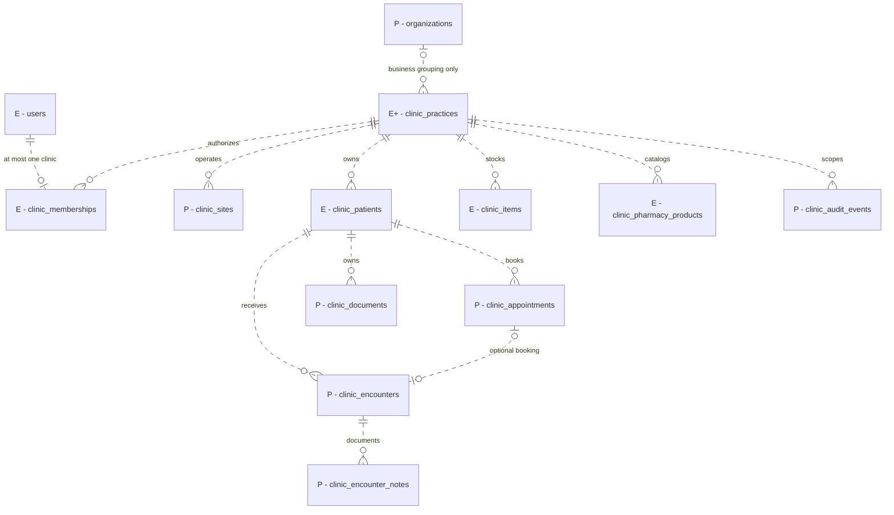

Detailed panels separate facilities from stock bins, directory identity from authorization, booked clinicians from actual participants, and draft history from signed revisions. Patient billing is a separate target domain, not the basis for APPly software fees.

## 2. Accounts, facilities and clinician identity

### Accounts and facility structure

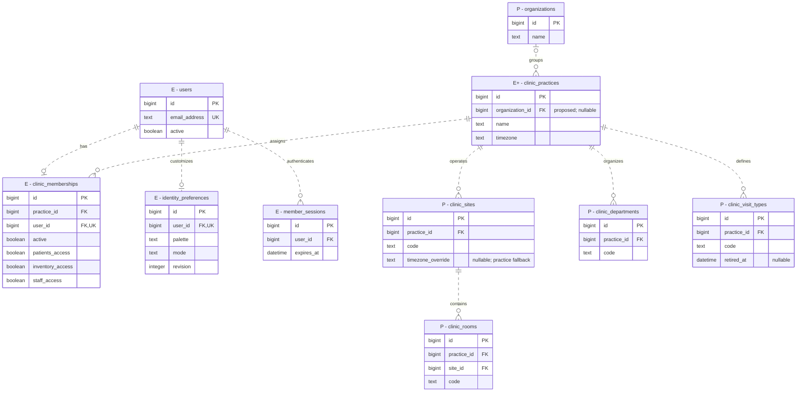

The account panel shows the existing flag-based baseline; the replacement must map every current inventory/action capability into the versioned authorization contract below, with one effective evaluator at cutover. Keeping parallel flag and grant authority is not required or permitted by these origin labels. Session expiry retains the 12-hour absolute maximum; no new MFA mechanism is inferred. No clinic picker, self-assignment or organization-wide clinical grant. A portal-only user has no clinic membership. Department may span sites; room belongs to one site, not necessarily a department. Codes are unique within practice, except room code is unique within `(practice_id, site_id)`. Human names and street text are not globally unique.

Operational settings remain typed/versioned at the practice or site that owns them, with explicit fallback only for named fields. The diagram shows the existing practice timezone and proposed site override, not an unrestricted settings JSON hierarchy.

### Clinician identity and assignments

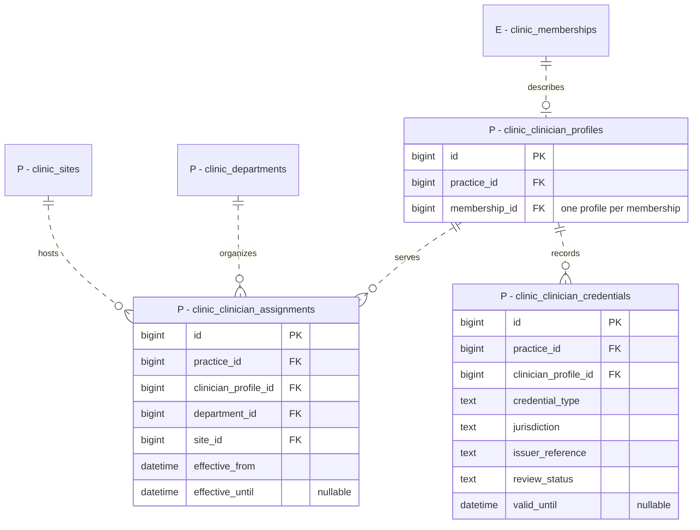

The proposed assignment tuple is unique within practice and lifecycle changes retain history; all linked entities must be in the same practice. A credential or assignment does not grant access or establish clinical authority. Existing `clinic_staff_members` remains a separate directory with no automatic user/profile linkage. Directory-only external clinicians must not be made login users just to appear in a directory. Reassignment/review history and provenance are required even though their event attributes are not expanded here.

## 3. Appointments, actual care and immutable notes

### Patient and encounter relationships

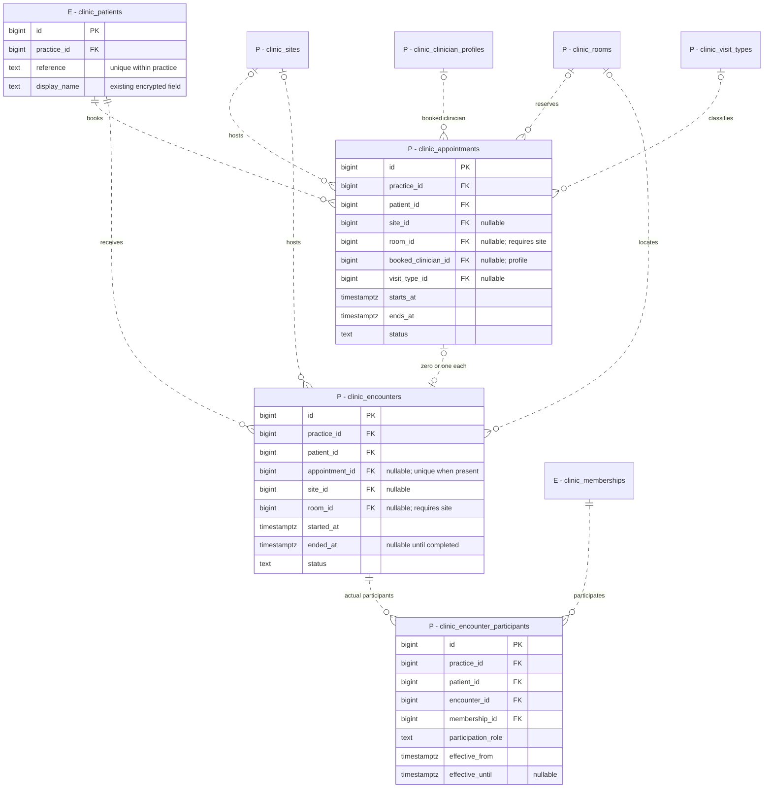

Walk-ins have no appointment. An appointment cannot be reused by multiple encounters. Both records own their patient link; encounter history is not inferred from mutable booking data. Actual participants include authorized clinical/staff memberships; their roles and event history require the accepted workflow. Optional site/room is a proposed baseline allowing unassigned/remote care; accepted workflows can require them. Room references must match both practice and site. Positive, half-open booking intervals need transactional same-resource overlap protection; clinical states and override policy are not selected by this diagram.

### Legacy drafts and future note lifecycle

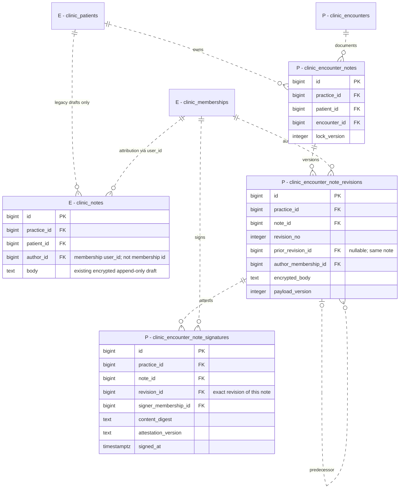

Header identity is immutable. Unique `(practice_id, note_id, revision_no)` and same-note predecessor/signature FKs bind history. Revision and signature rows inherit patient/encounter through the immutable note header; they do not duplicate independent patient IDs. Atomic creation should produce the initial revision; the diagram permits a header with no revision at the relational level, not a completed clinical note. Save/sign lock the header and reject stale expected versions; signed revisions never mutate. Addenda/corrections append with attribution and reason. Signer counts, co-signing and attestation rules remain clinically gated; `0..many` signatures is structural capacity, not a selected signing policy. No automatic migration of legacy drafts into encounters or signatures.

### Typed clinical values — later accepted fields only

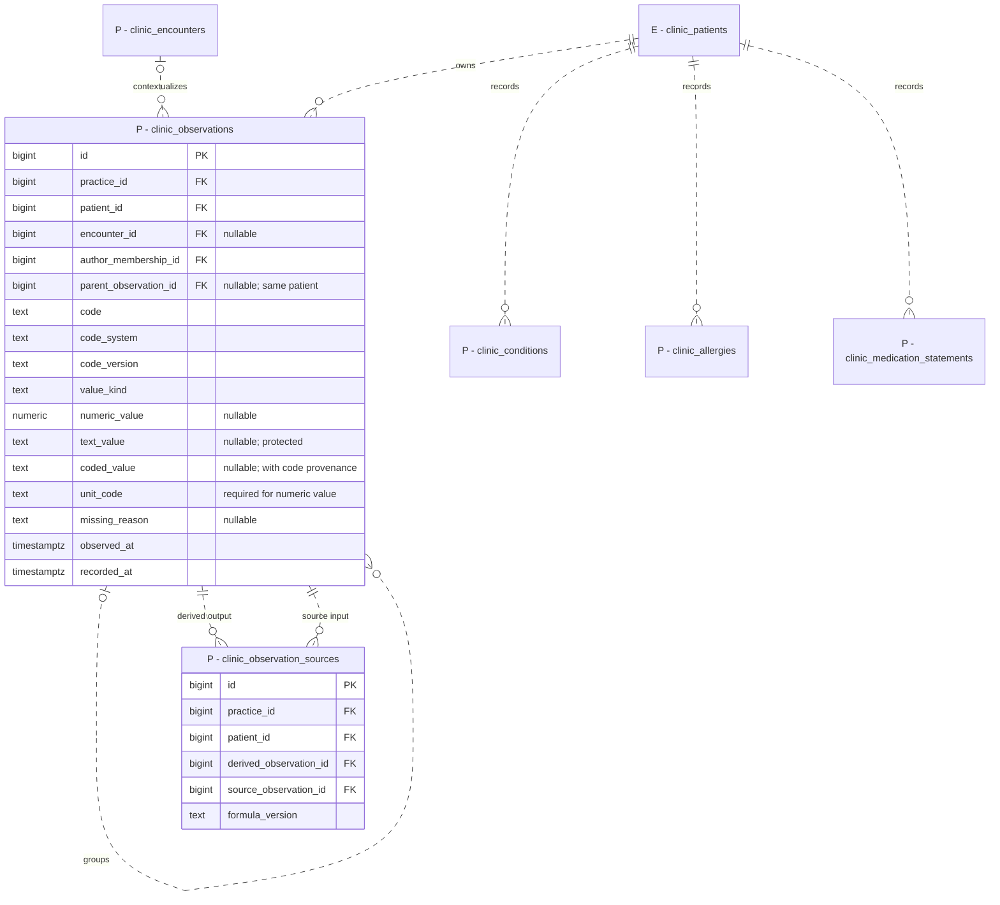

Each value-bearing observation has exactly one matching value representation or a missing reason with no value. A group-only observation (for example, a blood-pressure panel) has an explicit group kind, no scalar value/missing reason, and separately typed child components; reject cycles and cross-patient grouping. Systolic/diastolic are separate numeric observations. Source links are same-patient, immutable and acyclic; derived values preserve their formula and source versions rather than being silently recalculated. Clinical terminology, units, ranges and interpretation still require review. Conditions, allergies and medication statements need their own accepted typed history, not one generic clinical blob. Orders, results, procedures, administrations and dispensing are distinct later concepts, not automatically implemented by this panel or coupled to stock deductions.

## 4. Inventory — preserve the implemented single ledger

### Catalogs, positions and receiving

All entities in the next two diagrams already exist. Selected attributes/connectors omit legacy compatibility columns. In the replacement, preserve their required behavior, evidence and data through an explicit tested mapping; old columns/code need not remain active solely for shape compatibility. No legacy history is disposable by implication.

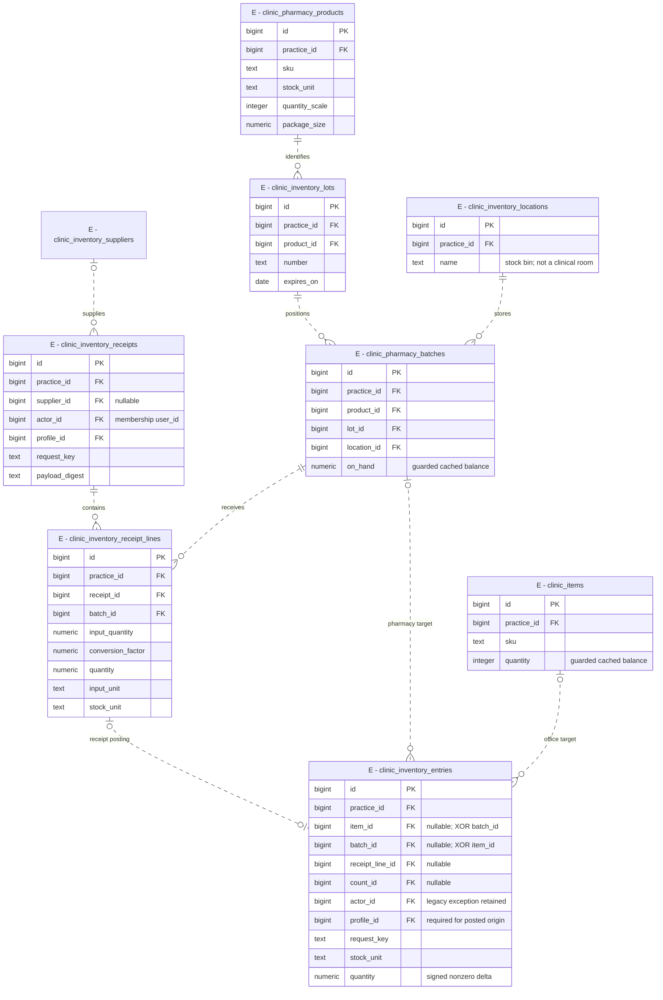

Each ledger row has exactly one target: office item **or** pharmacy position. Optional endpoints alone do not express that XOR. Product/lot/position tuples and clinic-scoped SKUs/positions remain constrained by the existing schema. Receipt posting requires one matching ledger entry by successful transaction completion; the optional diagram edge describes the nullable reference/relational maximum, not permission to leave a completed receipt unposted. Receipt line quantity is the exact input quantity × evidenced conversion. Retain optional receipt costs/currency and attribution; no supplier-price integration, valuation or billing formula is added.

### Holds, counts, provenance and audit metadata

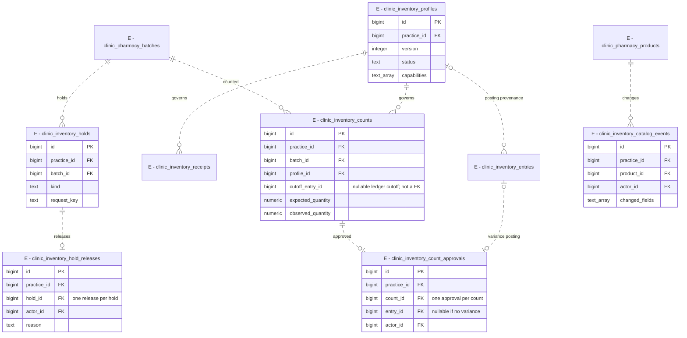

Existing actor references generally use `(practice_id, actor_id)` → membership `(practice_id, user_id)`, not membership PK. Preserve documented legacy nullable actor/profile exceptions. Profiles and relevant history are append-only; all applicable profile/actor FKs remain even where their lines are omitted. Holds may overlap; releasing one cannot clear another. Counts retain a ledger cutoff, stale-count checks and exact variance posting. Database-managed balances and the single ledger remain authoritative. Frozen legacy movement/batch-event history stays preserved; no duplicate `inventory_stock`, second ledger, patient-use, reservation or transfer model is introduced.

## 5. Later authorization and independently durable audit

### Versioned grants — not a second active evaluator

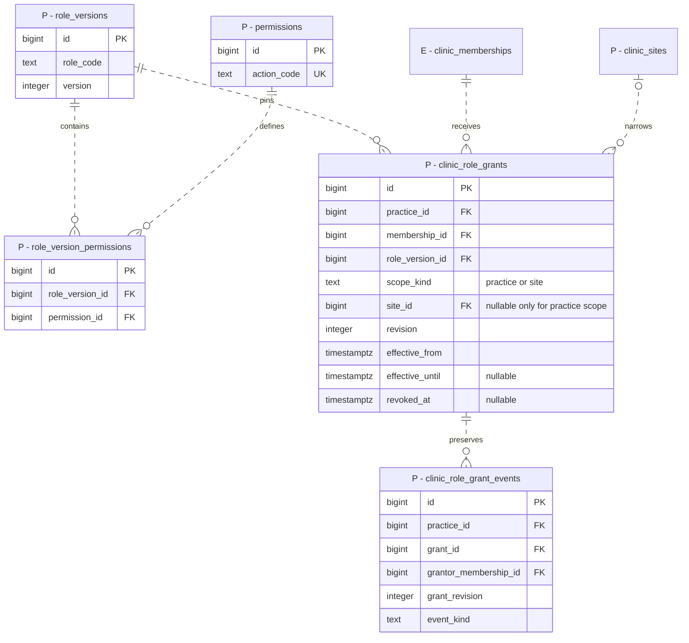

Role/permission definitions are controlled global catalogs, **not global clinical grants**. Role versions and their permission sets are immutable. Grant identity is null-aware unique across `(practice_id, membership_id, role_version_id, scope_kind, site_id)`; scope-kind/site checks remove null ambiguity. Stable grant rows retain all lifecycle events. Active membership, effective windows, action/scope and grantor ceilings are rechecked; no self-elevation. The current booleans remain the only evaluator until an accepted migration supplies a capability-equivalence matrix and single replacement evaluator. Identity issuer, MFA, RLS and operator roles are not selected here.

### Audit event, released-resource manifest and delivery receipt

**D-043/D-044 update — 2026-08-31:** PaperTrail is selected for application model-change auditing; see [Software Architecture](<../../APPlyVault/03%20Execution/Software%20Architecture.md#PaperTrail%20audit%20contract>). The gem and exception-on-version-error configuration are installed, but no version table or model opt-in exists yet. The panel below is the complementary operation/read/security evidence model, not PaperTrail's generated schema. The replacement's complete schema contract must add custom tenant-bound PaperTrail version storage and model coverage, then update the diagrams from actual implementation. These omitted version tables are a known diagram gap, not a deferred audit feature. Do not substitute a stock global `versions` table for operation events or claim the gem captures reads/denials. Note revisions/signatures and inventory history remain distinct authoritative evidence.

**Coverage clarification:** every implemented auditable patient-document or other domain mutation must have evidence, including child/related records written by callbacks and jobs; versioning a parent alone is insufficient. [Software Architecture](<../../APPlyVault/03%20Execution/Software%20Architecture.md#Callback-driven%20mutation%20coverage>) defines the required path matrix, create/update/destroy/touch handling, callback bypasses, transaction/after-commit boundaries and adverse-path tests. Document CRUD here means permitted mutations plus separately audited reads; it does not introduce permission to delete immutable objects or chart history. No diagram relationship grants authorization or implies that this wiring already exists.

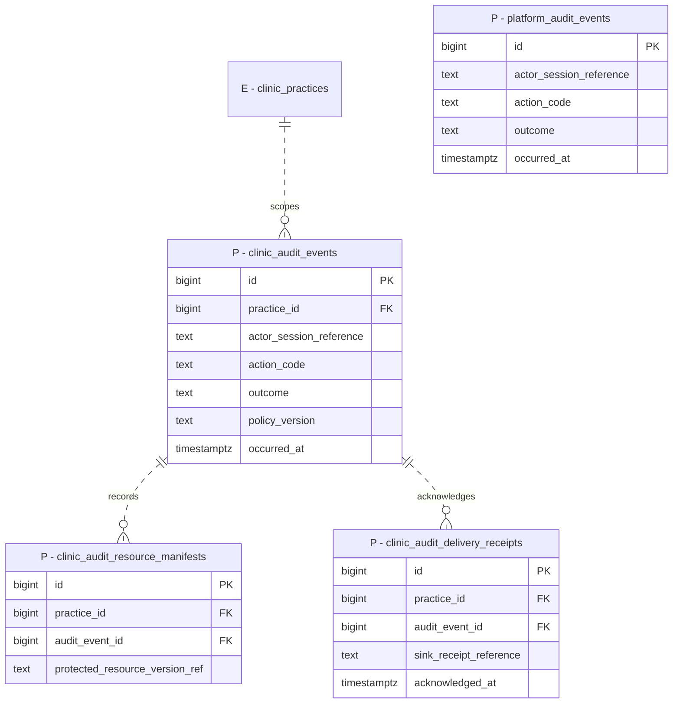

This is a logical evidence model, **not a decision to colocate the audit sink in the application database**. Resource manifests are protected evidence, not generic polymorphic domain FKs or authorization lookups. No sensitive payloads/search text/secrets in metadata. Unknown-tenant/platform failures use separate events, never a nullable wildcard clinic. Mutation evidence commits atomically; denial/rollback evidence must survive outside the failed transaction. Required capture failure blocks success/release. These relationships do not solve independent durability, trusted identity, runtime permissions, retention or restore; those remain T-34.5 and operational acceptance work.

## 6. Later addresses, private documents and messaging

### Explicit address ownership

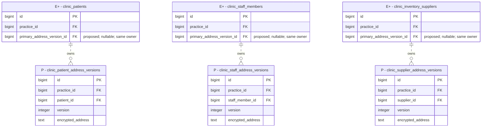

Each owner has one nullable primary pointer with a same-owner composite FK; not multiple `is_primary` flags. Owner → primary pointers are attributes rather than reverse lines to avoid obscuring the ownership relationships. Address rows are immutable, independently owned and may share street text. Pointer changes append attributable history. These typed address tables are illustrative decompositions; introduce only the address owners required by a selected workflow. No global contacts/address pool or person merge.

### Patient documents and delivery intents

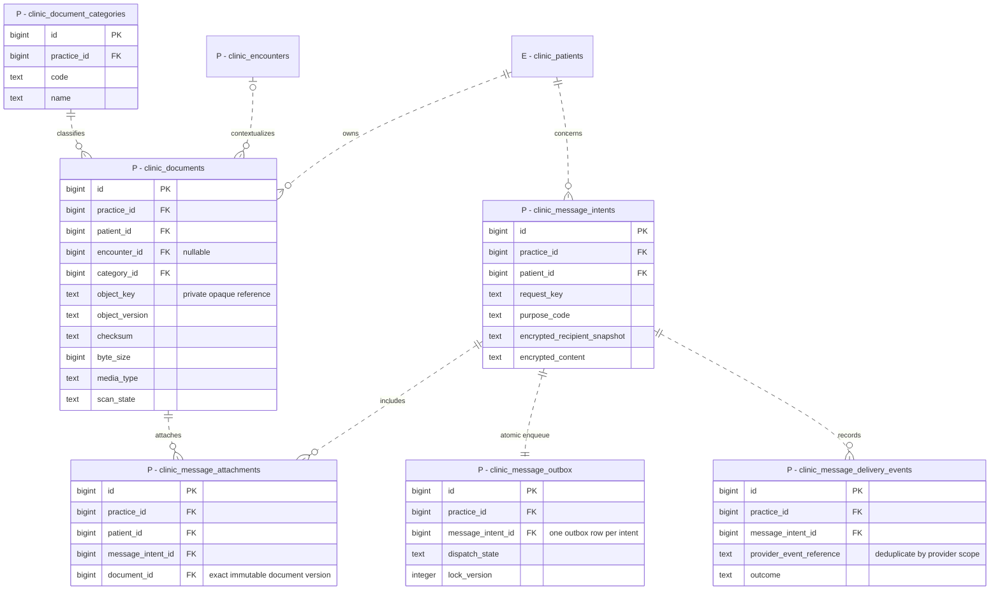

Each document row represents immutable object-version metadata; a future logical-document/version grouping must be explicit, not an object overwrite. Independent patient FK remains mandatory when encounter is null; encounter and category references are clinic-consistent. Attachment links additionally match the message's patient. Quarantined/pending/rejected files cannot download; each actual object/version requires reauthorization. Record immutable recipient/purpose evidence, atomically commit intent/outbox, and reconcile uncertain dispatch before retry; do not claim exactly-once external delivery. No public file URLs, upload/send service, inbound-message workflow or live credentials are selected.

## 7. Later patient billing — separate from APPly fees

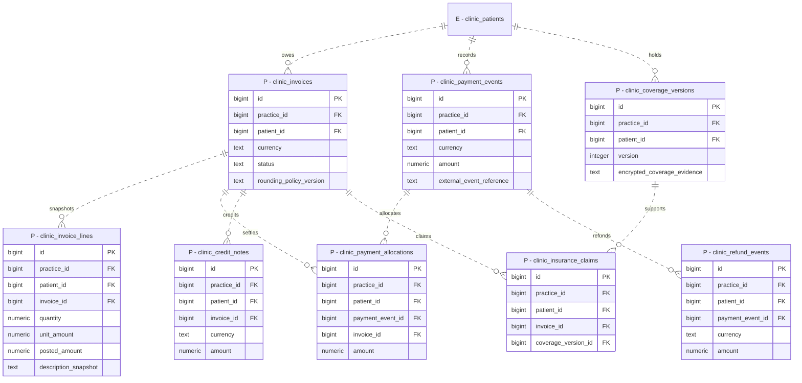

These structures are in the D-044 replacement baseline pending final amendments; their synthetic behavioral contract still needs the unresolved billing details, not invented defaults. Posted lines and financial events are immutable; corrections/reversals append. Posted invoices require lines. Source links are typed, same-practice/same-patient links, not `item_type/item_id`; no source catalog is invented here. Transactional allocation/refund/credit rules must prevent over-application, double-credit and currency mixing. External identifiers require provider-scoped deduplication and reconciliation. Exact bounded decimals and approved posting-rounding policy are mandatory design constraints; precision, eligibility, rates, tax, payer/remittance workflow and claim submission remain unselected. Unagreed dependent operations remain unavailable; do not defer the whole target module by quoting the superseded first-run scope. No card/bank credentials. APPly's ordered-inventory-value software fee and T-14 mechanics are outside this patient-billing diagram; D-029/T-37 supplier deferral remains.

## Relational constraints that connectors cannot express

For proposed tenant tables, retain bigint PK `id` and expose `UNIQUE (practice_id, id)` when referenced; do not replace existing IDs. Do not retrofit fictitious provenance into retained history.

| Relationship | Required target constraint |
| --- | --- |
| Patient-owned row | Independent `(practice_id, patient_id)` → patient `(practice_id, id)`; both non-null |
| Optional patient/encounter link | Also `(practice_id, patient_id, encounter_id)` → encounter `(practice_id, patient_id, id)`; only encounter component optional; never substitute this for the independent patient FK |
| Encounter/appointment | Same practice/patient composite FK; unique non-null appointment link; no silent reparenting |
| Room-bearing record | Independent site FK plus `(practice_id, site_id, room_id)` → room `(practice_id, site_id, id)`; room requires site |
| Note revision/signature | Tenant-qualified note FK; revision number unique per note; predecessor and signature target reference an exact revision in the same note |
| Membership/profile/participants | Same-practice composite FKs; profile unique per membership; existing legacy author/actor references continue to use membership `user_id` |
| Address primary pointer | Owner `(practice_id, id, primary_address_version_id)` → address `(practice_id, owner_id, id)`; nullable pointer, independent address-to-owner FK, immutable versions and pointer history |
| File/message attachment | Independent patient owner plus same-practice/same-patient message and document references; unique attachment tuple |
| Grants | Explicit scope/site null pattern; null-aware unique grant tuple; versioned immutable permission set and append-only grant events |
| Billing/coverage | Same-practice/same-patient invoice/payment/coverage links; immutable posting snapshots; transactional totals, currency, reversal and replay invariants |

History uses RESTRICT/NO ACTION semantics rather than cascading chart/audit deletion. Reject ordinary tenant/patient/author/parent changes, including before a record acquires children. Index referencing tuples and bounded query paths. Actual request authorization, field visibility, lock ordering, concurrency tests, encryption, external durability, retention and recovery cannot be proved by an ERD. Use the review's [adverse-path cases](<../../records/design-reviews/2026-08-31-multi-clinic-erd-review.md#Acceptance%20cases%20added%20by%20the%20corrections>) and revision 5 of [ERD Implementation Prompt](<../../records/prompts/2026-08-31-erd-implementation-prompt-revision-5.md>) across the full approved replacement.

## Evidence and exclusions

Source: local revision-2 review/prompt and selected canonical schema definitions inspected on 2026-08-31, on `feature/erd-adversarial-review`. Existing source hash: `9bac2cbf1a5597bef60dbfa29908063d2e7b642a5f67f2011b00c5028bb9c9ef`. The source image's instructions are not agent authority. No patient records, MD/SharePoint/governance originals, live databases, service configurations or hosting were accessed to make these diagrams.

Excluded rather than invented: full demographic/intake dictionaries, emergency contacts and directives, clinical transition/signature/terminology policies, scheduling overrides, patient-record transfer/merge, prescribing/labs/dispensing, inventory extensions, external integrations, approved audit/storage services and retention/offboarding durations. See the [Meta Clinic Implementation Tracker](../../APPlyVault/03%20Execution/Meta%20Clinic%20Implementation%20Tracker.md) and [Texas Diligence](<../../APPlyVault/02%20Research/Texas%20Diligence.md>) for current work and existing professional gates. Appearance preferences and clinic production-mode denial are unchanged. No Story or professional gate is completed by this visualization.
