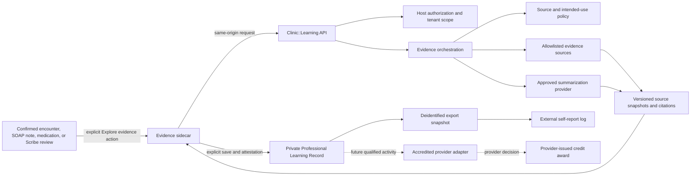

# Professional Learning Record Build Plan

Status: implementation-ready planning baseline; no feature code, migrations, evidence provider, or accredited activity has been implemented by this plan.

Backlinks:

- [ROADMAP.md](ROADMAP.md)
- [CLINICIAN_LEARNING_AUDIT_PLAN.md](CLINICIAN_LEARNING_AUDIT_PLAN.md)
- [Healthcare Capability Roadmap Index](../ROADMAP_INDEX.md)
- Shortcut planning Story `sc-410`

## Objective

Build a distinct `Clinic::Learning` capability that lets a clinician explore trustworthy medical evidence inside existing clinical work, explicitly turn meaningful engagement into a private professional-learning record, and export a deidentified history for self-reporting. Keep any future accredited CME award under the prospective authority of an accredited provider.

This plan intentionally separates three things that may look similar in the interface:

1. **Clinical context** belongs to the patient/encounter record and is protected clinical data.
2. **Evidence review** is a clinician-directed research interaction with sources and uncertainty.
3. **Professional learning** is a deidentified, clinician-confirmed record with reflection and attestation.

None of those facts, alone or together, creates accredited CME credit.

## Recommended architecture



The browser owns presentation, explicit user actions, keyboard/focus behavior, and recoverable draft state. Rails owns authorization, tenant and clinician identity, protected persistence, state transitions, source policy, evidence-provider calls, time acceptance, deidentification, exports, audit, and future provider decisions.

## Product placement

### Contextual entry points

The primary experience is a right-side drawer launched from the clinician’s current work. Do not add a primary “Learn” tab.

First supported entry points:

- confirmed encounter care details;
- an explicitly selected SOAP-note concept;
- a medication or condition in the server-authoritative care summary; and
- the general clinician quick action, without patient context.

Later entry points:

- Scribe Assessment or Plan review after the independent evidence workflow is trusted;
- laboratory results only after APPly has a reviewed lab-result source contract; and
- patient-context evidence reasoning only after its separate privacy, model, intended-use, and clinical-safety gate.

The tracking-board row is not a valid first entry point because the current chart workflow requires patient/encounter confirmation before opening protected clinical context.

### Evidence sidecar

The sidecar should follow APPly’s “Clinical Wayfinding Ledger” direction: quiet, dense but not cramped, explicit state, restrained color, MUI components, desktop/tablet first, and full keyboard/focus support.

It contains:

- a visible `General education` or later `Patient-context review` mode label;
- the selected topic, with patient identifiers excluded from the visible saved-learning preview;
- editable clinician question and suggested follow-up questions;
- concise answer sections: bottom line, why it matters, evidence, limits/uncertainty;
- inline citations and a source list with publisher, publication/update date, accessed date, evidence type, and freshness/retraction warnings;
- `Open source`, `Ask follow-up`, `Copy citation`, and `Save learning moment` actions;
- explicit loading, partial, unavailable, stale, corrected, and failed states; and
- a persistent but unobtrusive return path to the chart.

Closing the sidecar does not create learning. Unsaved reflection drafts participate in the clinic shell’s existing dirty-navigation blocking contract.

### Save learning moment

After meaningful engagement, APPly may surface a small suggestion. It must never show celebratory credit language. The review sheet contains:

- deidentified topic and learning objective;
- exact evidence/source snapshot represented;
- active engagement time, editable with reason when changed;
- a short reflection or structured impact choice;
- the applicable non-accredited/self-report status explanation;
- clinician attestation; and
- `Save`, `Keep as draft`, and `Discard` actions.

Target interaction time is under one minute. A clinician may also start a manual learning record without an AI answer, but must supply an inspectable source if it is represented as evidence-based learning.

### My learning record

The private portfolio may use a dedicated route such as `/clinic/learning`, but it is reached from the clinician profile/account area, a post-save link, and an optional quick action—not from primary clinic navigation.

It contains:

- pending learning candidates;
- confirmed non-accredited records;
- date, topic, specialty, impact, and status filters;
- documented active-time totals with plain-language limitations;
- exact source and revision history;
- export preview/create/download history;
- self-report submission/outcome history; and
- future provider-issued awards in a separately labeled section.

Practice settings may later contain source-policy and aggregate-adoption controls. They must not expose individual questions, reflections, patient-derived context, or reading history by default.

## Current source anchors

These are verified current paths as of 2026-09-06. They are integration anchors, not evidence that the proposed feature already exists.

| Current path | Existing responsibility | Planned relationship |
|---|---|---|
| `apps/web/src/App.tsx` | Owns clinic route selection, including confirmed encounter and Scribe routes. | Add the secondary portfolio route; do not add primary Learn navigation. |
| `apps/web/src/features/clinic/Workspace.tsx` | Loads server-projected capabilities, renders permission-filtered navigation, and wraps the clinic shell. | Project learning capabilities and mount any sidecar state at the shell level if persistence across chart sections is required. |
| `apps/web/src/features/clinic/clinicNavigation.tsx` | Owns same-origin history and dirty-work blockers. | Register unsaved reflection work through the existing contract. |
| `apps/web/src/features/clinic/TrackingBoardPage.tsx` | Shows care indicators and links to current/previous charts. | Do not launch protected evidence review until the exact chart is confirmed. |
| `apps/web/src/features/clinic/CareFlow.tsx` | Loads exact patient, encounter, observations, care summary, provider confirmation, and SOAP workflow. | First contextual integration surface after confirmation. |
| `apps/web/src/features/clinic/CareIndicators.tsx` | Displays current read-only medication, condition, allergy, precaution, and review summaries. | Offer typed topic entry points for verified condition/medication data; never send the entire summary by default. |
| `apps/api/app/serializers/clinic/care/patient_care_summary_serializer.rb` | Projects server-authoritative care-summary data. | Source minimum-necessary, authorized topic context through a typed adapter. |
| `apps/api/app/controllers/clinic/care/patient_care_summaries_controller.rb` | Reauthorizes patient access and tenant/encounter ownership. | Authorization precedent for context resolution. |
| `apps/api/app/controllers/clinic/care/observations_controller.rb` | Serves generic coded observations, currently used primarily as vitals. | Not an approved lab-results source; labs remain gated. |
| `apps/web/src/api/contracts.ts` | Defines clinic context and observation contracts. | Add learning contracts and projected permissions without treating generic observations as validated labs. |
| `apps/web/src/features/scribe/LiveScribeReviewWorkspace.tsx` | Owns Scribe session, context, consent, transcript, generation, review, and export UI. | Later explicit evidence entry point; keep Scribe consent and learning attestation separate. |
| `apps/web/src/features/scribe/ScribeReviewWorkspace.tsx` | Shows exact revisions, sources, review, edit, approval, export, and stale grounding. | Reuse the interaction concepts for source visibility and revision state, not the Scribe data model. |
| `apps/web/src/features/scribe/ScribeRecordingProvider.tsx` | Keeps recording state scoped while navigating. | Pattern for a persistent clinic sidecar, if required. |
| `apps/api/app/services/clinic/scribe/workflow.rb` | Enforces expected versions, digests, immutable revisions, approval, and export state. | Pattern for learning state transitions; no direct table coupling. |
| `apps/api/app/services/clinic/scribe/draft_generator.rb` | Generates grounded documentation locally and abstains from assessment/treatment planning. | Not a general AI/evidence provider and must not be repurposed as one. |
| `apps/api/app/models/ability.rb` and `apps/api/app/services/clinic/authorization.rb` | Define and enforce clinic capabilities. | Add clinician-owner learning capabilities and reauthorize every protected operation. |
| `apps/api/app/services/clinic/audit_recorder.rb` and `apps/api/app/models/concerns/clinic/auditable.rb` | Persist server-derived, protected audit evidence. | Record sensitive reads and state changes without putting content in metadata. |
| `apps/web/src/features/workforce/PayrollExportPage.tsx` | Implements select, preview, create, download, and immutable export history. | Best current UI precedent for exact learning-export review. |
| `apps/api/app/services/clinic/workforce/generate_payroll_export.rb` | Reauthorizes, validates freshness, uses idempotency/digests, and preserves correction lineage. | Best current server precedent for CSV learning exports. |

Current gaps that implementation must not conceal:

- There is no scholarly evidence, PubMed, guideline, literature-retrieval, or general LLM provider integration in the repository.
- Generic observations are not an authorized lab-results contract; `soap-with-labs` is currently disabled for that reason.
- Clinical charts and Scribe use separate encounter/note model families. Learning must not deepen that split or pretend a Scribe session is the official encounter.
- The current Scribe `parent_record_adapter` export records an export action but does not write to the authoritative SOAP note or an external system.
- The clinic has no proven server-side PDF export path. Ship CSV first unless a supported, visually verified PDF path is deliberately added.

## Proposed software ownership

### New capability-owned paths

Names remain proposed until implementation preflight verifies current conventions.

```text
apps/web/src/features/learning/
  EvidenceSidecar.tsx
  EvidenceAnswer.tsx
  SourceList.tsx
  LearningMomentReview.tsx
  ProfessionalLearningRecordPage.tsx
  LearningExportHistory.tsx
  learningApi.ts
  types.ts

apps/api/app/controllers/clinic/learning/
apps/api/app/models/clinic/learning/
apps/api/app/services/clinic/learning/
apps/api/app/serializers/clinic/learning/
apps/api/app/queries/clinic/learning/
```

`Clinic::Learning` owns inquiries, evidence-response provenance, source snapshots, engagement events, learning moments, clinician attestation, revisions, export snapshots, and external-status records. It may receive authorized opaque clinical references through typed adapters; Care and Scribe must not read Learning tables directly.

### Host-owned responsibilities

The host continues to own:

- session and CSRF security;
- user, membership, clinician profile, practice, site, and role identity;
- patient, encounter, note, care-summary, medication, observation, and Scribe authorities;
- capability projection and server-side authorization;
- shared audit, retention, feature flag, incident response, and observability infrastructure; and
- official clinical records and downstream integrations.

Learning never writes a diagnosis, order, prescription, note, Scribe draft, patient message, or billing item.

## Proposed data records

These are conceptual complete record shapes, including ownership and timestamps. Implementation must reconcile names and types with the canonical schema before migrations.

### `Clinic::Learning::Inquiry`

Protected working record for one clinician-led evidence session.

| Attribute | Purpose |
|---|---|
| `id` | UUID primary key. |
| `practice_id` | Required tenant owner. |
| `site_id` | Optional verified site context. |
| `clinician_membership_id` | Required tenant-scoped authenticated owner. |
| `clinician_profile_id` | Required professional identity associated with the membership. |
| `patient_id` | Optional internal-only patient reference; never exported. |
| `encounter_id` | Optional authoritative clinical encounter reference; never exported. |
| `context_kind` | General, SOAP selection, care-summary condition, medication, Scribe draft, or future lab result. |
| `context_ref` | Optional opaque versioned source reference. |
| `clinical_context_ciphertext` | Minimum-necessary protected context snapshot; null in general mode. |
| `question_ciphertext` | Protected clinician question. |
| `deidentified_topic` | Clinician-reviewable topic safe for the learning record. |
| `intended_use` | `general_education` or separately gated `patient_context_review`. |
| `state` | `opened`, `researching`, `completed`, `abandoned`, or `failed`. |
| `started_at` | Session start. |
| `last_active_at` | Last accepted active-engagement time. |
| `completed_at` | Completion time, if completed. |
| `abandoned_at` | Abandonment time, if abandoned. |
| `failure_code` | Allowlisted failure reason, if failed. |
| `lock_version` | Optimistic concurrency version. |
| `created_at`, `updated_at` | Record timestamps. |

### `Clinic::Learning::EvidenceResponse`

Immutable answer revision produced under a specific provider and policy version.

| Attribute | Purpose |
|---|---|
| `id` | UUID primary key. |
| `practice_id` | Required tenant owner. |
| `inquiry_id` | Parent inquiry. |
| `sequence_number` | Monotonic revision/follow-up number. |
| `provider_name` | Approved evidence/AI provider identity. |
| `model_name`, `model_version` | Exact summarization model identity. |
| `retrieval_profile_version` | Source/retrieval policy used. |
| `intended_use_policy_version` | Safety/claims policy used. |
| `prompt_digest` | Digest of protected request inputs. |
| `output_ciphertext` | Protected answer body. |
| `output_digest` | Integrity digest. |
| `source_set_digest` | Integrity digest of represented citations. |
| `answer_status` | `complete`, `partial`, `abstained`, `stale`, `corrected`, or `failed`. |
| `uncertainty_label` | Visible bounded uncertainty classification. |
| `generated_at` | Generation time. |
| `failed_at` | Failure time, when applicable. |
| `failure_code` | Allowlisted provider/policy failure. |
| `latency_ms` | Operational latency. |
| `input_token_count`, `output_token_count` | Usage observability where provided. |
| `created_at`, `updated_at` | Record timestamps; confirmed revisions are not overwritten. |

### `Clinic::Learning::EvidenceSource`

Versioned citation snapshot attached to an answer revision.

| Attribute | Purpose |
|---|---|
| `id` | UUID primary key. |
| `practice_id` | Required tenant owner. |
| `evidence_response_id` | Represented answer revision. |
| `ordinal` | Display order. |
| `source_kind` | Guideline, systematic review, primary study, drug label, or other approved type. |
| `title`, `publisher`, `authors` | Human-readable identity. |
| `canonical_url` | Original-source URL where licensed/permitted. |
| `external_identifier` | DOI, PMID, guideline ID, or equivalent. |
| `publication_date`, `last_reviewed_date` | Currency signals. |
| `accessed_at` | Retrieval time. |
| `region` | Applicable jurisdiction/region. |
| `evidence_level` | Policy-defined evidence classification. |
| `retraction_status` | `clear`, `warning`, `retracted`, or `unknown`. |
| `citation_locator` | Page, section, table, or paragraph locator where available. |
| `supporting_excerpt_ciphertext` | Minimal licensed supporting excerpt, if allowed. |
| `source_digest` | Snapshot integrity digest. |
| `created_at`, `updated_at` | Record timestamps. |

### `Clinic::Learning::EngagementEvent`

Append-only evidence of meaningful interaction. It is not itself proof of learning or credit.

| Attribute | Purpose |
|---|---|
| `id` | UUID primary key. |
| `practice_id` | Required tenant owner. |
| `inquiry_id` | Parent inquiry. |
| `clinician_membership_id` | Server-derived actor. |
| `evidence_response_id` | Optional answer revision. |
| `evidence_source_id` | Optional opened source. |
| `event_type` | Allowlisted event such as result released, source opened, follow-up asked, or active review accepted. |
| `occurred_at` | Server-accepted event time. |
| `client_event_id` | Idempotency key. |
| `active_seconds_delta` | Bounded accepted active-time increment, if applicable. |
| `correlation_id` | Cross-request trace ID. |
| `metadata_json` | Allowlisted non-content metadata only. |
| `created_at` | Append-only creation timestamp; no `updated_at` by design. |

### `Clinic::Learning::LearningMoment`

Clinician-owned deidentified record; confirmed revisions supersede rather than overwrite.

| Attribute | Purpose |
|---|---|
| `id` | UUID primary key. |
| `practice_id` | Required tenant owner. |
| `site_id` | Optional site at time of learning. |
| `clinician_membership_id` | Required tenant-scoped owner. |
| `clinician_profile_id` | Required professional identity represented by the record. |
| `inquiry_id` | Optional source inquiry. |
| `supersedes_learning_moment_id` | Prior confirmed revision, if corrected. |
| `activity_date` | Clinician-confirmed learning date. |
| `deidentified_topic` | Export-safe topic. |
| `specialty` | Optional clinician-selected specialty. |
| `learning_objective` | What the clinician sought to understand. |
| `learning_summary` | Concise export-safe learning summary. |
| `reflection_ciphertext` | Private free-text reflection. |
| `practice_impact` | `confirmed_approach`, `changed_approach`, `follow_up_needed`, `not_useful`, or `other`. |
| `documented_seconds` | Clinician-confirmed time. |
| `measured_active_seconds` | System-derived active time shown for comparison. |
| `learning_status` | `candidate`, `awaiting_reflection`, `documented`, or `voided`. |
| `record_classification` | `non_accredited_professional_learning`; future awards remain separate records. |
| `source_set_digest` | Evidence snapshot represented. |
| `attestation_version` | Exact statement accepted. |
| `attested_at` | Confirmation time. |
| `privacy_review_state` | `pending`, `clear`, or `needs_edit`. |
| `contains_patient_identifiers` | Server/client review signal that blocks confirmation/export when true. |
| `confirmed_at` | Durable confirmation time. |
| `voided_at`, `void_reason` | Non-destructive correction status. |
| `lock_version` | Optimistic concurrency version. |
| `created_at`, `updated_at` | Record timestamps. |

### `Clinic::Learning::ExportBatch`

Immutable deidentified snapshot following the proven payroll-export pattern.

| Attribute | Purpose |
|---|---|
| `id` | UUID primary key. |
| `practice_id` | Required tenant owner. |
| `clinician_membership_id` | Required tenant-scoped owner. |
| `clinician_profile_id` | Required professional identity represented in the export. |
| `supersedes_export_batch_id` | Prior export corrected by this snapshot. |
| `format` | `csv`, and later `pdf` after verified support. |
| `range_start`, `range_end` | Selected activity period. |
| `record_count` | Included record count. |
| `documented_seconds_total` | Exact included total. |
| `source_version_digest` | Digest of included learning revisions. |
| `payload_digest` | Generated artifact integrity digest. |
| `artifact_ciphertext` | Protected stored artifact or approved storage reference. |
| `state` | `previewed`, `created`, `superseded`, or `failed`. |
| `failure_code` | Allowlisted generation failure. |
| `generated_at`, `downloaded_at`, `expires_at` | Lifecycle timestamps. |
| `idempotency_key` | Duplicate-create protection. |
| `created_at`, `updated_at` | Record timestamps. |

### `Clinic::Learning::ExternalSubmission`

Record of a clinician’s external self-report; not proof that APPly awarded or verified credit.

| Attribute | Purpose |
|---|---|
| `id` | UUID primary key. |
| `practice_id` | Required tenant owner. |
| `clinician_membership_id` | Required tenant-scoped owner. |
| `clinician_profile_id` | Required professional identity represented in the submission. |
| `export_batch_id` | Optional submitted export snapshot. |
| `organization_name` | Board, employer, association, or other destination. |
| `jurisdiction` | Applicable jurisdiction. |
| `guidance_profile_version` | Rules profile used, if any. |
| `submission_type` | `self_report` for the initial release. |
| `reported_units`, `unit_type` | What the clinician says was submitted. |
| `status` | `prepared`, `submitted`, `accepted`, `rejected`, or `withdrawn`. |
| `status_source` | `clinician_reported` or future `verified_connector`. |
| `reference_number` | Optional external reference. |
| `submitted_at`, `decided_at` | External lifecycle dates. |
| `notes_ciphertext` | Private clinician notes. |
| `created_at`, `updated_at` | Record timestamps. |

### Future `AccreditedActivityVersion` and `CreditAward`

These records must not be added until there is an accredited-provider agreement and prospectively approved activity.

Before that pilot, `GuidanceProfileVersion` may support external self-report guidance with these attributes: `id`, `organization_name`, `jurisdiction`, `version`, `authoritative_source_url`, `source_effective_date`, `last_reviewed_at`, `reviewed_by_membership_id`, `field_mapping_json`, `guidance_text`, `status`, `effective_from`, `effective_until`, `supersedes_guidance_profile_version_id`, `created_at`, and `updated_at`. It supplies guidance only and has no award authority.

`AccreditedProvider` attributes: `id`, `legal_name`, `accreditor_name`, `accreditor_provider_identifier`, `agreement_reference`, `agreement_effective_at`, `agreement_expires_at`, `reporting_contact_ciphertext`, `adapter_configuration_ciphertext`, `status`, `created_at`, and `updated_at`.

`AccreditedActivityVersion` attributes: `id`, `accredited_provider_id`, `external_activity_id`, `version`, `title`, `activity_type`, `jurisdiction`, `designation_statement`, `eligible_start_at`, `eligible_end_at`, `maximum_credit_amount`, `credit_unit_type`, `calculation_rule_json`, `source_policy_version`, `participation_rule_version`, `reflection_requirement_version`, `status`, `approved_at`, `retired_at`, `created_at`, and `updated_at`.

`CreditAward` attributes: `id`, `practice_id`, `clinician_membership_id`, `clinician_profile_id`, `learning_moment_id`, `accredited_activity_version_id`, `provider_reference`, `amount`, `unit_type`, `status`, `requested_at`, `issued_at`, `rejected_at`, `revoked_at`, `certificate_storage_ref`, `reporting_receipt_ref`, `decision_payload_digest`, `created_at`, and `updated_at`.

Only a provider decision may move a future award to `issued`. A learning moment’s `record_classification` remains historically accurate and is not mutated to make it accredited.

## State and authority model

### Evidence session

```text
opened -> researching -> completed
                    \-> abandoned
                    \-> failed -> researching (explicit retry creates a new response revision)
```

### Learning moment

```text
candidate -> awaiting_reflection -> documented -> voided
                                  \-> corrected by a new superseding record
candidate/awaiting_reflection -> discarded (no durable confirmed record)
```

Export and external submission are related records, not learning-moment states. “Accepted externally” is valid only with `status_source`; “accredited credit issued” exists only on a future `CreditAward` with a provider decision.

## Proposed API surface

All endpoints use the existing same-origin session and CSRF model, derive actor/tenant server-side, reauthorize the exact resource, use idempotency where state changes may be retried, and return explicit unavailable/forbidden/conflict/stale states.

| Endpoint | Purpose |
|---|---|
| `POST /api/clinic/learning/inquiries` | Start a general or separately allowed context-linked inquiry. |
| `GET /api/clinic/learning/inquiries/:id` | Release one owned inquiry with answers and source summaries; audit sensitive release. |
| `POST /api/clinic/learning/inquiries/:id/follow_ups` | Ask a follow-up under the same protected context and new immutable answer revision. |
| `POST /api/clinic/learning/inquiries/:id/engagement_events` | Accept idempotent, bounded engagement signals; never trust raw client totals. |
| `POST /api/clinic/learning/inquiries/:id/complete` | End active research and calculate a reviewable candidate. |
| `POST /api/clinic/learning/learning_moments` | Create a manual or inquiry-derived draft. |
| `PATCH /api/clinic/learning/learning_moments/:id` | Edit an owned draft using expected version. |
| `POST /api/clinic/learning/learning_moments/:id/attest` | Confirm exact content, time, sources, and attestation. |
| `POST /api/clinic/learning/learning_moments/:id/void` | Non-destructively void a confirmed record. |
| `GET /api/clinic/learning/portfolio` | Return an owned, filterable portfolio projection. |
| `POST /api/clinic/learning/exports/preview` | Reauthorize and show exact deidentified content without creating an artifact. |
| `POST /api/clinic/learning/exports` | Create an immutable export snapshot. |
| `GET /api/clinic/learning/exports/:id/download` | Authenticated, audited artifact release. |
| `POST /api/clinic/learning/external_submissions` | Record a self-reported submission. |
| `PATCH /api/clinic/learning/external_submissions/:id` | Record clinician-supplied or connector-verified outcome with source. |

Do not expose a generic endpoint that accepts browser-supplied patient context, provider identity, elapsed time total, credit status, or arbitrary audit metadata.

## Evidence orchestration contract

### Retrieval

- Use allowlisted, licensed, and authoritative sources appropriate to the question: current guidelines, systematic reviews, official drug information, and selected primary literature.
- Prefer original/authoritative sources over general web summaries.
- Capture exact publisher, external identifier, dates, version/digest, region, evidence type, and access time.
- Reject or visibly warn on retracted, withdrawn, inaccessible, unsupported, or stale sources according to policy.
- Do not browse the public web silently as a fallback.

### Summarization

- Send only minimum-necessary content to an approved provider.
- Patient-context mode stays disabled until contractual/privacy controls and the clinical-safety evaluation are complete.
- Require claim-to-source linkage, visible uncertainty, and abstention when sources do not support an answer.
- Keep provider/model/policy versions and protected input/output digests.
- Treat prompt injection and malicious source content as untrusted data.
- Never allow answer text to write into the official record automatically.

### Time and engagement

- Count only bounded active interaction windows, not time while the tab is backgrounded, the device is idle, or a provider request is pending.
- Server accepts deltas under idempotent event IDs and clamps implausible values.
- The clinician sees measured active time and confirms documented time.
- A manual change requires a reason but is not presented as system-verified activity.
- Time is documentation evidence; it is not a credit calculation until an approved activity version defines that rule.

## Permissions and privacy

Proposed capabilities:

| Capability | Default authority |
|---|---|
| `learning.read_own` | Clinician may read their own learning data. |
| `learning.record` | Clinician may create and edit their own inquiry and draft records. |
| `learning.attest` | Eligible clinician may confirm or void their own learning moments. |
| `learning.export_own` | Clinician may preview, create, and download their own exports. |
| `learning.aggregate_read` | Optional future permission for approved deidentified aggregate measures only. |
| `learning.accreditation_manage` | Future provider/program configuration; never a shortcut for issuing local credit. |

Do not copy Scribe’s practice-wide permission semantics. Personal ownership must be enforced by authenticated membership/clinician identity on every query and mutation. A practice administrator is denied private content by default. Support staff have no content access. Any exceptional compliance-access design requires separate policy, visible audit, and minimum-necessary release.

Privacy boundaries:

- Protected inquiry text, answer text, clinical context, and reflection are encrypted/protected at rest under host standards.
- Durable learning summaries and exports must be deidentified before confirmation, not merely stripped at download time.
- Audit metadata contains opaque IDs, versions, outcomes, and allowlisted codes—not questions, note text, clinical values, patient identity, or reflections.
- Provider telemetry, application logs, analytics, traces, and error reports must not receive protected content.
- No local storage or analytics persistence of protected content in the browser.

## Domain events and audit

Suggested append-only domain events:

- `learning.evidence_question_created`
- `learning.evidence_result_released`
- `learning.source_opened`
- `learning.candidate_proposed`
- `learning.reflection_saved`
- `learning.moment_attested`
- `learning.moment_superseded`
- `learning.moment_voided`
- `learning.export_created`
- `learning.export_downloaded`
- `learning.external_submission_recorded`
- `learning.external_outcome_recorded`
- future `learning.provider_credit_issued`, `rejected`, or `revoked`

Every event is tenant-scoped, server-attributed, correlated, idempotent where applicable, and content-minimized. Protected releases fail closed if required audit evidence cannot be persisted, following the current clinic audit pattern.

## Failure and recovery behavior

| Failure | Required behavior |
|---|---|
| Evidence provider unavailable | Preserve the question locally on the server, show unavailable state, allow explicit retry, and create no learning claim. |
| Partial or uncited answer | Label partial/unsupported, block confirmation as evidence-based learning until source requirements are met, allow manual source addition if policy permits. |
| Source becomes stale/retracted | Mark affected answers and draft moments stale; preserve history; require review before new export. |
| Patient/encounter changes while drawer is open | Lock or clear context, warn visibly, and require explicit rebind; never silently carry context to another chart. |
| Optimistic-version conflict | Preserve both browser draft and server version, show reconciliation, and never overwrite a confirmed record. |
| Deidentification check fails | Block attestation/export and highlight what must be rewritten without exposing content to unauthorized staff. |
| Export retry/duplicate | Reconcile by idempotency key and payload/source digest; return the existing snapshot when identical. |
| External destination unavailable | Keep export/download usable; record no submission or acceptance without acknowledgement. |
| Audit persistence fails | Fail closed for protected release or state change. |
| Feature disabled | Hide entry points, keep existing records readable/exportable under explicit policy, and stop new provider calls. |

## Build sequence and Shortcut execution map

Each outcome remains in Shortcut Backlog until separately claimed and preflighted. Do not start all stories at once.

| Order | Shortcut | Outcome | Dependencies and freeze condition |
|---:|---|---|---|
| 1 | `sc-412` | Define policy, claims language, privacy, clinician ownership, time, attestation, sources, correction, and governance. | No implementation begins until the product boundary is approved. |
| 2 | `sc-413` | Build general-education evidence sessions, allowlisted retrieval, exact citations, immutable answer revisions, and engagement evidence. | Blocked by `sc-412`; freeze after complete backend/frontend/provider/error-state implementation. |
| 3 | `sc-414` | Embed **Explore evidence** in confirmed encounter, SOAP/care-summary/medication, and later Scribe workflows. | Blocked by `sc-413`; labs and patient-context reasoning remain out until separately approved. |
| 4 | `sc-415` | Build draft/reflect/attest/discard flows and clinician-owned deidentified learning moments. | Blocked by `sc-413`; may proceed alongside contextual integration after the evidence contract freezes. |
| 5 | `sc-416` | Build My learning record, exact export preview, immutable CSV first, correction lineage, downloads, and self-report log. | Blocked by `sc-415`; PDF requires a chosen and visually verified server path. |
| 6 | `sc-417` | Add sourced, versioned board/organization guidance profiles. | Blocked by `sc-416`; unsupported destinations remain unverified. |
| 7 | `sc-418` | Pilot one prospective accredited-provider adapter and provider-issued decision lifecycle. | Blocked by `sc-414` and `sc-417`, plus an external provider agreement and renewed safety/accreditation review. |

Dependency graph:

```text
sc-412 -> sc-413 -> sc-414 --------\
                   \-> sc-415 -> sc-416 -> sc-417 -> sc-418
```

### Build discipline for every story

1. Claim the Story, run repository preflight, and reconcile current source paths.
2. Build the complete bounded outcome across Rails, frontend, authorization, state, audit, and failure behavior.
3. Use synthetic data only and preserve unrelated worktree changes.
4. Freeze the implementation once the end-to-end outcome is complete.
5. Run one consolidated verification pass from the audit plan; do not interleave broad test gates with each micro-edit.
6. Inspect final diff, record factual evidence, update the capability packet/status, and commit the bounded result.

## Feature flags and rollout

Use separate server-authoritative flags so riskier work does not ride the same switch:

- evidence sidecar, general education;
- learning-moment capture;
- private portfolio and export;
- contextual clinical entry points;
- patient-context evidence review;
- external guidance profiles; and
- accredited provider activity.

Pilot sequence:

1. internal synthetic evaluation;
2. clinical/privacy review with no patient context;
3. small clinician pilot for general education and private records;
4. contextual entry-point pilot after stale-context and tenant-isolation proof;
5. export/self-report pilot;
6. patient-context pilot only after its separate safety gate; and
7. accredited activity only under the provider-approved version.

Rollback stops new inquiries/provider calls while preserving existing clinician-owned records and exports. Provider or rules changes create new versions; they do not rewrite historical evidence.

## Definition of software complete

A phase is not complete because screens exist or unit tests pass. Completion requires:

- the full intended workflow and negative states exist across browser and Rails;
- authorization and clinician ownership are server-enforced;
- evidence source/model/policy versions are inspectable;
- active time, reflection, attestation, export, submission, and award remain distinct facts;
- deidentification blocks protected content from the durable/exportable record;
- audit, idempotency, conflicts, stale context, corrections, and rollback work;
- desktop/tablet, keyboard, screen-reader, narrow-layout, and failure states are verified;
- the [audit plan](CLINICIAN_LEARNING_AUDIT_PLAN.md) has current evidence; and
- product copy never exceeds APPly’s actual accreditation authority.

## Planning sources

- [AMA: what to know about the other kind of CME credit](https://www.ama-assn.org/education/ama-pra-credit-system/what-know-about-other-kind-cme-credit)
- [AMA PRA Credit System requirements](https://www.ama-assn.org/education/ama-pra-credit-system/ama-pra-credit-system-requirements)
- [ACCME: joint providership](https://accme.org/rule/joint-providership/)
- [ACCME: urgent alert on the use of AI in accredited education](https://accme.org/news/urgent-alert-on-the-use-of-ai-in-accredited-ce/)
- [Heidi Evidence product guide](https://support.heidihealth.com/en/articles/13191359-get-started-with-heidi-evidence)

These references are current planning inputs, not a substitute for jurisdiction-specific legal, clinical, privacy, or accredited-provider review at implementation time.
