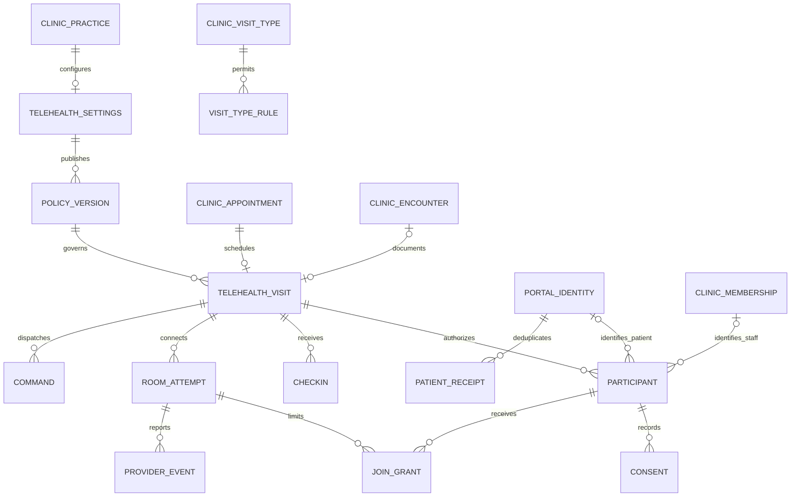

# Telehealth build specification

Navigation: [packet](README.md) · [sequence](ROADMAP.md) · [future verification](TELEHEALTH_AUDIT_PLAN.md).

All new objects, names and behavior below are **proposed**. Existing source facts are identified separately. This is the implementation contract for the bounded workflow in the roadmap, not evidence that it works today.

**2026-09-08 provider amendment:** the founder selected Twilio Video to reuse the existing Twilio account. This supersedes Daily as the proposed default in the original design below. New configuration and room attempts use Twilio; historical provider identities remain immutable and route through their own adapter. Twilio joins use a server-signed room-bound access token and `room_name`; `room_url` is null. Signed form callbacks enter at `/api/integrations/telehealth/twilio/events`. Keep SMS test credentials separate. See [local operation](LOCAL_OPERATION.md) for the current environment contract and [implementation evidence](IMPLEMENTATION_EVIDENCE.md) for actual verification. Provider-specific expiry, participant ejection and shutdown must follow Twilio's documented behavior; the earlier Daily API claims are not interchangeable guarantees.

## 1. Architecture decisions

Add `Clinic::Telehealth` to the existing Rails app and telehealth feature components to the existing React app. PostgreSQL remains authoritative. Use existing cookie sessions, CSRF/Origin protections, clinic membership/site permission checks, patient portal identity, audit infrastructure and encrypted-value conventions. Do not build another account system, chart, calendar, reminder sender or billing ledger.

Use one telehealth visit per appointment, with multiple provider room attempts if recovery requires replacement. Link the existing clinical encounter only when an authorized staff member starts it. A patient preparing, consenting, checking in or waiting never creates an encounter. A virtual visit has no physical room; retain the responsible clinic site when selected and authorize it as an administrative care location.

Persist scheduling, clinical and media state separately:

- Appointment owns who/when/provider/site/visit type and appointment outcome.
- Encounter owns clinical participation, notes, signing, instructions and clinical closure.
- Telehealth visit owns media participation eligibility, check-in/consent, admission, room access and transport shutdown.
- Provider room owns actual media presence and transport events; APPly verifies and reconciles them.
- Scribe owns recording/processing consent, captured sources, drafts and reviewed export into the encounter note.

### Existing source anchors

Paths below are relative to `C:/Users/joshr/Desktop/Work/APPly`.

| Responsibility | Existing files |
| --- | --- |
| Authoritative schema | `apps/api/db/structure.sql`, `apps/api/db/migrate/` |
| Appointments/encounters | `apps/api/app/models/clinic/appointment.rb`, `encounter.rb`; `apps/api/app/services/clinic/scheduling/{book_appointment,reschedule_appointment,transition_appointment,create_encounter,close_encounter}.rb` |
| Booking/encounter UI | `apps/web/src/features/clinic/CareFlow.tsx`: `BookingForm`, `ScheduleView`, `EncounterPage` |
| Front desk | `apps/web/src/features/clinic/FrontDesk.tsx`, `frontDeskModel.ts` |
| Clinic navigation | `apps/web/src/App.tsx`, `features/clinic/Workspace.tsx`, `ClinicFrame.tsx`, `clinicNavigation.tsx` |
| Patient access and workflow | `apps/api/app/controllers/clinic/patient_portal/base_controller.rb`; `apps/api/app/models/clinic/patient_portal/{identity,appointment_request}.rb` |
| Patient screens | `apps/web/src/features/patientPortal/{PatientPortal,PatientAppointmentRequests,PatientPrevisitNote,AfterVisitInstructions}.tsx` |
| Notes and Scribe | `apps/api/app/services/clinic/care/`; `apps/api/app/services/clinic/scribe/workflow.rb`; `apps/web/src/features/scribe/{ScribeRecordingProvider,LiveScribeReviewWorkspace}.tsx` |
| Authorization/receipts/audit | `apps/api/app/models/ability.rb`, `clinic/role_grant.rb`; `apps/api/app/services/clinic/{authorization,idempotency,audit_recorder}.rb` |
| Reminder delivery | `apps/api/app/models/clinic/{patient_reminder,patient_reminder_outbox}.rb`; `apps/api/app/services/clinic/reminders/reconcile_appointment.rb` |
| API contracts | `apps/api/config/routes.rb`; `apps/web/src/api/{client,contracts}.ts` |

Observed behavior: appointments use `scheduled`, `confirmed`, `cancelled`, `no_show`, `completed`; an encounter is unique per practice/appointment. Rescheduling updates the existing appointment and rejects started visits. Existing encounter closure can mark its appointment completed and reconcile reminders. Existing patient portal access includes an explicit development-account gate. This feature must preserve that release boundary; it must not bypass it to make video appear production-enabled.

## 2. Screens and exact entry points

### Clinic navigation and schedule

Add **Telehealth** immediately after **Schedule** in the clinic navigation, visible for `telehealth.read`. Route `/clinic/telehealth` is the operational waiting list, with status/date/clinician/site filters. Keep **Virtual waiting room** as a front-desk link to the same view; do not maintain duplicate queues.

The current Schedule is `/clinic` with schedule navigation state; `/clinic/schedule` is an existing alias. Preserve this routing. Add a `Video` label in the existing appointment row's visit-type/context area and a contextual **Open video visit** action. A label is descriptive, not a clickable status mutation.

In `BookingForm`, place **Visit format** directly after **Visit type**, before location/room: `In person` / `Video`. Options come from the backend visit-type rule. Selecting video removes the physical-room input and clears its submitted value with an explanatory field hint; clinic site and booked clinician remain. Put patient timezone display beneath appointment date/time, preserving the clinic's IANA timezone and explicit date/time offsets. Do not replace server scheduling conflict checks with browser checks.

Footer primary: **Book appointment**. Secondary: **Cancel**. Successful video booking returns the persisted appointment and visit and offers **Open visit details**; it does not open the camera or create a provider room. Booking errors preserve the unsent form. Unknown outcome offers **Check booking status**, using the original receipt identity.

Appointment details place a **Video visit** panel below time/provider: access availability, preparation state, invitation/delivery status, and **Open waiting room**. Existing reschedule/cancel actions remain in the appointment action menu. Rescheduling refreshes access windows, invalidates old check-in/access generations and supersedes reminders while retaining consent/history; cancellation revokes media access through the backend.

### Staff virtual waiting list: `/clinic/telehealth`

Header left: title, date and timezone. Header right: **Book video visit** opens existing booking with format preselected; **Refresh** re-fetches the authoritative list. Filters under header: date, clinician, site and status. Default scope follows the current authorized clinic/site; do not silently show all locations.

Table columns: appointment time, patient, clinician, readiness, waiting since, connection, next action. Readiness labels describe administrative facts (`Preparation needed`, `Consent needed`, `Waiting`, `Admitted`, `Connected`, `Disconnected`, `Ended`). They never claim clinical acuity. Display `Updated …` and a stale/error state if refresh fails.

Row primary for assigned clinician: **Review and start** before the encounter, **Open video visit** afterward. Front desk primary: **View preparation** opens an operational drawer. Drawer shows identity access state, device-result summary, patient-reported callback/location only with a dedicated preparation permission, and missing steps; no SOAP note.

Drawer actions: **Send visit reminder** opens the existing reminder composer with a portal destination; **Open appointment** returns to scheduling; **Request clinician assistance** creates an internal staff message only after explicit send; **Mark no-show** invokes the existing appointment transition with confirmation and re-checks active encounter/media state. No automatic no-show merely because media did not connect.

Waiting-room admission belongs to authorized care staff, not front-desk visibility by default. No **Admit all**. Each admission confirmation shows the patient and encounter, avoiding accidental admission from row-position changes.

### Patient entry: existing portal

Add **Prepare for video visit** in the existing Home > Next appointment card beneath time/provider, and in the matching appointment card under Appointments. Server access state changes the label to **Continue preparation**, **Enter waiting room**, **Return to visit**, or **View visit instructions**. Before the permitted window, show the opening time and permit device preparation; do not issue media credentials.

Route `/patient-portal/telehealth/:visitPublicId` uses the patient portal identity shell. The UUID is a locator only; copied URLs cannot authenticate anyone. If signed out, use the existing login flow with an allowlisted same-origin return route. Do not place bearer tokens, patient names, or clinical details in query strings. Portal routes require explicit `App.tsx` integration because current routing accepts only the portal's existing paths.

### Patient preparation

One page with a short stepper: **Your visit → Device check → Consent → Waiting room**. Header always shows clinic, clinician, appointment time and timezone from API. Footer has **Back** left and **Continue** right; closing/back preserves only server-saved steps. Protected unsaved content remains in memory and gets an explicit leave warning.

1. **Your visit:** display patient identity for confirmation; **This isn't my appointment** exits to the portal and opens an account-help explanation without exposing another record. Collect current physical address, region/country, callback phone and location attestation. Include unit/building/instructions in an optional field. **Save and continue** creates an immutable check-in version. Patient-reported location is distinct from independently verified information. Do not overwrite the patient's permanent address/contact from this form.
2. **Device check:** local camera preview, microphone meter, camera and microphone selectors; speaker output selector only when supported. Buttons **Enable camera and microphone**, **Play test sound**, **Try again**. Require user confirmation **I can hear the test sound**. Show keyboard-accessible permission troubleshooting; camera denial can allow audio participation only if policy allows it. Network/device checks report their actual scope and never guarantee connection quality. **Continue** saves categorical results and timestamp, not images, audio, device IDs or network identifiers.
3. **Consent:** display the applicable published telehealth policy and version, with no prechecked checkbox. **I agree and enter waiting room** appends consent and a waiting request atomically after validating current check-in/version/window. **I do not agree** records decline and shows existing contact/reschedule options. Optional recording consent is a separate later choice; do not bundle it with telehealth consent. On stale policy, show the updated text and require a new choice.
4. **Waiting room:** self-preview only; no provider media token until admission. Text `You're checked in. Waiting for your care team.` Show scheduled time, clinician, device controls, **Update location or callback**, **Leave waiting room**, **Get help**. Updates invalidate previously reviewed check-in evidence and require review before a new admission. Help shows configured contact and **Request an appointment change**, reusing portal requests. Do not invent a queue position or clinician arrival estimate.

### Clinician workspace: `/clinic/patients/:patientId/encounters/:encounterId/telehealth`

Before an encounter exists, `/clinic/telehealth/:visitPublicId` shows a preparation review. Top-right **Start encounter** checks the existing encounter permission and calls the existing service transactionally; if another staff member already created it, return that encounter. Starting documentation does not automatically admit the patient.

Desktop: fixed patient/encounter context header; left 60–65% video stage, right 35–40% chart with tabs **Scribe & note**, **Patient context**, **Participants**. Header shows appointment, clinician/site and connection status; it includes **Back to chart** and visible call state. Right pane reuses encounter-bound data and note components, with independent loading/error handling. Scribe is embedded here; recording, typed context and draft review do not require leaving the call. The required detailed contract is [Scribe in the video call](SCRIBE_IN_CALL.md).

The preparation strip above the stage shows patient-reported location/callback, consent policy version and check-in freshness. **Verify patient and location** records staff verification of the specific check-in; verification is explicit and does not invent clinical suitability. **Admit patient** becomes available only after current requirements pass. Staff select an authorized colleague through **Add care-team member** in Participants; selection is restricted by backend membership/site permissions. Every participant is visible to the patient. No silent observers.

Call control bar is fixed to the stage bottom in this order: **Microphone**, **Camera**, **Devices**, **Share screen**, **Participants**, **Leave call**, **End for everyone**. Toggle labels change to describe the action (`Mute microphone`, `Turn camera on`); icons have labels/tooltips and keyboard focus. `Share screen` is initially staff-only and invokes the browser picker on explicit click. **Stop sharing** stays conspicuous while active. Browser refusal is harmless and does not end the visit.

**Leave call** disconnects only this participant after clarifying the patient may remain with other admitted staff. **End for everyone** is clinician/authorized-host only, opens an explicit confirmation, blocks new admission immediately, queues transport shutdown and shows its confirmed or pending result. It never signs or closes the chart. Participants menu offers **Remove from call** for permitted members; removal revokes further grants and requests provider ejection. Remote unmute is not offered; use **Ask to unmute** as a visible in-app prompt only if the adapter supports it.

Place **Start Scribe** in the Note pane header next to note tools, not alongside camera buttons. It binds the exact clinical encounter and invokes Scribe's separate consent workflow. Remote audio must be captured from authorized provider audio tracks and local microphone through a dedicated audio bridge; the existing microphone-only recorder is insufficient for a video visit. This bridge must integrate with Scribe's existing chunk, consent, withdrawal and export rules. No screen capture workaround, double microphone capture, echo loop or hidden remote recording. Recording indication appears for all participants. If consent is unavailable/withdrawn, stop capture and processing according to Scribe's retention contract without ending the call.

### Patient in-call view

The same portal route switches to a dominant remote-video stage after authenticated admission. Top: clinician/clinic and connection state. Bottom: mic, camera, devices, **Leave visit**. A collapsible **Visit details** panel shows callback/location and **Withdraw telehealth consent**. A separate Scribe recording indicator/action appears only when enabled. Staff screen shares replace the main stage with video thumbnails retained. A patient may turn video off when policy permits; a permission failure is not depicted as successful video.

Patient leave/disconnect does not end the encounter. Show **Rejoin visit** while access remains valid, or **Return to appointments** after termination. Consent withdrawal immediately stops local tracks, denies new grants, queues removal and informs the clinician; retain immutable evidence rather than deleting it.

### Wrap-up

After ending video, clinician sees a summary strip: transport outcome, actual connected times when available, and disconnections; time shown is not a billing-duration determination. Main content is the existing encounter workflow. Primary actions: **Review note**, existing **Sign note**, existing **Release visit instructions**, **Schedule follow-up**, **Open billing**, and existing **Close encounter** with their own existing permissions/guards. Render only real supported actions; link back to the existing chart if a control cannot be composed safely.

Closing the encounter while media is active is blocked with **End video first**; ending video is still possible if note saving/signing fails. Patient sees `Your video visit has ended` and existing released instructions when available. A missing release says instructions are not yet available; it does not fabricate an after-visit summary. Follow-up uses the existing request/booking flow. No new charge is inferred from a connection event.

### Settings: `/clinic/settings/telehealth`

Add a **Telehealth** settings card/link in clinic Settings. It opens an admin-only page with sections Provider, Visit types, Patient preparation, Access windows and Support instructions. Header actions **Save draft**, **Publish settings**. Published policy versions are immutable; live visits keep their selected version unless an explicit reviewed migration invalidates current preparation.

Provider panel displays configured/not configured/degraded/disabled from the backend; **Check connection** runs a bounded server-side provider read, only when live-provider use is authorized. Credential configuration happens in server deployment secrets, not a browser API-key text field. Site/visit-type rules select existing records. Show who published the current version and when. **Disable new video visits** stops new booking/grants according to a clearly stated policy; provide separate **End active calls** as an explicit, privileged destructive operational action if later enabled. Disabling ordinary booking must not silently terminate active care.

### Responsive, accessibility and continuity

- Patient 360–430px: single column, safe-area-aware persistent call bar, wrapping labels, no horizontal scroll. Desktop patient remains simple.
- Clinic 1280/1440px: two panes; 768/834/1024px: video plus tabbed chart, persistent identity and controls. Preserve clinic density and MUI patterns.
- Reuse MUI Dialog, Drawer, Tabs, Stepper, Alert, Button, IconButton, Select and existing APPly wrappers; no parallel control library.
- Error text stays beside the failed action; global call state is announced through a polite live region. Do not announce every network sample. Restore focus after drawers/dialogs.
- Persistent `TelehealthSessionProvider` belongs under the authenticated clinic/portal shell, outside route-boundary remounts. Same-patient chart navigation can dock the call. Changing patient/practice/account or logging out requires leaving media and clearing credentials first. A compact dock always identifies the active patient and returns to the exact encounter; never rebind a running call to a newly selected patient.
- Unsaved note protection remains independent of call navigation. Full reload requires fresh authorization; no tokens, notes or check-in details in local/session storage. Cross-tab warnings may exchange only non-sensitive lease identifiers.

## 3. Database specification

### Conventions and invariants

All tables below use `id bigint GENERATED BY DEFAULT AS IDENTITY PRIMARY KEY`, `practice_id bigint NOT NULL`, and composite unique `(practice_id,id)` to support scoped FKs. All times use `timestamptz`. `N` means NOT NULL; `?` means nullable. `created_at N default now()` is universal. Mutable tables also have `updated_at N default now()` and `lock_version integer N default 0`; append-only tables have neither mutable timestamp nor editable lock counter. IDs called `public_id`/`provider_subject_id` are random UUIDs with database uniqueness, not patient identifiers. `varchar` fields have bounded lengths/check enums in migrations and model validation. JSON is explicitly schema/size validated; no arbitrary request or provider payload storage.

Every FK includes `practice_id`. Patient-bearing cross-links additionally validate patient consistency through composite FK/unique keys. Use `ON DELETE RESTRICT` for clinical/audit evidence. Mutable configuration may be retired, not cascade-deleted. Encrypt designated fields with existing Rails protected-value handling; omit plaintext/ciphertext/token material from audit/version bodies. Store keyed digests where a digest covers protected data; never use an unkeyed phone/address hash as a confidentiality substitute.

### Existing tables to extend

| Table | Added attributes | Constraints and behavior |
| --- | --- | --- |
| `clinic_appointments` | `visit_modality varchar(16) N default 'in_person'` | Enum `in_person,video`; video requires `room_id IS NULL`. New video bookings require a clinician and enabled visit-type rule in service; do not reinterpret historical rows. Serialize modality explicitly. |
| `clinic_patient_portal_appointment_requests` | `requested_modality varchar(16) ?` | `in_person,video` for new booking; reschedule carries source modality; cancellation has no requested modality. Review service validates eligibility. |

Do not add video status to appointment status, media URLs to the patient, transport state to the note, or a second billing table. Extend existing permission definitions and capability serialization for the new actions below. Existing encounter/Scribe links are reused; no new clinical note tables.

Also extend `clinic_scribe_recordings` with `telehealth_visit_id bigint ?`, `capture_owner_participant_id bigint ?`, `capture_epoch integer ?`, and `capture_source varchar(24) N default 'microphone'` (`microphone,telehealth_mix`). Telehealth mix requires all three links/epoch and the same practice/patient/clinical encounter. Ordinary Scribe retains null telehealth fields. A partial unique index permits only one active recording per telehealth visit; upload writes are fenced against the current capture epoch. See the linked Scribe contract for segment rollover and interrupted recording recovery.

### 1. `clinic_telehealth_settings` — mutable, one per practice

`provider_code varchar(32) N default 'daily'`; `provider_account_ref varchar(128) ?` (non-secret configuration reference); `enabled boolean N default false`; `active_policy_version_id bigint ?`; `health_status varchar(24) N default 'not_checked'` (`not_checked,ready,degraded,unconfigured`); `health_checked_at ?`; `last_error_code varchar(80) ?`; `updated_by_membership_id bigint N`.

Unique practice. Active policy must belong to the same settings/practice and be published. Account ref resolves an allowlisted server configuration, never a client URL/secret. Enable requires published policy, eligible rules and validated provider configuration. Health is operational evidence, not compliance status.

### 2. `clinic_telehealth_policy_versions` — editable draft, immutable after publication

`settings_id bigint N`; `version integer N`; `status varchar(16) N default 'draft'` (`draft,published,retired`); `consent_title varchar(160) N`; `consent_body text N`; `content_digest varchar(64) N`; `locale varchar(20) N`; `patient_instructions text N`; `support_label varchar(120) N`; `support_phone varchar(32) ?`; `support_url text ?`; `join_early_minutes integer N`; `join_late_minutes integer N`; `max_room_minutes integer N`; `grant_ttl_seconds integer N`; `checkin_max_age_minutes integer N`; `allow_audio_only boolean N default false`; `allow_staff_screen_share boolean N default true`; `scribe_enabled boolean N default false`; `require_location boolean N default true`; `require_callback boolean N default true`; `created_by_membership_id bigint N`; `published_by_membership_id bigint ?`; `published_at ?`; `retired_at ?`.

Unique `(practice_id,settings_id,version)`. Bounds: early/late 0–120 minutes; room duration 5–240 minutes; grant TTL 30–300 seconds; check-in age 5–1440 minutes. These are proposed software safety bounds, not clinical/legal standards. Deliberately no default published policy: admin supplies approved copy, support and windows. Enforce HTTPS allowlisted support URLs. Publishing atomically selects active version. Retiring preserves historical content and consent interpretation.

Recording policy attributes: `scribe_consent_title varchar(160) ?`, `scribe_consent_body text ?`, `scribe_consent_digest varchar(64) ?`. All required when `scribe_enabled=true`. Published policy includes separate recording/processing copy; the patient's telehealth checkbox never accepts it implicitly.

### 3. `clinic_telehealth_visit_type_rules` — mutable eligibility configuration

`visit_type_id bigint N`; `site_id bigint ?`; `enabled boolean N default false`; `allowed_region_codes jsonb N default '[]'`; `min_patient_age_years integer ?`; `max_patient_age_years integer ?`; `updated_by_membership_id bigint N`.

Separate unique partial indexes for site-specific and practice-wide rules; deterministic site-specific precedence. Valid country/region code list, maximum 250 entries. Empty region list means unconfigured, not unrestricted. If age limits are configured, evaluate with existing patient DOB access server-side and expose only eligibility/reason; missing DOB cannot silently pass. This is clinic-owned eligibility configuration and does not verify licensure or infer treatment suitability.

### 4. `clinic_telehealth_visits` — mutable visit aggregate

`public_id uuid N default gen_random_uuid()`; `patient_id bigint N`; `appointment_id bigint N`; `encounter_id bigint ?`; `policy_version_id bigint N`; `status varchar(20) N default 'scheduled'`; `access_generation integer N default 1`; `current_room_attempt_id bigint ?`; `first_started_at ?`; `last_ended_at ?`; `ended_by_membership_id bigint ?`; `end_reason_code varchar(40) ?`; `created_by_membership_id bigint N`.

Status `scheduled,in_progress,ending,ended,cancelled,no_show`. Unique `(practice_id,appointment_id)` and public UUID; unique encounter association when nonnull. Appointment and encounter FKs require same patient/practice, and encounter must reference that appointment (constraint trigger if necessary). Active published policy at creation. Room pointer must reference this visit. Positive generation. Index `(practice_id,status,appointment_id)`; date/clinician/site filtering joins indexed appointments. No duplicated schedule/location fields.

Required Scribe attributes: `scribe_encounter_id bigint ?`, `scribe_capture_owner_participant_id bigint ?`, `scribe_capture_epoch integer N default 0`, `scribe_capture_lease_expires_at timestamptz ?`. Scribe encounter must match patient/practice and canonical clinical encounter. Capture owner must be an authorized staff participant of this visit. An expiring server-side lease prevents two recording tabs; stale owners cannot upload after takeover. No raw audio, draft or token is stored on the visit.

### 5. `clinic_telehealth_participants` — mutable authorization and admission

`visit_id bigint N`; `role varchar(24) N` (`patient,clinician,assistant`); `portal_identity_id bigint ?`; `membership_id bigint ?`; `provider_subject_id uuid N default gen_random_uuid()`; `status varchar(24) N default 'eligible'` (`eligible,waiting,admitted,left,removed`); `admitted_by_membership_id bigint ?`; `admitted_at ?`; `admitted_generation integer ?`; `admitted_checkin_id bigint ?`; `last_seen_at ?`; `revoked_at ?`; `revocation_reason varchar(40) ?`.

Exactly one of portal identity or membership, matched to role. Patient identity must belong to the visit's patient. Unique `(practice_id,visit_id,portal_identity_id)` and `(practice_id,visit_id,membership_id)` partial indexes; only one patient participant per visit. Staff membership/profile must be authorized for visit site and role at action time; assignment does not grant extra permissions. Provider subject unique across integration namespace. `last_seen_at` is APPly presence only, not proof of media connection. Actual media presence comes from verified events.

### 6. `clinic_telehealth_checkins` — append-only patient preparation

`visit_id bigint N`; `participant_id bigint N`; `sequence integer N`; `access_generation integer N`; `location_payload text ?` **encrypted** (versioned address/region/country/unit/instructions); `callback_phone text ?` **encrypted**; `location_attested boolean N`; `device_results jsonb N` (strict enums for camera/mic/speaker/support, checked timestamp, audio-only request); `submitted_at timestamptz N`; `supersedes_checkin_id bigint ?`.

Unique `(practice_id,visit_id,sequence)`; participant must be patient for this visit. Insert is authorized from the active portal identity. Current preparation is latest accepted sequence for current generation, within freshness policy. Conditional presence for location/callback. Updates create another row; historical data does not change. Staff verification is recorded in the existing immutable clinic audit event with check-in resource reference; admission uses this reference and checks it has not been superseded. No media samples/device identifiers in `device_results`.

### 7. `clinic_telehealth_consents` — append-only decisions

`visit_id bigint N`; `participant_id bigint N`; `policy_version_id bigint N`; `purpose varchar(24) N default 'telehealth'` (`telehealth,scribe_recording`); `decision varchar(16) N` (`accepted,declined,withdrawn`); `sequence integer N`; `decided_at timestamptz N`; `method varchar(24) N default 'portal_authenticated'` (`portal_authenticated,staff_authenticated`); `policy_content_digest varchar(64) N`; `supersedes_consent_id bigint ?`.

Unique `(practice_id,visit_id,participant_id,purpose,sequence)`. All links same visit/patient. Digest equals the corresponding treatment or recording copy in the published policy. Latest decision per purpose determines consent; withdrawal never edits acceptance. Patient alone records treatment consent; each participant records their own recording decision. Staff cannot forge a patient's decision. A binding service feeds the current participant recording-consent set into Scribe's existing consent/processing authority and invalidates its epoch on withdrawal or participant change; treatment consent never permits recording. Audio-only mode still requires telehealth consent.

### 8. `clinic_telehealth_room_attempts` — mutable provider lifecycle

`visit_id bigint N`; `attempt_no integer N`; `provider_code varchar(32) N`; `provider_account_ref varchar(128) N`; `provider_room_name varchar(128) N`; `provider_room_url text ?` **encrypted/access-restricted**; `status varchar(24) N default 'pending'` (`pending,provisioning,ready,active,ending,ended,failed,unknown`); `access_generation integer N`; `provisioned_at ?`; `expires_at timestamptz N`; `started_at ?`; `ended_at ?`; `last_reconciled_at ?`; `last_error_code varchar(80) ?`.

Unique `(practice_id,visit_id,attempt_no)`; global unique `(provider_code,provider_account_ref,provider_room_name)`. Room name is random and contains no patient/practice names. At most one current nonterminal room per visit, enforced by partial unique index. Explicitly resolve/terminate an unknown attempt before replacement to prevent two live rooms. Room retention cleanup never deletes visit/evidence. Provider room URL is not sufficient authorization and is returned only with a permitted join response.

### 9. `clinic_telehealth_join_grants` — immutable issuance, mutable revocation only

`visit_id bigint N`; `participant_id bigint N`; `room_attempt_id bigint N`; `access_generation integer N`; `token_digest varchar(64) N`; `issued_at timestamptz N`; `expires_at timestamptz N`; `revoked_at ?`; `revocation_reason varchar(40) ?`.

Store no raw JWT. Composite FKs ensure participant/room/visit match. Expiry after issuance and within configured TTL/room expiry. Unique digest. Token delivered once to browser memory over authenticated no-store HTTPS; subsequent request is separately authorized and issues a fresh bounded grant. Receipt replay never returns a stored credential. A provider token is not presumed single-use or instantly revocable; provider semantics below define the remaining exposure.

### 10. `clinic_telehealth_commands` — mutable durable provider work

`visit_id bigint N`; `room_attempt_id bigint ?`; `participant_id bigint ?`; `kind varchar(32) N` (`create_room,end_room,extend_room,eject_participant,reconcile_room,delete_room`); `requested_expires_at timestamptz ?` (required only for extension); `dedupe_key varchar(160) N`; `access_generation integer N`; `status varchar(16) N default 'pending'` (`pending,leased,succeeded,failed,unknown,suppressed`); `attempt_count integer N default 0`; `available_at timestamptz N`; `lease_token uuid ?`; `leased_until ?`; `last_attempt_at ?`; `completed_at ?`; `last_error_code varchar(80) ?`.

Unique `(practice_id,dedupe_key)`; index `(status,available_at)` for bounded workers. Exactly required subject links per command kind. Job derives credentials from room/account refs; no raw request payload or token in queue. Lease fencing prevents an expired worker from committing over a newer worker. Failed/unknown outcomes do not become success because retry was queued.

### 11. `clinic_telehealth_provider_events` — append-only normalized evidence

`room_attempt_id bigint N`; `participant_id bigint ?`; `provider_code varchar(32) N`; `provider_account_ref varchar(128) N`; `provider_event_id varchar(160) N`; `event_type varchar(48) N`; `provider_session_ref varchar(160) ?`; `occurred_at timestamptz N`; `received_at timestamptz N`; `payload_digest varchar(64) N`; `normalized_metadata jsonb N default '{}'`.

Global unique `(provider_code,provider_account_ref,provider_event_id)` rejects duplicates. Normalize only approved event type, opaque subject/session identifiers and bounded transport facts. Strip names, IPs, user agents and media/token payloads. Room maps the practice; webhook-supplied practice/patient IDs are never authoritative. Signature/timestamp validation precedes persistence. Append event and update projections in one transaction; do not reopen ended/revoked state from a late event.

### 12. `clinic_telehealth_patient_receipts` — append-only patient command idempotency

`portal_identity_id bigint N`; `visit_id bigint N`; `request_key varchar(160) N`; `operation_code varchar(80) N`; `payload_digest varchar(64) N`; `digest_key_id varchar(80) N`; `digest_algorithm varchar(32) N`; `outcome varchar(24) N` (`committed,outcome_unconfirmed`); `result_kind varchar(24) N`; `result_id bigint ?`; `result_version integer ?`.

Unique `(practice_id,portal_identity_id,request_key)`. Use the host's canonical payload and keyed-digest convention, but do not pretend a patient has a staff membership required by `Clinic::Idempotency`. Result kinds are an allowlisted telehealth resource set, resolved within the authenticated visit; add constraint triggers where a polymorphic result cannot use a direct FK. Authorization is rerun before any replay. Staff commands reuse existing `clinic_operation_receipts` instead of this table. No join token in receipts.

### Relationships

### Migration order

Allocate unique migration versions only after the audit-safe base is selected. First add modality and tables without cyclic pointers; then composite unique keys/FKs; then settings active-policy and visit current-room pointers; then immutability/check/constraint triggers, indexes, permission catalog and generated structure. Existing rows default to in-person without creating telehealth visits. No reset or destructive backfill. A settings/visit FK cycle requires a deferred pointer constraint or nullable pointer populated after child insertion, never disabled FK enforcement. Verify only in a separate scratch database after implementation freeze.

## 4. State transitions and transaction ownership

| Command | Preconditions and authoritative result |
| --- | --- |
| Book video | Existing booking authorization and conflicts; validated rule/policy; atomic appointment + visit + patient participant creation; no provider HTTP inside DB transaction |
| Reschedule | Existing no-encounter restriction; lock appointment then visit; increment access generation, clear waiting/admission projections, suppress old commands/reminders and enqueue cleanup; retain all history |
| Change format | Before encounter only, existing booking authority; video to in-person revokes visit access, requires valid room/site if selected; returning to video reuses aggregate with a new generation and new preparation |
| Submit preparation | Active matching portal identity; append latest check-in; invalidate earlier staff verification/admission when material location/callback changes |
| Consent / wait | Current published-for-visit policy and preparation/window; append decision; set patient waiting only on explicit entry; decline leaves access denied |
| Verify preparation | Assigned/permitted staff; immutable audit reference to exact check-in; no client-written verification flags |
| Start encounter | Existing `CreateEncounter`; attach unique matching encounter; authorize independently of telehealth UI capability |
| Prepare room | Assigned/permitted staff; open matching encounter; create durable room attempt + command; render preparing until provider result confirmed |
| Admit | Lock visit/participant; open encounter, current check-in verification and consent, current generation and ready room; mark admitted and authorize grant issuance |
| Join grant | Reauthorize session/identity/membership/site, status, consent, room, generation and expiry at issuance; token role derives server-side |
| Leave | Stop browser tracks immediately; mark participant left; provider presence reconciles separately; no appointment/encounter completion |
| Rejoin | Same identity, unchanged context and valid consent/admission; fresh authorization and token; removed participant cannot self-readmit |
| Withdraw / remove | Revoke participant/new grants atomically; invalidate current grants and queue ejection; retain pending provider outcome until confirmed |
| End for everyone | `in_progress/scheduled → ending`; immediately deny new grants and queue termination; `ending → ended` only after provider confirmation or authoritative no-active-session reconciliation |
| Resume ended call | Explicit privileged action, encounter still open and appointment not terminal; new generation/room, re-check preparation/consent and re-admit; preserve earlier room evidence |
| No-show / cancel | Existing appointment service owns decision; refuse cancellation/no-show while a clinical encounter is active; media cleanup must be accounted for, with no false termination acknowledgement |
| Close encounter | Existing closure; block while active/unknown media shutdown; then existing appointment completion/reminder behavior; chart closure never initiated by a webhook |

Appointment/encounter are locked in their existing order before telehealth visit, room and participant rows. Establish and document one total order with existing services before coding; avoid wrapping a service that acquires locks in reverse order. Use expected versions for client commands. Distinct command IDs survive unknown outcomes; do not retry non-idempotent mutations automatically.

Cancellation cannot be rolled back because a remote provider times out. Persist access revocation and pending cleanup in one transaction; reconcile remote state asynchronously. A lost create response is resolved by looking up the deterministic random room name for that attempt, not by making another room.

## 5. Authorization and API contract

### New staff permission codes

`telehealth.read` (scoped queue/detail), `telehealth.prepare.read` (location/callback), `telehealth.prepare.verify`, `telehealth.host` (start media/admit/end/remove), `telehealth.participate` (join an explicitly assigned visit), `telehealth.configure` (settings), `telehealth.reconcile` (bounded recovery). Booking still requires `appointments.book`; starting/closing requires `encounters.write`; notes/signatures/instructions/billing/Scribe require their existing permissions. Front desk gets no implicit host or note access. Existing legacy fallback must not turn `patients.read` into video-host authority. User-picked role labels are never trusted.

Patient endpoints derive practice/patient/identity from the current active portal identity; reject staff/Omni preview from live media issuance unless an explicitly configured local test provider is in use. Every credential request rechecks active host session and identity. Provider webhook authentication uses its own narrow signature boundary, with no broad CSRF disabling on user routes.

### Routes and handlers

`V` below is the opaque visit public UUID; `P` is a scoped participant ID. These are proposed additions under the existing namespaces.

| HTTP endpoint | Service/query and purpose |
| --- | --- |
| `GET /api/clinic/telehealth/visits` | `VisitQueue`: date/site/clinician/status filters, bounded pagination, `as_of`, allowed actions |
| `GET /api/clinic/telehealth/visits/:V` | `VisitDetail`: scoped operational/clinical projection |
| `POST /api/clinic/telehealth/visits/:V/start_encounter` | `StartEncounter`: existing encounter service and binding |
| `POST /api/clinic/telehealth/visits/:V/verify_preparation` | `VerifyPreparation`: exact check-in reference |
| `POST /api/clinic/telehealth/visits/:V/prepare_room` | `PrepareRoom`: durable provisioning request |
| `POST /api/clinic/telehealth/visits/:V/participants` | `AddParticipant`: validate active staff member/site |
| `POST /api/clinic/telehealth/visits/:V/participants/:P/admit` | `AdmitParticipant` |
| `POST /api/clinic/telehealth/visits/:V/participants/:P/remove` | `RemoveParticipant`, access revocation + ejection |
| `POST /api/clinic/telehealth/visits/:V/join_grant` | `IssueJoinGrant`: caller's participant only |
| `POST /api/clinic/telehealth/visits/:V/leave` | `LeaveVisit`: caller only |
| `POST /api/clinic/telehealth/visits/:V/end` | `EndVisit`: privileged termination |
| `POST /api/clinic/telehealth/visits/:V/extend` | `ExtendVisit`: audited provider expiry extension within absolute policy ceiling |
| `POST /api/clinic/telehealth/visits/:V/resume` | `ResumeVisit`: deliberate new media generation |
| `POST /api/clinic/telehealth/visits/:V/reconcile` | `RequestReconciliation`: no arbitrary provider IDs/URLs |
| `GET /api/clinic/telehealth/settings` | `SettingsDetail`: redacted configuration and policy/rules |
| `PUT /api/clinic/telehealth/settings/draft` | `SaveSettingsDraft`: expected version, validate copy/rules |
| `POST /api/clinic/telehealth/settings/publish` | `PublishSettings`: immutable version + active pointer |
| `POST /api/clinic/telehealth/settings/check_connection` | `CheckProviderHealth`: only authorized configured provider read |
| `POST /api/clinic/telehealth/settings/disable` | `DisableNewVisits`: expected version; do not end active care |
| `GET /api/patient_portal/telehealth/visits/:V` | `PatientVisitDetail`: own appointment/check-in/policy/actions |
| `POST /api/patient_portal/telehealth/visits/:V/checkins` | `SubmitCheckin`: append preparation |
| `POST /api/patient_portal/telehealth/visits/:V/consents` | `RecordConsent`: append decision |
| `POST /api/patient_portal/telehealth/visits/:V/enter_waiting_room` | `EnterWaitingRoom`: optionally accept specified policy and wait atomically |
| `POST /api/patient_portal/telehealth/visits/:V/join_grant` | `IssueJoinGrant`: after admission only |
| `POST /api/patient_portal/telehealth/visits/:V/leave` | `LeaveVisit`: explicit leave waiting/media |
| `POST /api/integrations/telehealth/daily/events` | `VerifyWebhook` then `IngestProviderEvent` |

Extend existing appointment/request create/update contracts with modality; extend appointment serializers with minimal `{public_id,status,access_state,prepare_href,allowed_actions}` telehealth summary. Never add private room/token fields to queue or appointment list responses.

Read responses use `{data, as_of, version, allowed_actions}` with field-level redaction. `allowed_actions` is an affordance, not authorization. Example visit detail includes public ID, canonical appointment/encounter IDs, policy version, preparation requirements, server-derived access state, room status and participant projection. Include patient location/callback only in permitted detail responses.

User mutations send `{request_key,expected_version,...specific_fields}`; current actor/practice/patient/provider role are never accepted as authority. Return 200/201 for committed state, 202 with operation/resource locator for queued external work, 400 malformed, 401 expired session, 403 prohibited action, 404 foreign/unknown resource, 409 stale/conflicting/unknown outcome, 422 ineligible/missing preparation, 429 throttled, 503 provider unavailable. Error body `{error,code,field?,correlation_id,retryable}` contains no secrets or provider raw error text. Explicit **Check status** reads canonical state after unknown outcomes; do not represent 202 as connected.

Poll the authorized queue/waiting visit initially every 5 seconds while visible, back off on failure and stop on logout/context change. Use conditional GET/version to limit payloads. Actual provider media events are immediate in the active call UI but cannot independently commit clinical state. This avoids adding an unneeded second realtime server; SSE can follow only with a proven host contract. Background workers use the existing bounded worker lifecycle conventions.

## 6. Functions/services and proposed file ownership

Under `apps/api/app/services/clinic/telehealth/`, create one named operation per API command above and the required [Scribe operations](SCRIBE_IN_CALL.md). Supporting services:

- `Eligibility.call(context:, appointment:, policy:)`: scoped visit-type/site/region/age/window/identity checks; separate missing configuration from patient ineligibility.
- `ReconcileAppointment.call(appointment:, actor:)`: synchronize modality, schedule generation, cancellation, cleanup and existing reminders inside scheduling transactions.
- `AccessPolicy.authorize!(actor_context:, visit:, action:)`: current permission, assignment, participant and policy checks shared by commands/queries; no controller-only gates.
- `CurrentPreparation.call(visit:)`: latest check-in, consent and verification; compute reasons without modifying rows.
- `PatientIdempotency.execute(...)`: patient receipt boundary using host keyed-digest conventions.
- `DispatchCommand.call(command:, lease_token:)`: bounded provider calls with fencing and timeout classification.
- `ReconcileRoom.call(room_attempt:)`: retrieve real provider state and recover unknown create/end/eject results.
- `ExpireAccess.call(now:)`: use real server UTC for credentials and security expiry, never the development business-date override.
- `HandleIdentityRevocation.call(...)`: revoke future access and enqueue active participant removal on logout/revocation/membership suspension as applicable.
- `ReconcileReminders.call(visit:)`: reuse existing endpoint verification, quiet hours, consent, dedupe and source-version mechanisms; portal destination only.
- `ScribeAudioBridge` in frontend plus a scoped backend Scribe binding operation: connect authorized tracks to existing Scribe intake and exact encounter export; do not bypass Scribe processing gates.

Under `apps/api/app/models/clinic/telehealth/`, use `Setting`, `PolicyVersion`, `VisitTypeRule`, `Visit`, `Participant`, `Checkin`, `Consent`, `RoomAttempt`, `JoinGrant`, `Command`, `ProviderEvent`, `PatientReceipt` with the specified explicit table names. Queries go in `apps/api/app/queries/clinic/telehealth/{visit_queue,visit_detail,patient_visit_detail,settings_detail}.rb`; allowlisted serializers in `apps/api/app/serializers/clinic/telehealth/`.

Staff controllers go in `apps/api/app/controllers/clinic/telehealth/`; patient controllers in `apps/api/app/controllers/clinic/patient_portal/telehealth/`; provider webhook controller follows the existing integrations routing convention. Controller classes stay thin and do not call sibling controllers.

Provider interface `apps/api/app/services/clinic/telehealth/providers/daily.rb`: `create_room`, `get_room`, `issue_join_token`, `end_room`, `extend_room`, `eject_participant`, `delete_room`, `verify_event`, `normalize_event`, `health`. Use fixed provider host, configured account, bounded timeouts and typed safe errors. Adapter methods cannot select a tenant or authorize clinical actions. Test-only fake transport is injected only in isolated tests, never shipped as a successful production fallback.

Frontend proposed files under `apps/web/src/features/telehealth/`: `types.ts`, `api.ts`, `TelehealthQueue.tsx`, `VisitPreparationDrawer.tsx`, `ClinicianTelehealthVisit.tsx`, `PatientTelehealthVisit.tsx`, `PatientCheckin.tsx`, `DeviceCheck.tsx`, `ConsentStep.tsx`, `WaitingRoom.tsx`, `VideoStage.tsx`, `CallControls.tsx`, `ParticipantPanel.tsx`, `TelehealthSessionProvider.tsx`, `TelehealthDock.tsx`, `TelehealthSettings.tsx`, `useTelehealthVisit.ts`, `useTelehealthDevices.ts`, `dailyAdapter.ts`, `ScribeAudioBridge.ts`.

Required UI functions: `loadVisit`, `submitCheckin`, `recordConsent`, `enterWaitingRoom`, `verifyPreparation`, `prepareRoom`, `admitParticipant`, `requestJoinGrant`, `joinMedia`, `leaveMedia`, `endVisit`, `reconcileVisit`, `selectInputDevice`, `playSpeakerTest`, `toggleMicrophone`, `toggleCamera`, `startScreenShare`, `stopScreenShare`, `attachScribeTracks`, `stopScribeTracks`, `clearTelehealthContext`. Every mutation handler awaits authoritative outcome, preserves request identity through uncertainty, and drops stale responses after context changes. A click on a mute/camera control changes actual SDK tracks and reflects the SDK result, not just an icon.

Shared integration edits are narrowly owned: `App.tsx`, `Workspace.tsx`, `CareFlow.tsx`, `FrontDesk.tsx`, patient portal cards/request form, `identity/Settings.tsx`, API types/routes/serializers, scheduling/closure services, permission catalogs, Scribe provider integration, background-worker registration, dependencies/lockfile and later generated schema. Preserve unrelated dirty changes; no broad formatting/refactors. Final filenames may be adjusted to existing exports during implementation, but update this packet if contracts change.

## 7. Video provider and operational details

**Proposed provider: Daily.** Use its JavaScript call object for an APPly-owned MUI interface and server-side REST for private room/token management. Its official docs describe room-scoped token permissions and expiry; tokens without a `room_name` can have broader access, so APPly must always bind room and subject. [Daily meeting tokens](https://docs.daily.co/reference/rest-api/meeting-tokens/create-meeting-token).

Create private, randomly named, expiring rooms with recording disabled. Do not give patients owner privileges. The APPly waiting page has no media credentials until explicit admission; do not rely on a decorative waiting UI over a usable token. Provider knocking semantics must be configured/tested explicitly if used: ordinary tokens can bypass the provider's waiting screen. [Daily private rooms](https://docs.daily.co/reference/rest-api/rooms/create-room).

Grant TTL is for joining; it is not assumed to terminate an already-connected call. Configure a separate hard room expiry and explicit ejection/end controls. Token renewal/rejoin, room-extension and ejection behavior must be proven against the selected SDK/API version before release. On revocation, deny future APPly grants immediately and request ejection; an already-issued bearer token may remain usable until its short expiry if the provider cannot revoke it individually. Reconcile/eject any revoked subject that appears in provider events. If required revocation timing cannot be met, change provider/configuration before claiming acceptance. Never label provider-unconfirmed removal as complete.

Room expiry warnings at five minutes and one minute allow an authorized **Extend visit** only within policy maximum, via the audited expected-version `extend_room` command and `/extend` endpoint specified above; it changes room expiry, not appointment length or billing. API validates against absolute session ceiling and provider support; an unavailable extension offers safe wrap-up/rebooking rather than an invented extension.

Signed provider webhooks validate the documented HMAC and timestamp construction, constant-time comparison and a bounded replay window. Map the known provider account/room to APPly ownership; dedupe provider event ID before applying normalized events. Rate-limit and cap payload size. Acknowledge only after durable receipt; permit provider retry on transient DB failure. [Daily webhook verification](https://docs.daily.co/reference/rest-api/webhooks).

Daily's healthcare configuration is a provider/account dependency, not something implemented by adding SDK code. No subscription, BAA, live-provider account or real-data authorization was established here. [Daily healthcare configuration](https://docs.daily.co/docs/guides/privacy-and-security/hipaa).

Use server-held `APP_TELEHEALTH_PROVIDER`, `APP_TELEHEALTH_DAILY_API_KEY`, `APP_TELEHEALTH_DAILY_WEBHOOK_SECRET`, and configured account/domain/feature flags consistent with the host's secret deployment mechanism. These are proposed configuration names only; do not add values to browser bundles or tracked env files. CSP/Permissions-Policy and HTTPS must allow only selected media endpoints and expected camera/microphone/screen capture behavior; discover exact SDK endpoints from official documentation during implementation. No arbitrary external iframe URLs from record data.

Metrics: provisioning latency/failure, waiting duration, token denials, disconnects, provider-event delay, pending termination age, command retries and policy/identity revocations. Use opaque internal resource references and existing correlation/audit IDs; no names, tokens, audio or raw location in logs. Alert on sustained pending termination and failed webhook delivery. Run retention/deletion through existing governance: delete transient provider rooms after confirmed completion, expire grants and minimize event metadata; do not invent a clinical retention period or delete consent/note evidence automatically.

## 8. Principal failures and recovery

Wrong-patient/wrong-practice media access is the principal failure: a stale tab or copied visit URL requests a grant after identity/context changes. Prevention is server-derived identity, composite tenant/patient constraints, generation checks, assignment, current consent/admission and context-bound frontend teardown. Disproof requires cross-tenant direct API and stale-context tests in the future check plan; success means no credential and no leaked detail, with a safe denied audit record.

Other required cases: double booking/admission/end; lost provider create/end responses; expired lease finishing late; reordered webhooks; Scribe recording after withdrawal; patient navigation losing unsaved notes; appointment rescheduled after check-in; no configured provider; provider shutdown unavailable; clinician membership revoked mid-call. Each has an explicit source guard plus a later negative check. No successful unit test or planned control is a claim that these are currently safe.

## 9. Audit protection and handoff

This packet performs no migration, tests, application edits or runtime action. Do not import it into the active Stage 1 review candidate or mark that audit's findings addressed by proposed telehealth work. Before implementation, obtain the required Shortcut claim and identify non-overlapping checkout/database/ports. If this task's Shortcut connection remains unavailable, repository writes remain blocked by the existing root contract; read-only design can continue. Recovery of shared connection state during an active audit should be coordinated rather than silently initiated.

After implementation freeze, use the linked [verification plan](TELEHEALTH_AUDIT_PLAN.md), update the design to the actual contracts, and record source/build/runtime/provider evidence separately. Provider setup and audit-safe integration are unresolved dependencies; this document does not imply user acceptance of those limitations.
