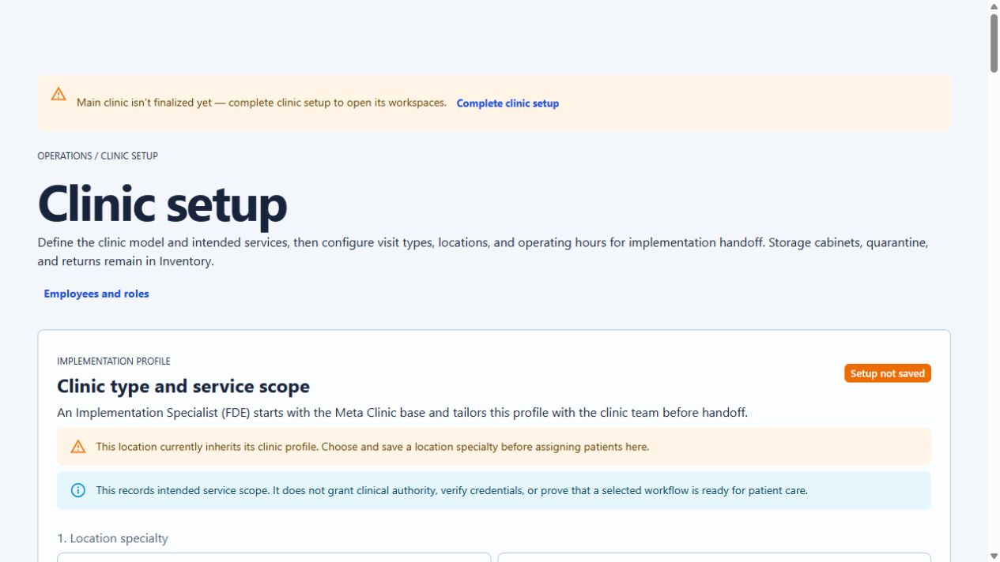
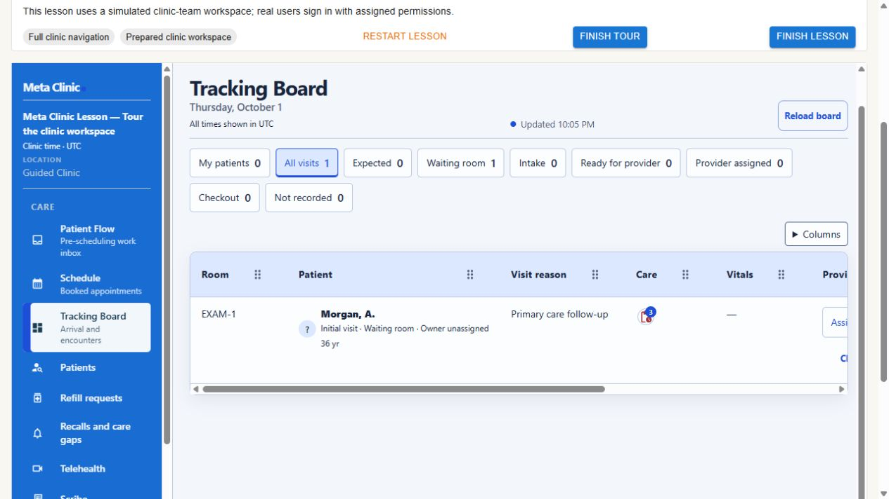
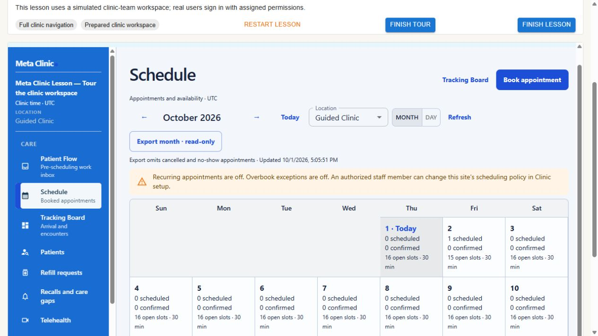
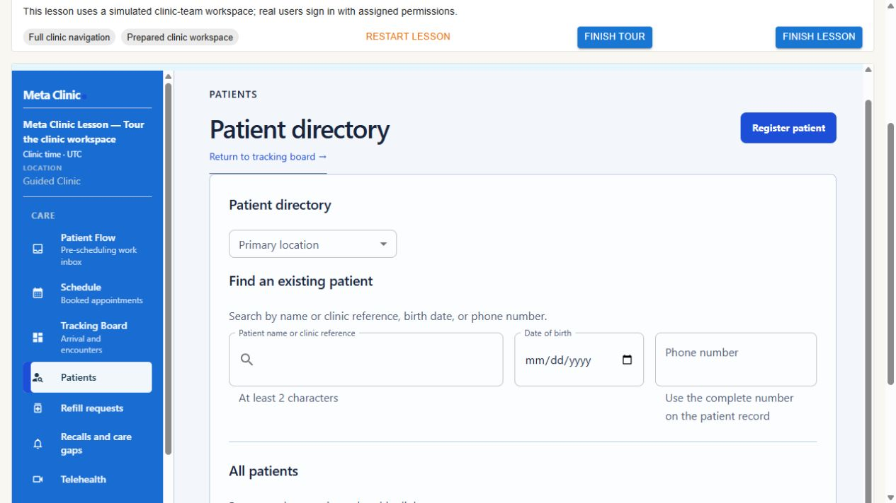
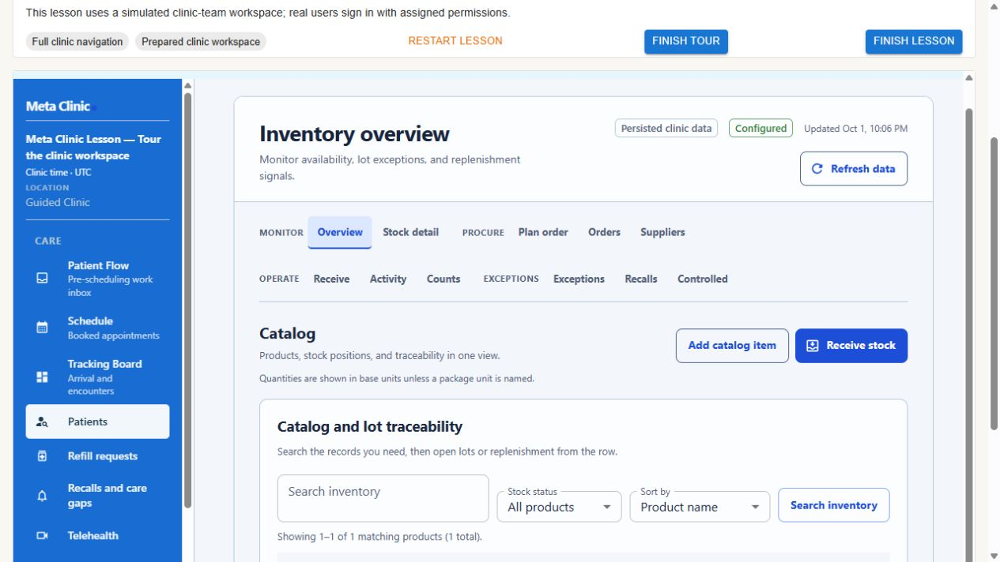
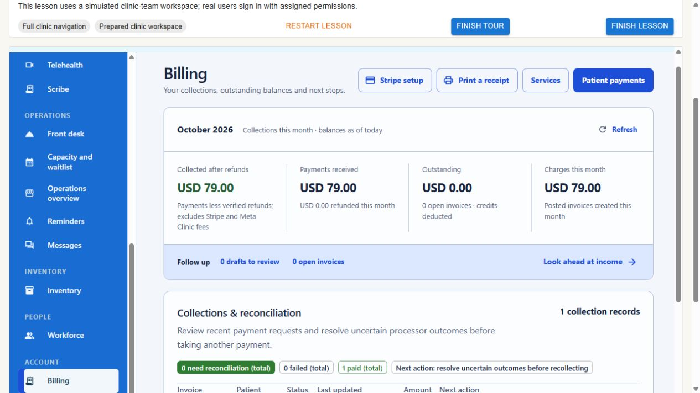

# Meta Clinic UI audit and modernization proposal

Date: 2026-10-01. Status: dated audit and proposed delivery sequence; application redesign is not implemented by this record. [Design.md](../../../APPlyVault/03%20Execution/Design.md) remains visual authority; the [Implementation Tracker](../../../APPlyVault/03%20Execution/Meta%20Clinic%20Implementation%20Tracker.md) remains the sole current status register.

## Conclusion

The app uses Material UI extensively, but does not yet have a consistently designed Material UI system. The import count is an adoption fact, not a quality measure. The visible problems are hierarchy, repeated containers, space allocation, control emphasis, and incomplete shared component styling. Adding more MUI imports or changing blue to sage would not resolve them.

Aim for a composed, contemporary clinical workspace: quiet navigation, strong readable typography, restrained surfaces, aligned controls, useful data visible early, and clear contextual actions. Preserve the approved Clinical Wayfinding Ledger direction. Modernity should come from precision and responsiveness, not decoration or hiding necessary information.

## Evidence and limits

- Source baseline: upstream `0cad7038e4bf21b6ae2c2189fc7f6c35944816bb` in an isolated worktree. Runtime: existing root checkout `0f5c962772a6` plus pre-existing uncommitted setup/scope changes. Root pull fetched main but could not merge over those changes; they were preserved.
- Screenshots are fresh local browser captures at approximately 1265 × 712. Screens 2–6 show the prepared synthetic navigation tour inside its existing iframe. The lesson header, iframe dimensions and disabled page controls are tour artifacts, not ordinary clinic behavior. The rendered palette was blue/light; this is not evidence that the approved sage reference is implemented consistently.
- Normal local sign-in reached unfinished clinic setup. The audit did not complete configuration to bypass that gate. The tour was prepared through its normal UI, creating synthetic lesson records. Local development startup also applied its existing pending `CreateInventorySupplierQuoteRequests` migration and started API, web and worker services.
- Inspected six initial surfaces, navigation between tour destinations, accessibility-tree structure, the shared theme/shell source, and relevant upstream diffs. Did not submit appointments, payments, clinical records or inventory transactions. Disabled controls in the tour cannot establish working interaction states.
- `Appearance.tsx` and `TrackingBoardPage.tsx` matched between the runtime HEAD and upstream. Upstream Workspace adds version navigation and location selection fixes; Schedule adds booking/cancellation behavior; shell CSS adds topbar wrapping. These do not constitute a complete visual redesign. Reproduce findings on the final integrated build before implementation sign-off.
- This is a representative visual audit, not a complete route, keyboard, contrast, responsive, accessibility or workflow acceptance review. Dark mode, tablet layouts, empty/error/loading transitions and dense real-world-sized synthetic lists remain unobserved. No tests were added or run.

## Numbered screen audit

### 1. Enter clinic setup — needs major hierarchy work

**Observed:** the local setup gate drops into a page with a very large title, an oversized introductory region and multiple prominent notices. The first actionable specialty choices begin at the bottom of the captured viewport. The accessibility tree exposes a long page of service scope, assessments, payment model, visit types, departments, clinicians, sites, facility details, operating hours, rooms and scheduling policy.

**Keep:** explicit setup state and the explanation of what must be completed.

**Change:** use the same clinic typography and shell treatment for setup gates. Provide section navigation and a compact completion summary. Show one active section with its existing save action and clear saved/unsaved state. Keep related choices together; do not introduce new dependencies or imply that incomplete sections are complete. Consolidate duplicate presentation of notices while preserving decision-relevant restrictions.

**Accessibility risk:** an oversized introduction and long form make orientation and keyboard travel costly. Inspect heading order, error links, focus after section changes and unsaved navigation in implementation. This screenshot is particularly sensitive to the root checkout's ongoing setup changes.

### 2. Open Tracking Board — needs major density and priority work

**Observed:** the blue navigation area competes with the work surface. Nine similarly weighted filter controls wrap into two rows. A separate Columns control adds another toolbar level. Patient rows combine identity, visit state, ownership and age while the wide table places provider/status/action information beyond the visible right edge in this tour viewport. Existing column resizing/reordering and filters already exist; do not rebuild them as new capabilities.

**Keep:** clear page title, clinic timezone, explicit update timestamp, unknown/not-reviewed states, existing column preferences and operational status semantics.

**Change:** compact the header and combine table tools. Preserve the current filter selection semantics; use lighter filter chips/toggles with restrained counts, not nine equally prominent rectangular buttons. Make patient identity the visual anchor; align room, operational status, owner, wait and next action consistently. Prioritize those columns in the initial view, retain optional details through existing column controls, and evaluate sticky identity/action columns against minimum readable widths. Keep horizontal scroll for extended data rather than shrinking text.

**Accessibility risk:** clipped actions and drag-oriented column affordances need keyboard alternatives and visible focus. Do not infer urgency/clinical acuity from wait time or color.

### 3. Open Schedule — needs toolbar and calendar refinement

**Observed:** date navigation, location, month/day selection, refresh, export, explanatory text and a policy alert consume multiple rows above the calendar. Many cells repeat zero scheduled/confirmed counts with equal visual weight. The displayed month supports overview, but competes with the high-frequency booking task.

**Keep:** prominent Book appointment, visible timezone, month/day views, explicit availability and existing server-owned booking rules.

**Change:** compose a stable two-level header: title/timezone and Book appointment; then date navigation, view and scope controls. Move export into a labelled secondary action menu. Present configured-off policy as quiet contextual information unless it blocks the current action. Visually emphasize appointment/availability information over repeated zero counts, while retaining a readable full description. Refine the existing day view for daily work without silently changing users' saved or linked view selection. Appointment details should retain schedule context; choose a side panel only if the existing detail flow benefits from it, not as a blanket modal replacement.

**Accessibility risk:** selected day and availability cannot rely solely on tint; preserve complete accessible names and keyboard date navigation. Booking/cancellation and timezone correctness were not exercised in this read-only tour.

### 4. Open Patient directory — needs major composition work

**Observed:** Patient directory appears as both page title and card heading, followed by another Find an existing patient heading. Large search controls and generous vertical gaps push the patient list below the visible viewport. A return-to-board link occupies another header line.

**Keep:** multiple patient matching criteria, visible labels, useful minimum-input guidance and explicit registration action.

**Change:** one page title, one aligned search/filter region and the list directly below it. Keep name/reference prominent, with date of birth and phone as available matching refinements. Use deliberate 44px control targets, compact helper-text spacing and a consistent row design. Do not replace reliable matching or duplicate prevention with fuzzy selection, nor lose the persistent patient context when opening a record.

**Accessibility risk:** label/helper associations and search progress/result announcements require live verification. Do not compress away identifiers needed to distinguish patients.

### 5. Open Inventory — needs container and navigation simplification

**Observed:** page container, multi-line workspace navigation, Catalog heading and nested Catalog and lot traceability panel all precede the actual stock rows. Search/filter controls vary in apparent height. The captured sidebar still highlights Patients while Inventory is displayed: verify route selection on the integrated normal workspace before treating this as a general navigation defect.

**Keep:** task grouping, available/on-hand distinction, units, traceability, and attention queue.

**Change:** retain the information architecture while simplifying its presentation. Give the inventory workspace one consistent subnavigation treatment, one contextual toolbar and one table surface. Remove repeated Catalog introductions. Put actionable stock data above secondary explanations. Use right-aligned quantities with units and consistent number formatting; never visually merge available and on-hand stock.

**Accessibility risk:** small dense subnavigation and quantity/status distinctions need contrast, focus and zoom review. Do not collapse held/recalled/unknown into a generic healthy state.

### 6. Open Billing — strongest starting pattern, needs shared polish

**Observed:** the summary groups related amounts and labels their time basis, making it easier to scan than the nested patient/inventory screens. Several strong header actions and a large summary still compete with the collections worklist below. State chips begin another dense band above that list.

**Keep:** the consolidated financial summary, distinct amount definitions, explicit currency and uncertain-outcome reconciliation guidance.

**Change:** reuse this grouping discipline elsewhere. Reduce summary padding, align numeric typography and make patient payments the primary local action. Move infrequent setup/printing actions into sensible secondary placement. Keep unresolved financial states visible beside affected records; do not reduce important reconciliation information to a disappearing toast.

**Accessibility risk:** money and status need readable text and correct semantic labels independently of green/red styling. No financial behavior was exercised.

## Root cause in the shared implementation

[`Appearance.tsx`, lines 115–227](../../../apps/web/src/features/clinic/Appearance.tsx#L115) defines only primary/background/text/divider palette mappings and partial typography. It customizes seven component families: Button, Link, Card, Paper, Chip, IconButton and Dialog. That is a useful start, but not a coherent set of forms, navigation, tables, feedback and overlays. Semantic success/warning/error colors are not explicitly mapped to clinic tokens there.

[`ClinicFrame.tsx`](../../../apps/web/src/features/clinic/ClinicFrame.tsx) and [`clinicFrame.css`](../../../apps/web/src/features/clinic/clinicFrame.css) mix custom shell/menu behavior with MUI controls. [`Workspace.tsx`, lines 185–417](../../../apps/web/src/features/clinic/Workspace.tsx#L185) already groups navigation using MUI lists. Preserve those groups and permissions. [`appearance.css`](../../../apps/web/src/features/clinic/appearance.css) also applies broad typography/table/input styling, so theme work must check CSS specificity instead of layering another override system on top.

The installed `@mui/material` and icon packages are sufficient for this proposal. More components are useful only when they improve the task. No MUI X purchase, replacement design library, new font package, component framework or app-wide rewrite is proposed.

## Concrete visual treatment

| Element | Proposed treatment within the existing direction |
| --- | --- |
| Shell | 220–240px quiet neutral/sage sidebar; a restrained active-item tint/indicator; consistent 44px targets; readable group labels; preserve existing grouping and route labels. Separate brand accent from operational status. |
| Workspace | Neutral page canvas, one primary data surface, thin separators, minimal nested borders; reserve elevation for overlays. Use existing palette tokens for each scheme rather than introducing unrelated hex values. |
| Type | Complete MUI variant hierarchy: page title 28–32px, section title 20–24px, body 16px, supporting text 14px; tabular numerals for times/amounts; restrained weight changes. No tiny uppercase functional labels. |
| Spacing | Existing 4px rhythm with 8/12/16/24/32 steps; 24px page gutters on desktop, 16px on tablet; remove redundant heading/container gaps before reducing readability. |
| Controls | 44px interactive targets; control radius 4–6px, surfaces 8px, dialogs 10px. One visually primary action per local task. Text/outlined secondary actions and intentional selected/hover/focus/disabled/busy states. |
| Tables | Calm sticky headers where useful, aligned values, visible row hover/focus/selection, predictable row actions. A compact readable baseline, optional detail, and explicit no-results/error/refresh states. |
| Forms | Consistent label/helper/error spacing; existing field grouping; meaningful section titles; retained input on failed saves; focusable linked errors. No automatic policy or clinical defaults added by restyling. |
| Motion | Brief restrained transitions for opening panels, menus and state changes; respect reduced motion. Never animate clinical status to imply urgency or delay access to data. |

## Proposed delivery sequence

### Phase 1 — shared foundation plus a visibly complete Tracking Board

Use `Appearance.tsx`, existing appearance tokens/CSS, `ClinicFrame.tsx`, `Workspace.tsx`, `TrackingBoardPage.tsx` and board styles. First reconcile the root's ongoing setup/scope work with upstream; preserve its ownership.

1. Complete semantic palette and typography mappings. Define consistent MUI `defaultProps`, `styleOverrides` and existing variants for actual components in this slice: inputs/labels/helper text, selects, menus, lists, toggles, tables, tooltips, alerts and overlays. Keep local composition in the owning page; avoid a new abstraction for each style.
2. Apply the quieter shell and aligned header. Retain the current navigation structure. Migrate a custom menu/drawer only when MUI removes duplicate behavior without losing keyboard, dismissal, focus restoration or unsaved-work handling.
3. Recompose the board toolbar and row hierarchy. Preserve column state, sorting, resizing, filters, permissions, freshness and available actions. Resolve CSS/theme collisions at their owner rather than adding more `!important` rules.
4. Produce before/after screenshots on the same final build, palette, viewport and synthetic dataset. This phase must show a complete polished daily-use screen, not merely a token change with old layouts left underneath.

**Visible completion criteria:** shell no longer dominates the work; selected navigation and filters are clear; patient identity, operational state and next action are readily findable; the task toolbar reads as one coherent region; extended columns remain reachable; existing actions and unknown states remain intact. Verify default/hover/focus/disabled/loading/error states for changed controls. Capture desktop and tablet widths with no page-level accidental overflow.

### Phase 2 — Schedule and contextual task surfaces

Refine `ClinicSchedule.tsx` using the same theme: consolidated date/scope toolbar, calmer calendar cells and action hierarchy, consistent appointment details and booking form. Reuse existing slot/timezone helpers and upstream cancellation safeguards. Preserve linked view/date/site parameters and backend conflict handling.

**Visible completion criteria:** calendar work begins earlier in the viewport; selected date and view are obvious; booking is the clear primary action; secondary export/setup actions do not dominate; opening and closing details retains context and focus. A failed save retains entered information and an actionable error. Read-only screenshots alone cannot close these behavior checks.

### Phase 3 — patient, front-desk, setup and inventory layouts

Apply the proven system to existing patient lookup/registration, front desk and setup before spreading decorative changes everywhere. Remove duplicate titles and nested shells; group forms by the user's task. Follow with inventory's navigation/toolbar/table composition and billing polish. Inspect unobserved front-desk/chart states first rather than treating this audit as evidence of their defects.

**Visible completion criteria:** patient results and inventory records appear materially earlier at the same viewport; no duplicate page/card heading; controls align; primary actions stay discoverable; patient identity, payment uncertainty, stock units and lost-work protection remain explicit. Expand the same treatment to remaining screens only after representative patterns work.

### Phase 4 — close visual and interaction gaps

Review the integrated result in approved sage/light and dark mode, then alternate themes. Check 1440/1280 desktop and 1024/834/768 tablet widths, with a usable phone fallback. Review keyboard/focus, zoom, contrast, long labels, dense synthetic lists, empty results, loading, failed refresh, permissions and retained drafts for the changed surfaces. Do not interpret a beautiful screenshot as proof that money, stock or persistence works.

Follow the repository's no-tests-unless-requested preference. Use scoped source/diff review and necessary non-test type/build checks during implementation, plus a short manual walkthrough of affected behavior. No dates, owners, effort savings or completed acceptance are invented here.

## Reference patterns applied, not copied

- [MUI theme components](https://mui.com/material-ui/customization/theme-components/) and [theming](https://mui.com/material-ui/customization/theming/): use theme defaults, overrides and variants to make existing controls consistent.
- [Linear's UI redesign](https://linear.app/now/how-we-redesigned-the-linear-ui): borrow attention to hierarchy, alignment, density and coherent navigation/content treatment, not its exact visual identity.
- [Nielsen Norman Group heuristics](https://www.nngroup.com/articles/ten-usability-heuristics/) and [progressive disclosure](https://www.nngroup.com/articles/progressive-disclosure/): keep system state visible and secondary detail available without separating information users must compare.
- [Baymard inline validation](https://baymard.com/research-articles/inline-form-validation): useful input feedback, retained values, and no premature error noise. Apply per field/task rather than imposing one timing rule on every clinical form.
- [Stripe app design guidance](https://docs.stripe.com/stripe-apps/design): preserve context for short related tasks; give longer tasks an appropriately focused surface.
- [Mobbin](https://mobbin.com/explore) supports comparing comparable flows; its complete signed-in library was not reviewed. [Awwwards evaluation](https://www.awwwards.com/about-evaluation/) supplies visual inspiration, not evidence that showcase-site interactions suit clinic operations.

This proposal changes presentation and use of existing components. It introduces no healthcare fields, clinical protocol, billing rule or inventory rule; no new healthcare implementation guide is selected. Any subsequent substantive workflow/data change must follow the repository's U.S. standards-guided development process.

## Handoff boundary

Audit and proposal only. Six screenshots were captured and inspected. No application source files changed, no automated tests ran, and no deployment occurred. The normal clinic setup gate and the read-only tour limit behavior conclusions. Keep this record as dated evidence; track approved implementation and completion in the canonical tracker rather than maintaining a second backlog here.
