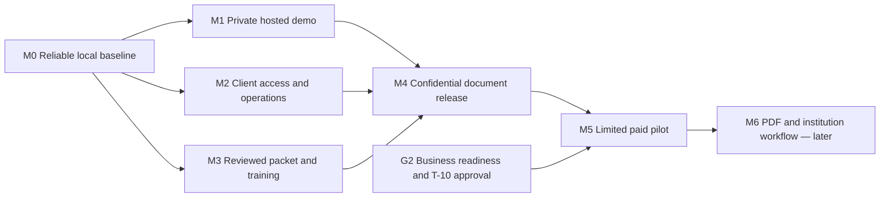

# Roadmap and Tasks

Home: [[00 Home]] · Index: [[01 Table of Contents]] · Developer handoff: [[CICD]] · Decisions: [[Decisions]] · Changes: [[Progress Log]]

**Shortcut cutover — 2026-09-03:** the tables and stored task states in this
note are frozen planning/status snapshots. APPly [Agent Workspace](../../docs/development/shortcut.md)
now owns active Stories, claims, owners and workflow state. Preserve this note's
milestone gates, dependencies and acceptance contracts, but do not update it to
mirror Shortcut.

## Current developer handoff — 2026-08-31

Start with [[CICD]] for setup/checks and [[Software Architecture]] for code ownership. Local source is the completed React/Vite frontend plus Rails API/PostgreSQL split (T-40), with shared exact-unit inventory, receipts, holds and counts (T-34/T-38). The founder removed retired `reference/`; no code/workflow depends on it. Root `.gitignore` supplies shared local-artifact exclusions. [[01 Table of Contents]] routes task-specific review; the former full-vault reading requirement is replaced, not the safety/release gates.

T-22 has observed successful five-job main CI and six-job pull-request run `33469316602`, including the new agent/vault-document job; a rebased commit still requires its own checks. Staging's PostgreSQL/API/web cutover, paired delivery and bounded recovery were verified on 2026-08-31. [[Progress Log#2026-08-31 — Staging delivery activated and PostgreSQL cutover verified]] owns that hosted evidence; it is not a new observation by this planning review. Browser/accessibility and broader T-20/M1 operations remain open. Production retains its older SQLite release and needs separate cutover/activation authority under T-38. The dated baselines below remain historical; do not redo completed staging work or treat it as production acceptance.

**Current planning entry point:** [[Roadmap and Tasks#Five-step implementation plan]] breaks the five recommended workstreams into chunks with failure scenarios and required tests under existing task IDs. Follow [[Working Agreement#Failure-first planning and review]] before starting and accepting each chunk. The milestone gates below remain in force.

**Historical backend replacement handoff (D-044):** [[ERD Implementation Prompt]] revision 5 now scopes a full backend/schema replacement from [[Target-State Clinic ERD]], pending the founder's minor amendments, with PaperTrail callback/job mutation coverage. Its stages supersede the old ERD prompt's hardening-only limit; the task-status snapshots below remain dated evidence, not completed replacement work or current status. Preserve applicable workflow/professional/release gates and resolve dependent details without treating every pictured module as automatically deferred.

**Backend validation, 2026-08-31:** T-45 and [[Backend Verification Report]] record the completed review of source commits `600976f`/`5436764`, full table/model/relationship matrices, synthetic seeds and verified corrections. This does not close T-13/T-34.5 or professional/release gates: access audit, protected-value handling, clinical content and legacy permission-transition acceptance remain incomplete.

**Frontend mapping and minimum slice, 2026-08-31:** [[Clinic Frontend Backend Mapping]] reconciles the browser with the implemented API layer and supplies five user-flow diagrams. The founder then selected the bounded context plus read-only scheduling/patient/encounter/observation slice: context now drives navigation, legacy inventory/Operations retain a compatibility summary, and unsafe clinical mutations remain absent. T-13/T-34/T-44 stay open: protected values, access auditing, board flow/handoff, patient commercial membership, prescribing and external object/message/payment workflows remain unresolved. Review permission/site projection and a correctly provisioned patient-capable synthetic account before expanding this slice.

## Rules

This is the preserved pre-cutover task plan and acceptance register. Future work requires a claimed Shortcut Story with an accepted scope; founder-confirmed direction is recorded in [[Decisions]]. D-020 authorized the consultancy website; D-024/D-025 authorized the local launch and clinic experiences; D-033 now separates their browser UI from the Rails API. T-28/T-29 track migration and the synthetic clinic prototype. Production clinical release, budgets, dates, outreach and professional engagements remain uncommitted. The MD's source materials were expected on 2026-08-31 morning; this was not a deadline or automated follow-up. Further general business questions are deferred while the website moves forward. The founder subsequently requested a focused pharmacy provider/counsel discussion guide; T-35 records that delivery and T-36 the proposed follow-up, without reopening settled direction or assigning a meeting.

The founder expressed no deadline pressure. Use dependencies and readiness evidence rather than an arbitrary 90-day calendar. The founder now plans to gather Kevin's existing materials; receipt, permission and review remain unrecorded. Synthetic packet engineering can proceed while those sources are unavailable. Resolve business decisions at the point their commitment needs them, not as blanket development prerequisites.

The subsequent backend documentation request is recorded as T-18. [[Data Modeling]] is a PostgreSQL proposal; it does not close T-13, select hosting, authorize a build, or pass L-05.

D-021/D-022 authorize [[Client Portal]]. D-025 adds the separately presented [[Clinic Workspace]]; D-033 now puts both experiences in `apps/web` with shared backend authority in `apps/api`. This synthetic prototype does not approve the complete clinical model in T-18, PHI or production sharing. T-20 remains hosting, not clinical release.

Snapshot states used before cutover were backlog, ready, in progress, awaiting input, blocked and done. They are retained as dated context only. Current state uses Shortcut's Standard workflow; unknown owners/dates remain unknown rather than being inferred from this snapshot.

## Milestones and evidence gates — proposed

| Gate | Outcome | Evidence required to pass |
| --- | --- | --- |
| G0 — Agreed foundation | We know what we are trying to sell and to whom | NP/PA, Sherman/North Texas, done-for-you/support, Kevin's role, formation stages, ownership facts, and ordered-inventory-value pricing basis recorded; resolve remaining valuation/rate rules, support/cost terms, governance details, budget, and capacity when the commitment needs them |
| G1 — Grounded offer and packet | A specific launch package is worth testing | Existing MD materials indexed; packet mapped with transfer limits; specific local prospects/needs; scope and cost/price hypothesis; review needs identified |
| G2 — Ready for a paid pilot | We can responsibly deliver the agreed scope | Applicable professional review, contract/scope, accepted owner/capacity, measurable outcome, and data boundary; unresolved blocking issues closed or scope narrowed |
| G3 — Repeatable delivery / product investment | We can scale the launch package and plan the separate software product responsibly | Actual paid delivery results, labor/rework/costs by entity, approved reusable packet, product requirements/economics, and scoped migration/investment decision |

Passing a company milestone is not a clinical go-live authorization. Customer clinics need their own applicable readiness evidence and responsible professionals.

## Development plan — proposed 2026-08-30

**Recommended sequence:** finish a reliable, operable consultancy portal before adding document-delivery automation. Keep the separate EHR/inventory product on its own discovery and approval path. This plan responds to the founder's current vault/code review request; it is not acceptance of new implementation, spending, public release, or patient-data access.

The G0–G3 gates above concern the business. The M0–M6 milestones below concern software delivery; G0 is not a prerequisite to safe local website work. All new milestones remain **proposed and unpassed**. T-16/T-19 describe delivered prototype work, not production readiness. Owners remain unassigned and dates TBD; no estimates assume unknown capacity.

**Current refinement:** D-033 supersedes the Rails-rendered-UI choice from D-024/D-025/D-032. `apps/web` owns the independent React frontend; `apps/api` owns Rails JSON and the established domain boundaries. T-28/T-29/T-39 preserve prior delivery history; T-40 records the frontend/API split. The clinic prototype remains synthetic and production-disabled. The baseline below is historical evidence, not a current architecture prescription.

**Planning refinement, 2026-08-31 / D-037:** the five-step breakdown below is the current implementation-planning sequence. It supplements these milestone exit criteria; it does not mark them passed or authorize all proposed builds/releases. A smaller chunk can be complete while its parent milestone remains open.

### Reviewed baseline

| Area | Direct observation / evidence | Planning consequence |
| --- | --- | --- |
| Vault | All 23 Markdown notes and 5 JSON configurations reviewed, including concurrent updates. All 208 baseline wiki links resolve; all notes are reachable from Home | No missing local note blocks planning. The old missing mentorship note exists; D-019 explains earlier ownership/pricing discrepancies. Obsidian still has stale `Welcome.md` UI references and Sync enabled; preserve settings and do not infer approved synchronization |
| Product boundary | D-021/D-022 and current code implement Contact, provisioned login, paperwork and training; no public signup or EHR | Extend the existing portal; do not import the clinical PostgreSQL proposal into it |
| Code | Separate `site/` Git repository; reviewed base `c063938` plus existing uncommitted local-demo changes. Vinext/React frontend, Rails 8.1.3.1 service, SQLite, npm and Bundler lockfiles | Preserve both repositories and local edits. These runtime choices describe this portal only |
| Existing protection | Account-scoped paperwork, session revocation, origin/CSRF checks, encrypted inquiry/document fields, server-enforced demo signing, guarded local demo access | Useful foundation, but no production security or signature-sufficiency conclusion |
| Deployment | Vault records an owner-only Sites frontend and no deployed Rails backend; current hosted state was not independently rechecked in this review | Online contact/login and client access need a separately approved Rails host and end-to-end release verification |
| Verification | Five frontend tests, typecheck, frontend lint, Rails lint and Brakeman pass. Rails passes 26 tests / 214 assertions on a fresh schema-only scratch database | Build, browser interaction, container, hosted flows and dependency audits were not rerun in this review; prior results stay historical |
| Reproducibility gap | `db:prepare test` on a fresh scratch database seeds three guides and fails two list assertions; `db:schema:load test` on a second fresh database passes | Fix/document deterministic test setup; do not report all initialization paths green |
| Automation gap | Only `backend/.github/workflows/ci.yml` exists; its commands assume Rails at the repository root, and it has no frontend jobs | Wire checks at the actual site repository root or another approved CI service. GitHub requires repository-root `.github/workflows`; S-23 in [[Source Register]] supports this limited finding |
| Workflow gaps | Provision/reset are interactive tasks; no activation/reset delivery, content-management flow, durable activity audit, real signing, PDF or submission pipeline | Build the smallest operator workflow and approved record lifecycle before real-client release |
| Evidence gaps | Actual MD packet, reuse permission, governance and SharePoint/security originals remain absent | These block dependent content, commercial or clinical conclusions, not M0 local engineering |

**Later repository-layout correction, 2026-08-30:** D-023 replaces the separate-repository arrangement described in the historical baseline above. `site/` is now an ordinary folder in APPly; future GitHub CI belongs at APPly's root `.github/workflows/`, with explicit `site/` and `site/backend/` working directories. This Git repair does not complete T-22 or change application/runtime behavior. See [[Progress Log#2026-08-30 — Site moved into the main Git repository]].

**CI repair and team guide, 2026-08-30:** [[CICD]] documents local development, independent branches/databases, CI and the proposed release process. The local workflow now lives at APPly's root `.github/workflows/ci.yml`, with explicit Rails/Ruby working directories, corrected cache paths, SQLite installation and fresh synthetic test setup. It runs checks only; no image publication or AWS deployment is configured. Push and observe the GitHub run before accepting the remote-CI criterion; T-22/M0 remains open. Historical baseline findings above are preserved.

**D-030 environment setup, 2026-08-30:** separate private staging and production containers are running with independent data/keys; production sample content is disabled. Root delivery workflows and scoped OIDC/SSM configuration are prepared locally, but GitHub login/settings/role activation, commit/push and observed runs remain outstanding. Public HTTPS needs domain/DNS configuration. [[CICD]] supersedes the earlier delivery-proposed guide; no clinical/confidential release gate is passed.

**Database dependency, updated by D-031:** local PostgreSQL conversion, inventory controls, CI service, container verification and synthetic migration/restore rehearsal now pass under T-38. The hosted maintenance cutover remains pending. Previously, the checkout changed to PostgreSQL while hosted verification was in progress. The incompatible candidate was rejected; both hosts retain the verified SQLite release. T-20/T-22 require reconciliation of CI, host database configuration and migration/recovery testing before delivery activation from that newer source. No concurrent database changes were reverted or treated as a completed hosted migration.

T-28 corrected the earlier unsupported “opened the doors” copy to “worked through the setup,” preserving the unknown opening/first-patient status in [[MD Pilot]]. Final copy approval remains open.

### Dependencies and scope

M2 engineering and M3 source review can proceed while M1 acceptance is unresolved. M3 source inventory/review may start as soon as authorized materials arrive; M0 acceptance is required for accepting the integrated portal, not for reading permitted sources or preparing synthetic content infrastructure. Until approved services and data handling exist, use wholly synthetic records; keep confidential originals in controlled storage outside this vault/prototype. An unavailable source leaves its branch awaiting input rather than stopping all development.

The diagram describes acceptance dependencies, not a prohibition on independent synthetic engineering. Steps 2–4 can use the delivered local baseline while M0 browser and M1 operations acceptance remain open; step 5 can prepare its walkthrough in parallel. Hosted account testing needs explicitly provisioned synthetic access; clinic tests remain local because packaged clinic routes are denied. Existing main-push CI can deploy staging, so publishing/merging is not a read-only planning action.

### M0 — Reliable local baseline

**Outcome:** a reproducible developer handoff with a clearly bounded demo. **Work:** T-22; preserve T-16/T-19 delivery history. **Entry:** current checkout and synthetic fixtures; no new business answers required.

Exit criteria:

- A clean checkout reproduces Rails API tests, frontend tests/typecheck/build, lint and static checks using the Bundler/npm lockfiles and documented runtime versions. D-033 reintroduces an independent JavaScript frontend after T-28. Test initialization uses explicitly isolated synthetic databases and handles the sample-seed conflict without touching development/client records; verification cleanup names only its own generated scratch database.
- CI is configured for the actual repository layout, covers the Rails API and independent frontend, and has an observed successful run in an approved service. If no remote CI is available, local reproducibility may pass but the CI criterion stays open.
- The ordinary and local-demo paths pass separate regressions: authentication, CSRF/origin denial, cross-account denial, admin denial, stale/double signing, training progress, expiry/revocation and backend outage. The demo shortcut is absent/denied in production, including with its flag accidentally set.
- Browser QA is explicitly scoped before execution and records desktop/mobile and keyboard outcomes for login → paperwork → training → logout, Contact, reload/back navigation, empty/error states and expired sessions. A working build alone does not satisfy this criterion.
- Current documentation matches the demo; the unsupported opening claim is corrected or evidenced. The review records no unresolved defect that exposes another account, loses saved work, falsely reports success, or blocks a primary flow.

**Evidence to close:** reproducible commands/runtime versions, CI result, test/QA matrix, defect dispositions and reviewed code version. **Proposed acceptance roles:** engineering owner and founder/product reviewer; names not yet assigned.

### M1 — Private hosted demo with recoverable storage

**Outcome:** Rails selling/onboarding works online using synthetic accounts only; clinic release remains a separate authorization. **Work:** T-20. **Entry:** M0 and an approved hosting/data-flow choice; the local password-free shortcut is not the hosted login strategy.

Exit criteria:

- The chosen Ruby host runs a verified production artifact/container. Configure exact HTTPS origins, protected secrets and persistent storage; no development keys, database or flag enter the artifact. Retain a single service instance/process-local-limit constraint until a reviewed scaling design replaces it.
- Test the actual HTTPS → Rails path for login/session/logout, demo paperwork, training and Contact/inbox. Verify Secure/HttpOnly/SameSite cookies, host/origin/CSRF rejection, direct-backend exposure, caching and logs. No unauthorized account receives content.
- Correct proxy trust and abuse controls are tested: abusive traffic is limited without one user's requests consuming every legitimate client's allowance. Document where limits live and what restart/scaling does to them.
- A restart/redeploy preserves synthetic records. Restore encrypted data with the matching protected keys into an isolated environment and verify it is usable. Agree recovery-time and acceptable-data-loss targets before the exercise and record measured results against them.
- Prove rollback/recovery from a failed release; define operator, health/error alerts and escalation. Keep owner-only access unless a specifically reviewed audience change is authorized. This gate grants no real-client storage permission.

**Evidence to close:** hosted synthetic acceptance record, runtime/configuration checklist without secret values, restore/rollback results and operator runbook. **Proposed acceptance roles:** engineering and operations/security reviewers.

### M2 — Client access and contact operations

**Outcome:** an operator can admit and support a paid client without ad hoc account repair. **Work:** T-23 and remaining T-17. **Entry:** delivered isolated local baseline for synthetic development; scoped hosted access and relevant M0/M1 evidence for hosted acceptance.

Exit criteria:

- Document who confirms payment and authorizes access. Payment may remain manual; no checkout or inventory billing is required. Preserve no public signup. Provisioning is atomic/idempotent or has tested recovery from partial failure; the operator can assign the intended content without editing production tables manually.
- Implement and test an approved activation/recovery method, preferably expiring single-use links allowing the client to set their password. Secure assisted delivery is an explicit alternative, with identity verification and expiry/change rules documented. No default password or secret appears in logs, URLs beyond approved one-use tokens, the vault or support messages.
- Exercise duplicate provisioning, expired/reused activation, failed delivery, lost access, password reset, deactivation and session revocation. Define least-privilege operator roles and record the MFA/step-up requirement before confidential access; verify the selected controls at M4.
- Keep one individual account as the initial access boundary. Confirm whether the first engagement needs multiple people; if so, model engagement membership/permissions and test two-client isolation before release. Never solve collaboration with a shared password or the EHR schema.
- Contact has approved notice/retention handling, a named response owner and a tested inbox review/response process. Test persistence failure and uncertain retries without false “received” claims or uncontrolled duplicates. Notifications are optional; no automatic email is presumed.

**Evidence to close:** synthetic operator/client walkthrough and access/response runbook. **Proposed acceptance roles:** operations owner, engineering and privacy/security reviewer.

### M3 — Reviewed packet and publishable training

**Outcome:** the portal can assign an approved, versioned launch packet and written learning material. **Work:** T-02/T-03/T-05/T-12 and T-24. **Entry:** authorized access/handling for actual source review; synthetic workflow scaffolding can use the delivered isolated local baseline without those sources. Integrated acceptance retains M0 and the source/content review criteria below.

Exit criteria:

- Index each source's owner, version, access/reuse permission, NP/PA/service/locality applicability and reviewer scope. Map every proposed launch-packet requirement to evidence; unknown requirements stay blocked rather than becoming invented forms. Preserve restricted originals outside this workspace.
- Release a bounded packet version with required inputs, preparer/reviewer/approver/signer responsibilities and completion evidence for each item. Mark unsupported profession/locality cases explicitly; supporting both NPs and PAs remains the market direction, not an assertion that one form covers both.
- An authorized operator can publish/withdraw training and assign/supersede packet versions through a controlled interface or documented tool. Cross-client assignment tests pass; new versions cannot overwrite issued/signed evidence. Separate shared training from confidential per-client documents.
- Record the exact version associated with progress/acknowledgment; a material revision has an explicit rule for requiring review again. Walk a synthetic applicant through assignment, return/resume and correction without duplicate input or ambiguous completion.
- The initial written set has authorship/reuse/review evidence and a maintenance owner. Generic examples remain labeled. Kevin's videos are optional later content: no video gate until actual approved material and a private delivery/captioning plan exist.

**Evidence to close:** controlled source index, reviewer-approved packet/content manifest and synthetic assignment walkthrough. **Proposed acceptance roles:** source/content owner, applicable professional reviewers and product/operations reviewer. No professional engagement is created by this plan.

### M4 — Confidential document and signing release

**Outcome:** the narrowly scoped portal is approved to handle the selected applicant documents. **Work:** T-25 with T-09/T-12 and applicable professional review. **Entry:** M1–M3; this is separate from patient-data approval.

Exit criteria:

- Approve the actual applicant-data flows, storage/services, access roles, retention/holds, export/offboarding and incident responsibilities. Test encryption/key recovery, least privilege, selected MFA/session controls and private retrieval. No PHI is admitted to this portal or vault.
- Select the signing method per reviewed document/recipient requirement. Preserve an attributable exact content version, intent/consent, timestamp and audit evidence; test stale content, concurrent/double actions, reassignment, revocation and correction without overwriting history. Hashes and the current demo receipt alone cannot close this gate.
- Record access, assignment, signing and administrative events in protected audit evidence; verify ordinary application roles cannot rewrite completed evidence. Test audit failure, export and recovery. Evaluate privileged access separately rather than claiming tamper-proof records.
- Complete a scoped security review and browser acceptance on the deployed candidate. Resolve all issues permitting unauthorized access, lost/altered evidence or false completion; record dispositions for lesser issues with owners. Confidential data and secrets must be absent from unapproved logs, analytics and third-party resources.
- Record an explicit release decision identifying audience, permitted data, packet versions, signing method and operator. Non-demo signing stays server-disabled until this decision and the required implementation exist. If an approved external/manual signing route is used, track verified evidence and label its status accurately; do not pass the in-app signing capability as complete.

**Evidence to close:** scoped handling/security/signature review, negative-test matrix, recovery evidence and release authorization. **Proposed acceptance roles:** responsible privacy/security and document/legal reviewers plus the authorized business release owner.

### M5 — One limited paid-client pilot

**Outcome:** demonstrate the full agreed consultancy-portal journey with one explicitly approved engagement before expanding access. **Work:** T-10/T-26; G2 applies. **Entry:** M4, accepted scope/price/support/capacity, a consenting client and a recorded go decision. No lead or start date is assumed.

Exit criteria:

- Confirm payment/access approval, deliver the account securely, complete all pilot-required paperwork and written onboarding, and resolve a support interaction through the documented process. The client can retrieve their records and understand what remains outstanding.
- Reconcile every required item to its actual evidence. “Signed,” “submitted,” “accepted” and clinic readiness remain distinct; external/manual steps have accountable owners and controlled evidence. No institution submission is implied by a portal checkbox.
- Observe the agreed support/review window and record delivery labor, rework, support issues and costs by entity against success thresholds accepted before the pilot. No silent data loss or cross-client exposure; any such incident stops expansion and invokes the response process.
- Record client acceptance or specific unmet requirements, remaining defects and the founder's go/revise/stop decision for the next engagement. One successful engagement demonstrates a pilot, not G3 repeatability, HIPAA compliance or clinical readiness.

**Evidence to close:** a non-sensitive pilot outcome summary linked to controlled records and the decision. **Proposed acceptance roles:** client, operations owner and authorized founder; professional reviewers retain their own gates.

### M6 — PDF generation, institutional delivery and feedback — later

**Outcome:** extend only a reviewed, explicit part of T-21 after the pilot validates the manual workflow. **Entry:** M5, actual recipient requirements, approved services and explicit implementation/submission authority. This milestone is not required for the first portal pilot if accepted manual delivery covers the engagement.

Exit criteria:

- For each supported form, rendered PDF fields, pagination and final signed version match the reviewed template; the recipient's format/signature requirements and authorized submitter are recorded.
- Track prepared, authorized-to-send, sent, delivery outcome, feedback, corrections and accepted/closed separately. Preserve versions and timestamps; allow only evidence-backed transitions.
- Test retries, duplicate-send prevention, forged/replayed callbacks, recipient rejection, lost acknowledgments and resubmission in a sandbox or synthetic harness. Provide operator recovery and traceability without leaking document content into messages/logs.
- An authorized human reviews the exact recipient and package before any real submission, unless a separately approved workflow explicitly delegates that action. Successful transport never automatically means institutional acceptance.

**Evidence to close:** reviewed form/recipient matrix, PDF QA, failure/retry tests and scoped acceptance record. **Proposed acceptance roles:** operations, engineering and applicable document/recipient reviewers.

### Separate SharePoint and EHR/inventory path

This path does not wait for M6, and the portal does not wait for a custom EHR. Discovery can proceed alongside portal work when access is authorized; implementation and real patient use require separate decisions.

| Stage | Dependencies | Exit criteria |
| --- | --- | --- |
| E1 — Validated requirements and product boundary | T-06/T-09/T-13; T-14 before billing design | Synthetic SharePoint walkthrough mapped to supported/manual/missing functions; approved custody/support/IP boundaries; bounded clinical and inventory scope; migration/reconciliation requirements; review [[Data Modeling]] against evidence rather than treating its table catalog as the backlog. Preserve ordered-inventory-value basis without inventing rates |
| E2 — Authorized synthetic technical proof | E1, accepted architecture/build scope and named engineering/security/clinical reviewers | Only a selected vertical slice implemented in an isolated synthetic environment; tenant/role isolation, immutable history, read/change auditing including failure paths, export/restore and migration rehearsal meet the scenarios in [[Data Modeling#Required synthetic acceptance scenarios]]. No entire clinical platform implied |
| E3 — Scoped clinical deployment decision | L-05 and applicable L-01–L-08, actual agreements/services, clinical and operational review | Responsible reviewers approve the exact system/workflow, controls, continuity and support; synthetic migration rehearsal reconciles records/versions and demonstrates rollback. Only a separately authorized process outside this synthetic-only workspace may then access/migrate real patient data |

SharePoint starter delivery has its own L-05/clinical/operational gates even if the custom replacement has not started. Passing a portal milestone does not close them.

### Pharmacy capability implementation sequence

**D-028 changes the planning assumption:** support clinics choosing and combining pharmacy setups; do not wait for one operating-model selection before designing the shared foundation. [[Pharmacy Inventory Data Requirements#Configurable pharmacy capabilities]] defines the proposed scope and [[Data Modeling#Inventory and commercial boundary]] the logical records. T-32's initial whole-package slice has since been extended by D-031 with the shared PostgreSQL ledger, typed units, receipts, holds and counts. Broad configurability is confirmed; the table describes intended full increments, not a claim they are all complete. T-34 records the remaining configuration/security scope; no dated commitment or authority for clinical modules is implied.

| Increment | Dependency and proposed scope | Evidence before accepting the increment |
| --- | --- | --- |
| Configuration and inventory foundation | Existing synthetic catalog/ledger; versioned location/operator profiles, composable capabilities, typed package/base units, receipt provenance, count records and overlapping holds | Two synthetic profiles share core records without access leakage; unsupported/disabled actions are denied server-side; same-lot deliveries remain distinct; duplicate retries do not repost; counts reconcile; releasing one hold leaves other holds effective; existing package history is not silently converted |
| Purchasing and transfers | Foundation; order/receipt/invoice/credit matching, acquisition-cost history, internal and in-transit stock, reporting and reorder proposals | Partial deliveries/cancellations/credits reconcile independently of physical stock; internal transfers conserve stock; no purchase or cross-entity shipment is submitted by saving a draft; billing amounts remain uncalculated pending T-14 |
| Containers and storage conditions | Foundation; container genealogy, opening/use-by rules, sensor/reading records, excursions and disposition | Two containers from the same lot can expire at different use-by times; unknown instructions or missing readings stay visible; stock exposed during a location/time interval is traceable; a count correction cannot bypass a safety hold |
| Administration, practitioner supply and pharmacy dispensing | Applicable foundation/storage capabilities plus a separately scoped protected workflow; model the three pathways distinctly | Wholly synthetic event/lot allocations reconcile use and waste exactly once; prescription creation does not consume stock; partial fill, cancellation, handoff and reversal do not overwrite history; role and clinical-data boundaries are tested before any release |
| Controlled-drug and tracing overlays | Relevant inventory/dispensing pathways and reviewed requirements for each overlay; synthetic evidence/reporting harness first | Acquisition/disposition and formal counts reconcile to the same ledger; package/transaction evidence is retrievable; investigation and reporting errors/retries are accountable; no regulator/supplier submission or live integration implied |
| Compounding, repackaging and other specialized setups | Relevant capabilities plus specialist requirements, preparation/quality/facility scope and a separately accepted synthetic build slice | Source-to-output genealogy, yield/waste, preparation/check/release and applicable storage conditions reconcile; unsupported combinations are rejected; detailed clinical/quality criteria must be established rather than inferred from a generic batch table |

The foundation can progress without the missing SharePoint originals or a first clinic's final formulary. E1 still governs validation of the complete clinical/product/migration scope, and E2/E3 and L-05 still govern their respective technical and real-use acceptance. [[Pharmacy Provider and Counsel Questions]] supplies the professional/operational review agenda under T-36; it does not block shared synthetic foundation design or establish an approved clinic profile. Higher-risk overlays must be present and accepted before using the associated product/workflow; table order is not permission to dispense controlled drugs before their controls exist. T-13 owns requirements, T-34 the remaining configuration/foundation acceptance, and T-14 the unresolved commercial mechanics. No duplicate status list is maintained here.

### Supplier pricing integration — deferred

D-029 puts supplier product/price integration on hold at the founder's request. [[Inventory Price Comparison Sources]] preserves the public catalog baseline, supplier API/PunchOut/EDI and platform findings, proposed record boundaries, access gaps and resumption sequence. T-37 is the canonical deferred task; no supplier onboarding, connector build or scheduled follow-up is active. T-13/T-34's broader inventory foundation remains separate and unchanged, and T-14 still owns fee mechanics. An eventual comparison layer must not place orders, change physical stock or calculate fees merely because a price is imported.

### Decisions needed at the point of use

| When | Question / evidence needed | Work that can proceed meanwhile |
| --- | --- | --- |
| Before completing M1 | EC2 region, small paid hosts and private audience are recorded under D-027/D-030. Who accepts operations/recovery, and what evidence supports the PostgreSQL/pair cutover and any audience change? | M0, synthetic M2 and packet mapping; do not reopen the settled bootstrap hosting choice or assume wider release |
| Before M2 confidential use | Who verifies payment and handles access/recovery/inquiries? Does the first engagement need several individual accounts? | Synthetic one-account flows; no public signup or billing automation |
| Before M3 release | Where are the authorized MD sources, who may reuse/review them, and which packet/content subset is ready? | Generic labeled training and synthetic workflow scaffolding |
| Before M4 | Which confidential-storage and signing approach is approved for these exact documents/recipients, and who accepts release risk? | Keep demo signing enabled only for synthetic documents; real signing disabled |
| Before M5 | Which actual client, paid scope, support capacity and pilot success thresholds are accepted? | Complete readiness evidence; no invented pipeline or outreach |

These are deferred gate questions, not a new prerequisite interview. Previously settled market, execution model and entity direction are unchanged.

### Recording milestone completion

A milestone passes only when each exit criterion has linked evidence, a named accepting reviewer, date and scope. Include the applicable failure cases, observable detection and recovery results from [[Working Agreement#Failure-first planning and review]]; no happy-path-only acceptance. Mark unmet criteria awaiting input or blocked; do not average them into a percentage or substitute “code complete.” Scope reduction requires an explicit decision and must name what is excluded. Store confidential evidence in approved controlled storage; this vault holds non-sensitive summaries/references only. Update the task rows below and [[Progress Log]] rather than opening another backlog.

## Five-step implementation plan

D-037 accepts the five workstreams and failure-first method. The detailed child contracts now live in focused [[Task Briefs]] with consistent frontmatter for task-aware context retrieval. This plan does not authorize feature work, production changes, external integrations or professional/release acceptance.

Common child exit contract: versioned artifact, normal and adverse-path results, observable failure signal, recovery/fallback result, reviewer/date and residual-risk disposition. Mocked or tabletop evidence is labeled as such.

### Child task status snapshot

This compact table preserves the dotted child-task state at cutover. Task-brief
frontmatter carries the same dated snapshot for targeted context retrieval;
`bin/agent-preflight --task` does not treat it as current status. Use Shortcut
Agent Workspace for live state and ownership.

| Child ID | Status | Contract |
| --- | --- | --- |
| T-12.1 | awaiting input | [[Task Briefs/T-12.1 source-inventory-after-the-founder-gathers-permitted-kevin-materi|brief]] |
| T-13.1 | in progress (synthetic walkthrough drafted) | [[Task Briefs/T-13.1 clinic-intake-handoff-walkthrough-synthetic-walkthrough-script-an|brief]] |
| T-13.2 | awaiting input | [[Task Briefs/T-13.2 walkthrough-with-kevin-relevant-staff-after-t-13-1-and-authorized|brief]] |
| T-13.3 | backlog | [[Task Briefs/T-13.3 field-state-permission-api-contract-after-t-13-2-and-scoped-revie|brief]] |
| T-13.4 | in progress (provider draft/wrap-up probe implemented) | [[Task Briefs/T-13.4 synthetic-interaction-prototype-and-engineering-handoff-after-t-1|brief]] |
| T-17.1 | backlog | [[Task Briefs/T-17.1 contact-handling-and-combined-operator-walkthrough-account-journe|brief]] |
| T-20.1 | backlog | [[Task Briefs/T-20.1 harden-candidate-images-and-verify-the-existing-scan-gate-candida|brief]] |
| T-20.2 | backlog | [[Task Briefs/T-20.2 recovery-and-operations-acceptance-agree-operator-targets-and-aut|brief]] |
| T-20.3 | done (bounded synthetic staging review; listener currently closed) | [[Task Briefs/T-20.3 staging-ip-certificate-two-allowlisted-individual-synthetic-revie|brief]] |
| T-20.4 | in progress (private candidate failed closed; correction verified) | [[Task Briefs/T-20.4 d-047-exact-account-staging-clinic-review-stagingdemouser-receive|brief]] |
| T-22.1 | backlog | [[Task Briefs/T-22.1 candidate-acceptance-matrix-use-current-source-pinned-runtimes-an|brief]] |
| T-22.2 | backlog | [[Task Briefs/T-22.2 browser-acceptance-after-t-22-1-separately-approved-synthetic-hos|brief]] |
| T-23.1 | in progress (structure accepted) | [[Task Briefs/T-23.1 client-access-workflow-revision-3-founder-accepts-structure-with-|brief]] |
| T-23.2 | in progress (local test fixtures) | [[Task Briefs/T-23.2 five-reusable-local-synthetic-identities-prepared-under-d-040-inc|brief]] |
| T-23.3 | in progress (session maximum) | [[Task Briefs/T-23.3 d-040-12-hour-absolute-session-cookie-setting-implemented-locally|brief]] |
| T-23.4 | backlog | [[Task Briefs/T-23.4 scoped-mfa-step-up-and-protected-lifecycle-audit-after-role-mecha|brief]] |
| T-24.1 | backlog | [[Task Briefs/T-24.1 version-assignment-progress-contract-and-immutable-content-revisi|brief]] |
| T-24.2 | backlog | [[Task Briefs/T-24.2 controlled-publishing-withdrawal-and-assignment-after-t-24-1|brief]] |
| T-24.3 | backlog | [[Task Briefs/T-24.3 version-specific-learning-and-review-progress-after-t-24-1-t-24-2|brief]] |
| T-24.4 | backlog | [[Task Briefs/T-24.4 minimal-launch-execution-checklist-after-the-version-contract|brief]] |
| T-24.5 | backlog | [[Task Briefs/T-24.5 adversarial-synthetic-packet-operator-acceptance-after-t-24-2-t-2|brief]] |
| T-24.6 | awaiting input | [[Task Briefs/T-24.6 bounded-reviewed-content-manifest-after-t-12-1-t-24-5-and-applica|brief]] |
| T-34.1 | backlog | [[Task Briefs/T-34.1 capability-location-operator-matrix-using-current-inventory-requi|brief]] |
| T-34.2 | backlog | [[Task Briefs/T-34.2 versioned-scoped-profiles-and-suspension-lifecycle-after-t-34-1|brief]] |
| T-34.3 | backlog | [[Task Briefs/T-34.3 permission-administration-after-t-34-1-reuse-identity-controls-fr|brief]] |
| T-34.4 | backlog | [[Task Briefs/T-34.4 reconcile-foundation-invariants-under-both-profiles-after-t-34-2-|brief]] |
| T-34.5 | backlog | [[Task Briefs/T-34.5 separately-scoped-security-proof-for-one-inventory-read-and-write|brief]] |
| T-38.1 | awaiting input | [[Task Briefs/T-38.1 production-maintenance-activation-preflight-separate-founder-auth|brief]] |
| T-38.2 | backlog | [[Task Briefs/T-38.2 production-cutover-and-paired-release-after-t-38-1-and-applicable|brief]] |

### Step 1 — Engineering and release foundation

T-22.1, T-22.2, T-20.1, T-20.2, T-20.3, T-20.4, T-38.1 and T-38.2 are tracked below; see their task briefs for the proposed outcomes, failure cases and exit evidence. Existing M0/M1 gates and staging/production boundaries remain in force.

### Step 2 — Client onboarding and operator workflow

T-23.1–T-23.4 and T-17.1 are tracked below; see their task briefs. Synthetic individual accounts and no public signup remain the scope.

### Step 3 — Synthetic packet and training infrastructure

T-12.1 and T-24.1–T-24.6 are tracked below; see their task briefs. Draft, synthetic and reviewer-approved content remain distinct; M4 confidential-document gates remain.

### Step 4 — Configurable inventory foundation

T-34.1–T-34.5 are tracked below; see their task briefs. Broad configurability does not authorize clinical activation, real use or universal implemented coverage.

### Step 5 — Define the first clinic workflow

T-13.1–T-13.4 are tracked below; see their task briefs. The proposed workflow remains synthetic/provisional and does not establish clinical authority, signing, prescribing or release.

See the milestone gates and separate SharePoint/EHR path above for entry/exit authority.

## Current task register

This is the preserved parent-task status snapshot at the 2026-09-03 Shortcut cutover. Detailed five-step acceptance contracts are in [[Task Briefs]]. Status strings below are retained exactly from the prior register; completed historical details remain in the [task archive](../../records/tasks/2026-09-03-completed.md). They must not be used to infer current owners, dates or state.

| ID | Priority / status | Deliverable (summary) | Dependency (summary) |
| --- | --- | --- | --- |
| T-01 | P2 / backlog (deferred) | Round 3 answers recorded; remaining business questions deferred by founder in favor of the website | Revisit when needed; not a marketing-site blocker |
| T-02 | P0 / awaiting input | Public clinic identity/location recorded; complete internal profile and index existing diligence/workflow materials | Founder will gather Kevin's materials; receipt/review not recorded. |
| T-03 | P1 / awaiting input | Both NP/PA and Sherman/North Texas settled; define exact supported clinical services, locality coverage, and applicant prerequisites | T-02; packet applicability mapping |
| T-04 | P0 / awaiting input | Kevin 51% / founder 49% and developer employee/software-owner roles known; review legal name, documented authority/veto, employment/IP terms, budget, and capacity | Deferred documents/decisions; not a marketing-site blocker |
| T-05 | P1 / in progress | Tailor [[Texas Diligence]] to the clinic profile; preliminary pharmacy findings and [[Pharmacy Provider and Counsel Questions]] now identify review issues, proposed reviewer roles and evidence needed | Actual client-specific tailoring still needs T-02 / T-03 and qualified review; T-36 owns the pharmacy follow-up. |
| T-06 | P1 / backlog | Document a synthetic SharePoint walkthrough and gaps in [[SharePoint and EMR]] | T-02 and authorized walkthrough |
| T-07 | P1 / backlog | First-applicant count unsure; agree an owner/channel for lead identification, then capture prospects and scoped offer-test outcomes | Acquisition approach/owner; participant permission |
| T-08 | P0 / awaiting input | Done-for-you launch + ongoing support confirmed; settle price, outside-cost coverage, support limits/fees, required provider actions, and handoff criteria | T-04 / T-05; inform with T-07 / T-12 |
| T-09 | P0 / awaiting input | Consultancy formed/software not formed/different owners known; define supplier, contracts/billing/IP, support, patient-data roles, and handoff | [[Entity and Product Boundary]]; T-04 / T-05 / T-06 / T-08 |
| T-10 | P2 / backlog | Make a recorded go / revise / stop decision on a paid pilot, with owners and dates | T-08 / T-09 and G2 evidence |
| T-11 | P1 / awaiting input | Agree shared-vault access, backup approach, task owners, and review cadence | Founder / team preferences |
| T-12 | P0 / awaiting input | Turn existing MD process into a reviewed applicant packet; source inventory, applicability variants, inputs, execution checklist, and handoff evidence | T-02; [[Clinic Launch Packet]] outline exists; relevant reviews in T-05 |
| T-13 | P1 / in progress (provider draft/wrap-up probe implemented; proposed full-route contract documented) | A local patient-bound draft/wrap-up flow exists; T-13.1–T-13.4 own walkthrough, reviewed contract and intake/handoff acceptance. [[Clinic Encounter Workflow Contract]] remains proposed. | Structured production identity, handoff, signing, prescribing, migration and clinical/release acceptance remain open. |
| T-14 | P0 / awaiting input | Ordered-inventory-value basis confirmed; define rate, eligible value, adjustments, billing terms, and implementation fee before metering design | T-09; deferred software decisions |
| T-15 | P0 / awaiting input | Document Kevin's physician/mentorship contracts, fee structure, service cadence, capacity, backup, and responsibilities for both NP/PA pathways | Kevin's operating plan and applicable review under L-02 / L-04 |
| T-16 | P1 / done (2026-08-30) | Completed historical task; full original row preserved in archive | [[Website MVP]] · [archived row](<../../records/tasks/2026-09-03-completed.md#Completed%20task%20rows>) |
| T-17 | P1 / in progress | Contact persistence/encrypted inbox delivered; T-17.1 in [[Roadmap and Tasks#Step 2 — Client onboarding and operator workflow]] owns handling states, failure/retry evidence, response ownership and the combined operator walkthrough | T-23 account controls and T-24.2 assignment for combined walkthrough; scoped T-20 hosted access, notice/retention and response ownership review. |
| T-18 | P2 / done (2026-08-30) | Completed historical task; full original row preserved in archive | [[Data Modeling]] · [archived row](<../../records/tasks/2026-09-03-completed.md#Completed%20task%20rows>) |
| T-19 | P1 / done locally (2026-08-30) | Completed historical task; full original row preserved in archive | [[Client Portal]] · [archived row](<../../records/tasks/2026-09-03-completed.md#Completed%20task%20rows>) |
| T-20 | P1 / in progress | D-027/D-030 environments and D-042 protected staging review are active; D-047 staging-only clinic demo source is verified under T-20.4 and awaits controlled candidate release. | Staging TLS, restart, decryption and independent PostgreSQL restore passed; broader operations/browser acceptance and production release remain open. |
| T-21 | P2 / backlog | Deliver M6 reviewed PDF generation, authorized institutional submission and feedback pipeline | T-12 actual packet, recipient/signature requirements, T-25/T-26, approved confidential storage and explicit implementation scope |
| T-22 | P1 / in progress | Five-job API/frontend CI verified on GitHub main run `33366127061`; six-job PR run `33469316602` also passed, including `agent_docs`. | Rebased commits require their own passing checks; browser/accessibility and production activation remain open. |
| T-23 | P1 / in progress | D-040 accepts [[Client Access Workflow]] structure and 12-hour sessions; reusable local synthetic test profiles and session controls are implemented and verified. | D-038 founder payment/access approval plus activation, recovery, MFA and audit acceptance remain open. |
| T-24 | P1 / backlog (synthetic engineering); awaiting input (content release) | T-24.1–T-24.6 in [[Roadmap and Tasks#Step 3 — Synthetic packet and training infrastructure]] cover immutable versions, publishing/assignment, progress, execution evidence, synthetic acceptance and the reviewed manifest | T-12.1/T-12 source/applicability work blocks reviewed content, not synthetic engineering. |
| T-25 | P1 / awaiting input | Pass M4 confidential-document release: approved handling/signing method, protected audit/history, scoped security review and explicit release record | M1–M3, relevant T-09/T-12/professional findings; not an EHR or PHI approval |
| T-26 | P2 / backlog (proposed) | Produce M5 limited-pilot operational evidence and acceptance, including exceptions, delivery effort and support results | T-10 go decision, G2, T-25 and an actual approved engagement; no client/date assumed |
| T-27 | P1 / done (2026-08-30) | Completed historical task; full original row preserved in archive | [[Progress Log#2026-08-30 — Current-state review and development milestones]] · [archived row](<../../records/tasks/2026-09-03-completed.md#Completed%20task%20rows>) |
| T-28 | P1 / done locally (2026-08-30) | Completed historical task; full original row preserved in archive | [[Website MVP]] · [[Client Portal]] · [archived row](<../../records/tasks/2026-09-03-completed.md#Completed%20task%20rows>) |
| T-29 | P1 / done locally (2026-08-30) | Completed historical task; full original row preserved in archive | [[Clinic Workspace]] · [archived row](<../../records/tasks/2026-09-03-completed.md#Completed%20task%20rows>) |
| T-30 | P1 / done locally (2026-08-30) | Completed historical task; full original row preserved in archive | [[Progress Log#2026-08-30 — Assigned Test Clinic and explicit login navigation]] · [archived row](<../../records/tasks/2026-09-03-completed.md#Completed%20task%20rows>) |
| T-31 | P1 / done (2026-08-30) | Completed historical task; full original row preserved in archive | [[Pharmacy Inventory Data Requirements]] · [archived row](<../../records/tasks/2026-09-03-completed.md#Completed%20task%20rows>) |
| T-32 | P1 / done locally (2026-08-30) | Completed historical task; full original row preserved in archive | [[Clinic Workspace#Pharmacy background integration]] · [archived row](<../../records/tasks/2026-09-03-completed.md#Completed%20task%20rows>) |
| T-33 | P1 / done (2026-08-30) | Completed historical task; full original row preserved in archive | [[Progress Log#2026-08-30 — Broad pharmacy configurability adopted]] · [archived row](<../../records/tasks/2026-09-03-completed.md#Completed%20task%20rows>) |
| T-34 | P1 / in progress | D-031's ledger/units/receipts/holds/counts remain delivered; T-34.1–T-34.5 own capability, profile, permission, invariant and security proofs. | Preserve T-32 history and D-026 clinic assignment; clinical activation, live integration and production release remain open. |
| T-35 | P1 / done (2026-08-30) | Completed historical task; full original row preserved in archive | [[Pharmacy Provider and Counsel Questions]] · [archived row](<../../records/tasks/2026-09-03-completed.md#Completed%20task%20rows>) |
| T-36 | P1 / backlog (proposed) | Review the pharmacy questions with the applicable providers, pharmacist and Texas healthcare/pharmacy counsel; document authority, charging/procurement, staffing, controls, exclusions and evidence-backed findings. | Requires authorized facts, sources and reviewer scope; no outreach, purchase, filing or real use is authorized. |
| T-37 | P2 / backlog (deferred by founder) | When explicitly resumed, deliver a scoped supplier-price comparison using verified identities/units, clinic-scoped offers, freshness history and validated imports; attempt one authorized connector only if access exists. | D-029 resumption, T-13/T-34 reconciliation, eligibility, data rights and costs; see [[Inventory Price Comparison Sources]]. |
| T-38 | P1 / in progress | D-031 PostgreSQL foundation and the 2026-08-31 staging cutover are complete with synthetic reconciliation, role checks, independent restore and app restart evidence. | Production conversion remains separately authorized; preserve original staging recovery evidence and clinical/release limits. |
| T-39 | P1 / done locally | Completed historical task; full original row preserved in archive | [[Progress Log#2026-08-30 — Full software-structure refactor completed]] · [archived row](<../../records/tasks/2026-09-03-completed.md#Completed%20task%20rows>) |
| T-40 | P1 / done (local source/runtime) | Completed historical task; full original row preserved in archive | [[Progress Log#2026-08-31 — Frontend and API separation completed; test database recreated]] · [archived row](<../../records/tasks/2026-09-03-completed.md#Completed%20task%20rows>) |
| T-41 | P1 / done (local source) | Completed historical task; full original row preserved in archive | [[Progress Log#2026-08-31 — Selectable clinic themes implemented]] · [archived row](<../../records/tasks/2026-09-03-completed.md#Completed%20task%20rows>) |
| T-42 | P1 / done (planning documents, 2026-08-31) | Completed historical task; full original row preserved in archive | [[Progress Log#2026-08-31 — Failure-first planning and five-step breakdown added]] · [archived row](<../../records/tasks/2026-09-03-completed.md#Completed%20task%20rows>) |
| T-43 | P1 / in progress (implemented; scoped browser checks pass) | D-039 account-owned clinic Settings, responsive containers and session-bootstrap correction are integrated with reusable test personas. | [[Progress Log#2026-08-31 — Clinic and test-account integration verification]]; populated/all-theme visual, zoom and screen-reader acceptance remain open. |
| T-44 | P1 / in progress (usable schedule-aware board plus provider draft/wrap-up flow) | D-041/D-049/D-051 workload-first Overview, permission-scoped board projection, patient-bound chart navigation and bounded provider draft/wrap-up flow are implemented locally. | Production check-in/handoff/provider ownership and full workflow acceptance remain open; see the linked tracking-board evidence in [[Progress Log]]. |
| T-45 | P1 / done (local verification and report) | Completed historical task; full original row preserved in archive | [[Backend Verification Report]] · [archived row](<../../records/tasks/2026-09-03-completed.md#Completed%20task%20rows>) |
| T-46 | P1 / done locally (expanded 2026-09-03) | Completed historical task; full original row preserved in archive | [Agent-harness evidence](../../records/progress/2026/09/2026-09-03-agent-harness-separated-from-software-knowledge-base.md) · [archived row](<../../records/tasks/2026-09-03-completed.md#Completed%20task%20rows>) |
| T-47 | P1 / done locally (Continuous Ledger foundation, 2026-09-02) | Completed historical task; full original row preserved in archive | [[Design]] [[Progress Log#2026-09-02 — Continuous Ledger clinic foundation implemented]] · [archived row](<../../records/tasks/2026-09-03-completed.md#Completed%20task%20rows>) |
| T-48 | P1 / done locally (production-shaped board data and layout hardening, 2026-09-02) | Completed historical task; full original row preserved in archive | [[Progress Log#2026-09-02 — Tracking-board data and resize hardening implemented]] · [archived row](<../../records/tasks/2026-09-03-completed.md#Completed%20task%20rows>) |
| T-49 | P1 / in progress (cash-pay local workflow expanded, 2026-09-03) | Atomic non-clinical front-desk, scheduling and cash-pay billing access includes a bounded patient projection, drawer lifecycle, cash tender/refund, receipt and variance recording. | [[Progress Log#2026-09-03 — Cash-pay drawer, receipt, and staff workflow implemented]]; external payments, document rules, browser/operational acceptance and release remain open. |
| T-50 | P1 / proposed (patient portal roadmap, 2026-09-03) | Proposed cash-pay portal path: identity/lifecycle, processor-backed payment and credit, approved booking, clinician-released content and bounded requests. | [[Patient Portal Implementation Roadmap]] defines gated slices; owners, vendors, qualified reviews, real-data use and production authority remain unassigned. |
| T-51 | P1 / done locally (2026-09-03) | D-058 separates agent control, developer guidance, current product knowledge and historical evidence; compacted oversized developer/technical/progress material while preserving stable vault pointers and every task/source ID. | [Cleanup manifest](<../../records/vault-cleanup-2026-09-03.md>); `bin/verify-vault`, `bin/verify-agent-harness`, `bin/vault-audit` and whitespace checks. |

## Completed setup

Completed setup details remain in the [archive](../../records/tasks/2026-09-03-completed.md#Completed%20setup).

## Update format

Do not update task state, owners or dates here. Start and complete work through a claimed Shortcut Story. At review, reconcile affected product/requirement notes, record decisions or risks only when they change, and add one concise dated outcome pointing to detailed evidence when the result is material.
